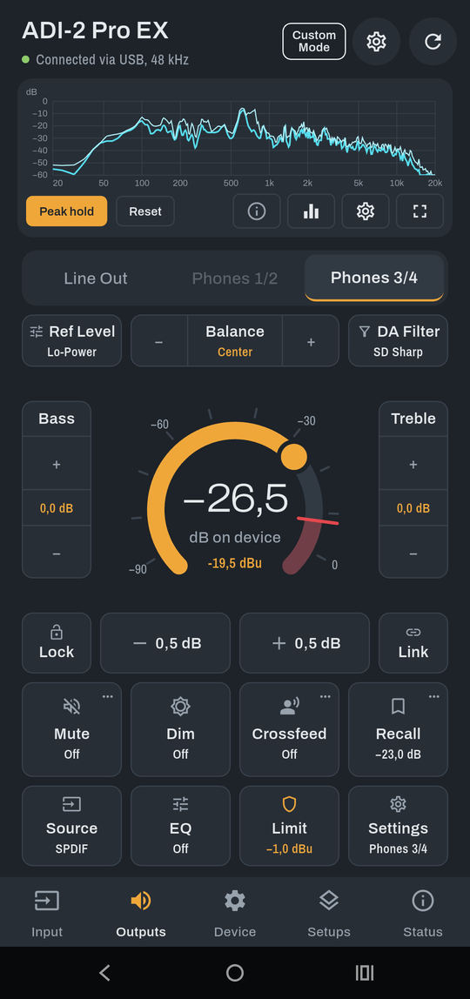
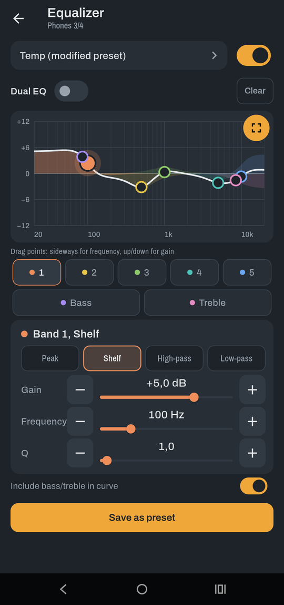
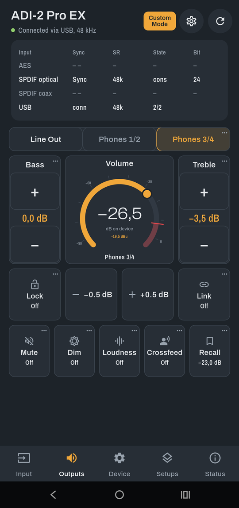
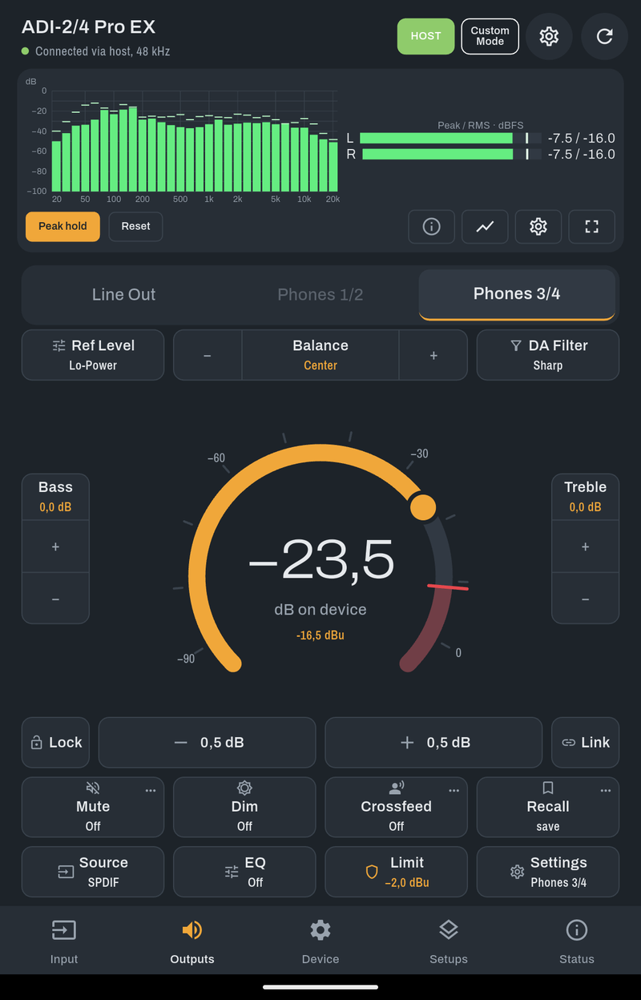
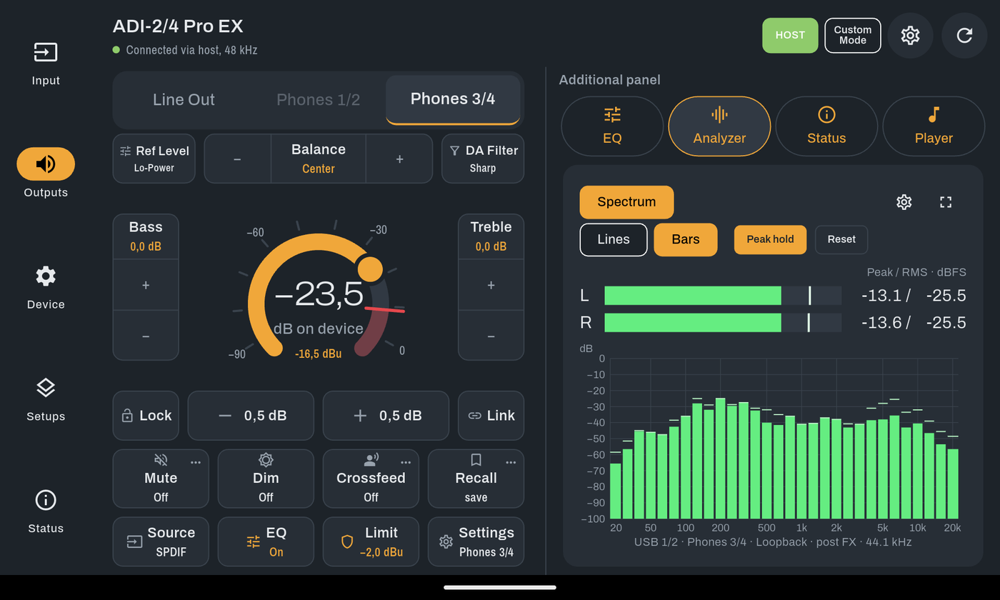
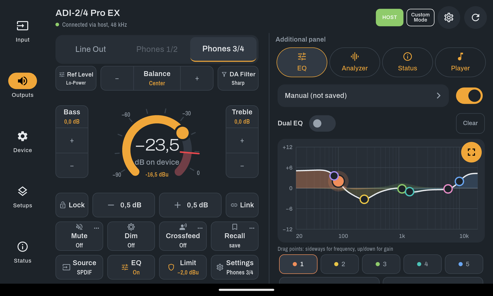
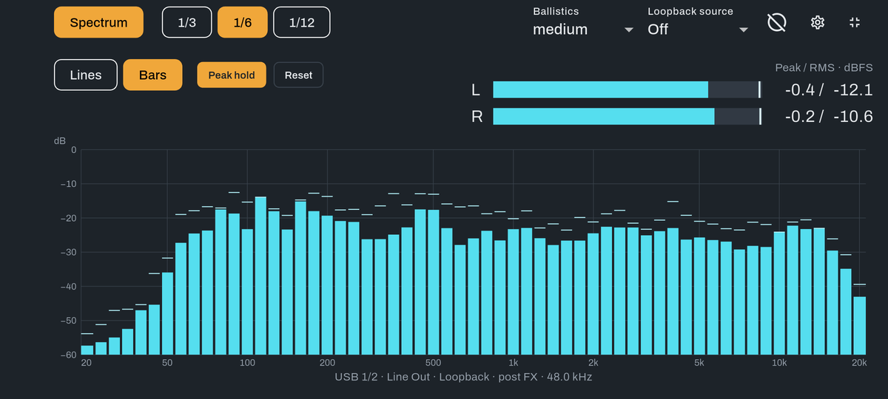
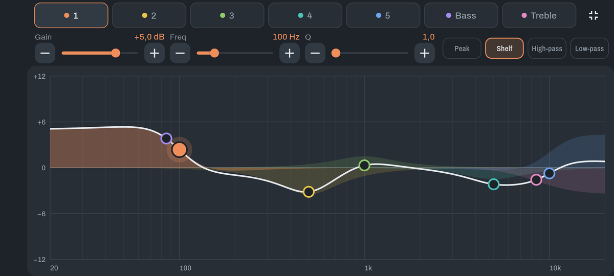
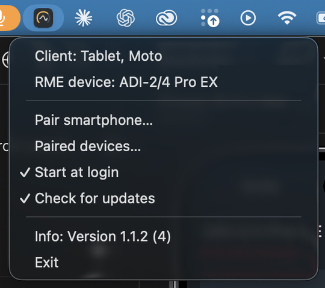

# Remote for ADI-2

[Deutsch](docs/README.de.md)

Remote for ADI-2 is a free Flutter app for controlling compatible ADI-2 audio interfaces directly over USB MIDI from a smartphone or tablet. It provides output and device controls, an EQ editor, setups, backups, a configurable control panel and a USB audio analyzer. Version **1.2.0 (5)**. © 2026 Markus Rass.

## Download

| What | File | For |
| --- | --- | --- |
| **App** | [Remote-for-ADI-2-Android.apk](https://github.com/kahuna34/remote-for-ADI-2/releases/latest/download/Remote-for-ADI-2-Android.apk) | Android smartphone or tablet |
| **Host for Mac** | [Remote-for-ADI-2-Host-macOS.zip](https://github.com/kahuna34/remote-for-ADI-2/releases/latest/download/Remote-for-ADI-2-Host-macOS.zip) | Mac with the ADI-2 connected by USB |
| **Host for Windows** | [Remote-for-ADI-2-Host-Windows-Setup.exe](https://github.com/kahuna34/remote-for-ADI-2/releases/latest/download/Remote-for-ADI-2-Host-Windows-Setup.exe) | Windows PC (64-bit) with the ADI-2 connected by USB |

All files of the current version are also on the [releases page](https://github.com/kahuna34/remote-for-ADI-2/releases/latest). The host is only needed to control the ADI-2 over Wi-Fi through a computer; for a direct USB connection the app is enough.

App and host report new versions; this can be disabled, and the check only asks GitHub for the latest version. Downloads start only when you choose Download.

**Install the app (Android):** Download the APK in Chrome itself. If the link opens inside another app (for example GitHub, Gmail or a messenger), the download stops at 100 % and the file cannot be opened: tap **⋮ → Open in Chrome** first. Then open the APK on the smartphone and allow installing from this source when Android asks. If Google Play Protect warns, choose **More details → Install anyway**. If Play Protect blocks the installation, turn it off for the installation: open the **Play Store**, tap your profile picture at the top right, then **Play Protect → Settings** (gear icon at the top right), and switch off **Scan apps with Play Protect**. Turn it back on after installing. Connect the ADI-2 with a data-capable USB cable (USB OTG) and switch on **MIDI Control** on the device. On first launch, a wizard guides you through setup, including enabling the player display.

[Privacy policy](PRIVACY.md)

**Install the host on a Mac:** Unzip the file and move **Remote for ADI-2 Host** to Applications. The program is not signed by Apple: on first start, macOS blocks it. Open **System Settings → Privacy & Security** and choose **Open Anyway**. The icon then appears in the menu bar.

**Install the host on Windows:** Run **Remote-for-ADI-2-Host-Windows-Setup.exe**. It installs for your user account without administrator rights, adds **Remote for ADI-2 Host** to the Start menu and switches on **Start with Windows**; uninstall it under **Settings → Apps → Installed apps**. If SmartScreen warns, choose **More info → Run anyway**. The icon appears in the notification area of the taskbar, possibly behind the arrow (^).

Allow **Private networks** when Windows Firewall asks. If access was granted only for Public networks, open **Windows Security → Firewall & network protection → Allow an app through firewall** and check **Private** for **Remote for ADI-2 Host**.

On Windows, the host detects devices being connected or disconnected and opens a fresh MIDI connection for each session through a small helper program. The host keeps running and its icon stays visible. Pairings and settings are preserved.

**Connect smartphone and host:** Choose **Pair smartphone…** in the host menu, then **Connect via host** in the app and scan the QR code or enter the code. Up to four smartphones or tablets can be connected at the same time; pair each one once. Details are in the [user guide](docs/USER_GUIDE.md#control-through-a-computer-host).

## Screenshots

Android smartphone and tablet, plus the host on a Mac; the screenshots show the English interface. Layouts and available controls depend on the device model.

| Smartphone: Outputs | Smartphone: EQ | Smartphone: Custom Mode |
| --- | --- | --- |
|  |  |  |

| Tablet: portrait | Tablet: Outputs and analyzer | Tablet: Outputs and EQ |
| --- | --- | --- |
|  |  |  |

| Smartphone: analyzer fullscreen | Smartphone: EQ fullscreen |
| --- | --- |
|  |  |

| Mac: host menu |
| --- |
|  |

## Features

- Output volume ring, 0.5 dB steps, balance, bass/treble, Mute, Dim, Loudness and Crossfeed where available.
- Slow volume increases, per-output Volume Limit in dBu, Recall, Lock and linked output volume.
- Input and device settings, Loopback to USB, Basic Mode signal flow views and device status.
- Five-band parametric EQ plus bass/treble, Dual EQ and a fullscreen graph.
- Device setups 1–9, EQ presets 1–20, an EQ preset editor, app EQ library, import and sharing.
- Device backups and model-specific offline settings with an explicit transfer action.
- Custom Mode with four layout slots per model, editable tiles and shared or separate output pages.
- USB analyzer with lines or bars, octave resolutions, Peak hold, ballistics and level calibration.
- English and German interface; tablet landscape navigation with an Additional panel.
- Android player controls through notification access, when an active media session is available.
- Wi-Fi control through the background host for Mac and Windows, with pairing by code or QR code.

## Devices and verification

Supported models are ADI-2 Pro, ADI-2 Pro EX, ADI-2/4 Pro SE, ADI-2/4 Pro EX and ADI-2 DAC. The app has been tested with all of them on an Android smartphone and an Android tablet, and with the ADI-2 DAC on a Mac. Built-in test-tone calibration is not yet confirmed on the ADI-2/4 Pro EX, and the Mac analyzer is not yet confirmed.

The macOS app includes a USB analyzer using the same Dart signal processing as Android, with 1/3-, 1/6- and 1/12-octave bands and level calibration per Mac/ADI-2 combination. Capture and the built-in test tone explicitly select the connected ADI-2; the Mac's default audio devices are unchanged. Capture requires microphone permission. The Mac analyzer has not yet been verified on real hardware.

## Connect over USB

Connect the ADI-2 directly to the mobile device with a data-capable USB cable. Android needs USB host support, usually through a USB-OTG adapter.

Enable **MIDI Control → ON** on the ADI-2:

- DAC: **SETUP → Options → Remap Keys / Diag → MIDI Control**.
- ADI-2 Pro / ADI-2/4 Pro: **SETUP → Options → Device Mode / DSD → MIDI Control**.

Confirm the USB permission dialog. The app searches automatically; use **Search again** or select the device in **MIDI devices** if needed. Alternatively, the smartphone can control the ADI-2 over Wi-Fi through a Mac or Windows PC running the background program **Remote for ADI-2 Host**; see [Control through a computer (host)](docs/USER_GUIDE.md#control-through-a-computer-host).

## Build and install from source

Install Flutter with a Dart SDK satisfying `^3.13.7`, and the platform tooling reported by `flutter doctor`. Android requires the Android SDK and a compatible JDK. Enable developer options and USB debugging for installation on an Android device. This installation connection is separate from the app's later USB connection to the ADI-2.

Run these commands in the repository:

```sh
flutter doctor
flutter pub get
flutter analyze
flutter test
flutter devices
flutter run
```

Choose the connected mobile device when prompted. For a local Android release build:

```sh
flutter build apk --release
flutter install --release
```

The build produces `build/app/outputs/flutter-apk/app-release.apk`. No prebuilt APK or store release is provided here. If analysis or building fails in a directory containing non-ASCII characters, try a checkout in a directory with an ASCII-only name.

## Documentation and limits

- [User guide](docs/USER_GUIDE.md) / [Benutzerhandbuch](docs/BENUTZERHANDBUCH.md)
- [Windows/macOS host: technical notes](docs/HOST_PLAN.md) / [Host auf Deutsch](docs/HOST_PLAN.de.md)

Android sound effects can change audio played over USB. The app cannot switch them off. Analyzer calibration helps correct a level offset, but cannot undo frequency-dependent processing. Readings follow the selected tap; use **post FX** for comparison with the device.

Volume limits are enforced by the app while it is connected; they are not a permanent hardware protection setting.

## License and trademarks

Free software under **GPL-3.0**. © 2026 Markus Rass. See the [GNU GPL version 3](https://www.gnu.org/licenses/gpl-3.0.html) for the license terms. Third-party open-source notices are accessible through **App settings → Trademarks and legal → Open-source licenses**.

RME is a registered trademark of RME Intelligent Audio Solutions. ADI-2 Pro is a trademark of RME Intelligent Audio Solutions; ADI-2 and ADI-2 Remote are RME product names. Alesis and ADAT are registered trademarks of Alesis Corp.; ADAT optical is a trademark of Alesis Corp. Apple, Mac and macOS are trademarks of Apple Inc. Android is a trademark of Google LLC. Direct Stream Digital and DSD are trademarks of their respective owners (Sony / Philips). All other trademarks and product names belong to their respective owners and are used only to identify compatible devices and functions.

[Privacy policy](PRIVACY.md)
