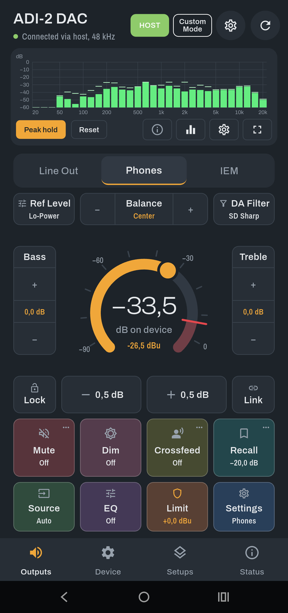
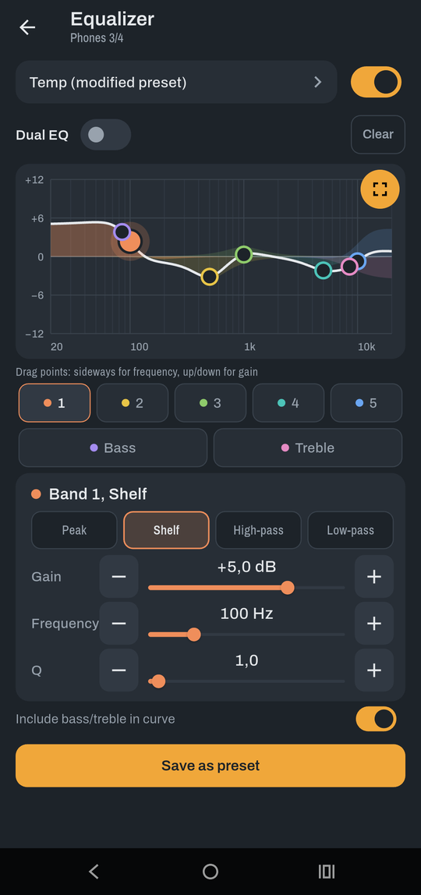
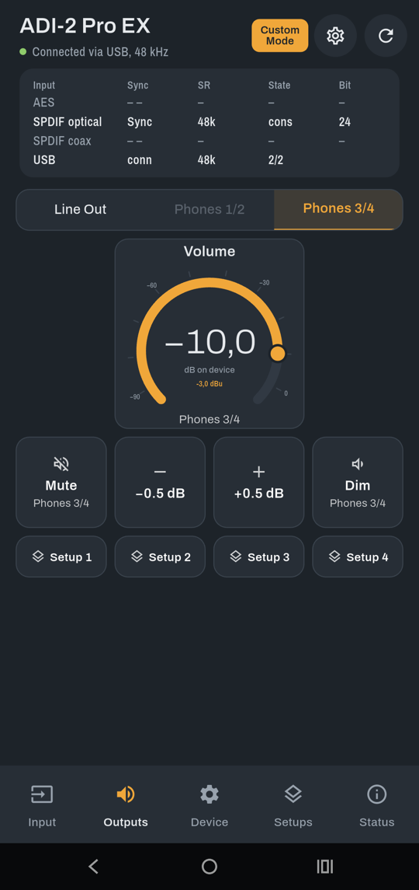
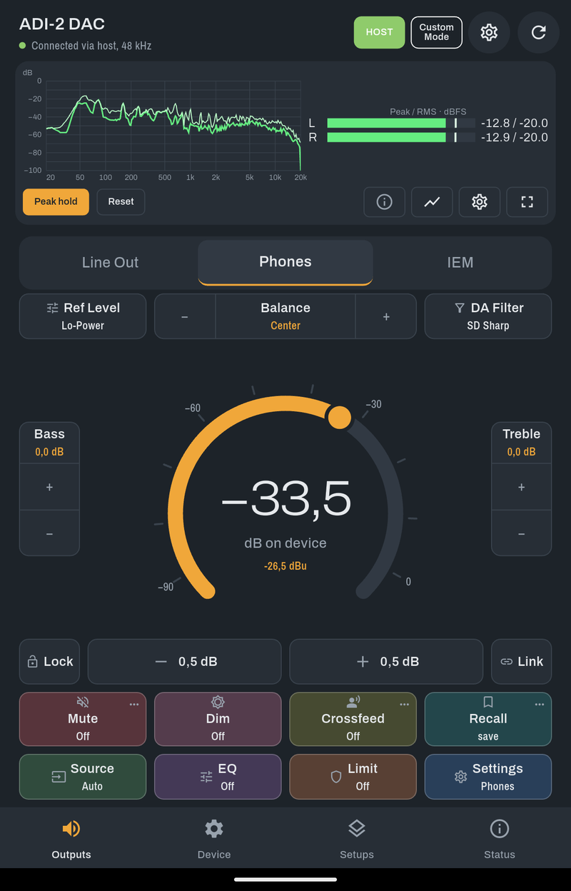
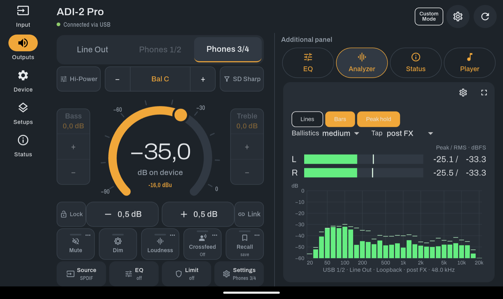
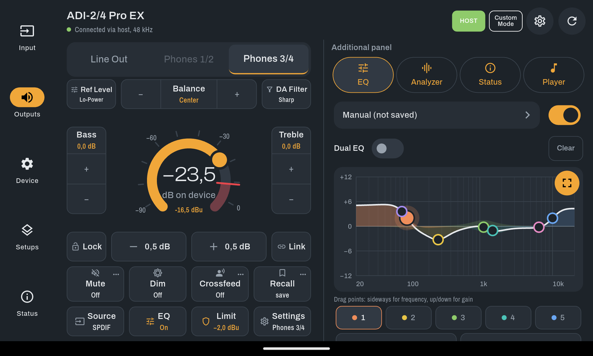
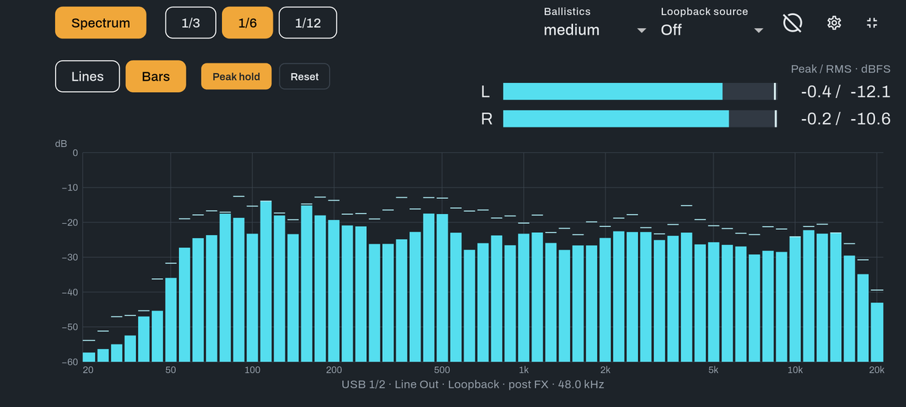
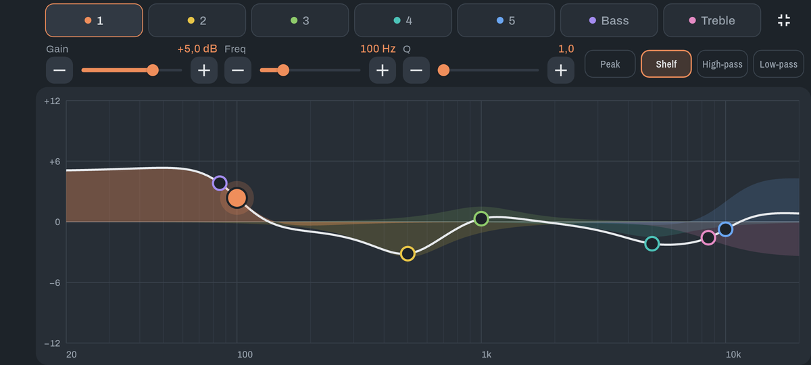
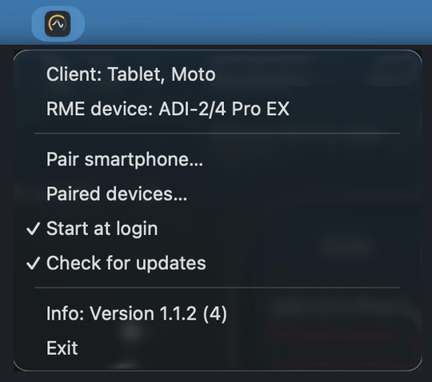

# Remote for ADI-2

[Deutsch](docs/README.de.md)

Remote for ADI-2 is a free Flutter app for controlling compatible ADI-2 audio interfaces directly over USB MIDI from a smartphone, tablet or computer. It provides output and device controls, an EQ editor, setups, backups, a configurable control panel and a USB audio analyzer. Version **1.3.0 (10)**. © 2026 Markus Rass.

## Download

### Android and computer

| What | File | For | Installation |
| --- | --- | --- | --- |
| **App** | [Remote-for-ADI-2-Android-1.3.0.apk](https://github.com/kahuna34/remote-for-ADI-2/releases/download/v1.3.0/Remote-for-ADI-2-Android-1.3.0.apk) | Android smartphone or tablet | [Guide](docs/install/android.md) |
| **Host for Mac** | [Remote-for-ADI-2-Host-macOS-1.3.0.zip](https://github.com/kahuna34/remote-for-ADI-2/releases/download/v1.3.0/Remote-for-ADI-2-Host-macOS-1.3.0.zip) | Mac with the ADI-2 connected by USB; includes controls on the computer | [Guide](docs/install/host-mac.md) |
| **Host for Intel Mac** | [Remote-for-ADI-2-Host-Intel-Mac-1.3.0.zip](https://github.com/kahuna34/remote-for-ADI-2/releases/download/v1.3.0/Remote-for-ADI-2-Host-Intel-Mac-1.3.0.zip) | Alternative for Intel Macs that show flickering or stripes in the interface (different graphics renderer) | [Guide](docs/install/host-mac.md#intel-mac) |
| **Host for Windows** | [Remote-for-ADI-2-Host-Windows-Setup-1.3.0.exe](https://github.com/kahuna34/remote-for-ADI-2/releases/download/v1.3.0/Remote-for-ADI-2-Host-Windows-Setup-1.3.0.exe) | Windows PC (64-bit) with the ADI-2 connected by USB; includes controls on the computer | [Guide](docs/install/host-windows.md) |
| **Linux** | [Remote-for-ADI-2-Linux-1.3.0.AppImage](https://github.com/kahuna34/remote-for-ADI-2/releases/download/v1.3.0/Remote-for-ADI-2-Linux-1.3.0.AppImage) | Linux PC (x86_64), e.g. Linux Mint 22 / Ubuntu 24.04 | [Guide](docs/install/linux.md) |

### iPhone

The iPhone app is not in the App Store. It is installed with your own Apple ID through AltStore/SideStore or, on a Mac with Xcode, with a build script.

| What | File | For | Installation |
| --- | --- | --- | --- |
| **App (IPA)** | [Remote-for-ADI-2-iPhone-1.3.0.ipa](https://github.com/kahuna34/remote-for-ADI-2/releases/download/v1.3.0/Remote-for-ADI-2-iPhone-1.3.0.ipa) | iPhone with iOS 15 or later, through AltStore or SideStore | [Guide](docs/install/iphone-altstore.md) |
| **AltStore source** | `https://raw.githubusercontent.com/kahuna34/remote-for-ADI-2/main/apps.json` | Add in AltStore/SideStore under Sources; updates then appear there | [Guide](docs/install/iphone-altstore.md#3-install-remote-for-adi-2) |
| **AltServer** | [altstore.io](https://altstore.io) (official download) | Mac or Windows PC: installs AltStore and keeps the app signed | [Guide](docs/install/iphone-altstore.md#1-install-altserver-on-the-computer) |
| **Xcode package** | [Remote-for-ADI-2-iPhone-Xcode-1.3.0.zip](https://github.com/kahuna34/remote-for-ADI-2/releases/download/v1.3.0/Remote-for-ADI-2-iPhone-Xcode-1.3.0.zip) | Mac with Xcode, no AltStore needed | [Guide](docs/install/iphone-xcode.md) |
| **Host for Mac / Windows** | [macOS](https://github.com/kahuna34/remote-for-ADI-2/releases/download/v1.3.0/Remote-for-ADI-2-Host-macOS-1.3.0.zip) · [Windows](https://github.com/kahuna34/remote-for-ADI-2/releases/download/v1.3.0/Remote-for-ADI-2-Host-Windows-Setup-1.3.0.exe) | Control over Wi-Fi; runs next to AltServer | [Mac](docs/install/host-mac.md) · [Windows](docs/install/host-windows.md) |

All files of the current version are also on the [releases page](https://github.com/kahuna34/remote-for-ADI-2/releases/latest). Remote for ADI-2 Host includes its own interface for controlling the ADI-2 directly on Mac and Windows and provides Wi-Fi control. On Linux, Remote for ADI-2 combines both functions. A computer can also control the ADI-2 attached to another computer (host to host). For a direct USB connection on a smartphone, the app is enough.

App and host report new versions; this can be disabled, and the check only asks GitHub for the latest version. Downloads start only when you choose Download. On iPhone, AltStore shows updates from the source.

**Connect smartphone and host:** Choose **Pair client…** in the host menu, then **Connect via host** in the app and scan the QR code or enter the code. Up to four smartphones or tablets can be connected at the same time; pair each one once. Details are in the [user guide](docs/USER_GUIDE.md#control-through-a-computer-host).

[Privacy policy](PRIVACY.md)

## Screenshots

Android smartphone and tablet, plus the host on a Mac; the screenshots show the English interface. Layouts and available controls depend on the device model.

| Smartphone: Outputs | Smartphone: EQ | Smartphone: Custom Mode |
| --- | --- | --- |
|  |  |  |

| Tablet: portrait | Tablet: Outputs and analyzer | Tablet: Outputs and EQ |
| --- | --- | --- |
|  |  |  |

| Smartphone: analyzer fullscreen | Smartphone: EQ fullscreen |
| --- | --- |
|  |  |

| Mac: host menu |
| --- |
|  |

## Features

- Output volume ring, 0.5 dB steps, balance, bass/treble, Mute, Dim, Loudness and Crossfeed where available.
- Slow volume increases, per-output Volume Limit in dBu, Recall, Lock and linked output volume.
- Input and device settings, Loopback to USB, Basic Mode signal flow views and device status.
- Five-band parametric EQ plus bass/treble, Dual EQ and a fullscreen graph.
- Device setups 1–9, EQ presets 1–20, an EQ preset editor, import and sharing.
- Device backups and model-specific offline settings with an explicit transfer action.
- Custom Mode with four layout slots per model, editable tiles and shared or separate output pages.
- USB analyzer with lines or bars, octave resolutions, Peak hold, ballistics and level calibration.
- English and German interface; tablet landscape navigation with an Additional panel.
- Android player controls through notification access, when an active media session is available; on iPhone, the player bar shows Apple Music.
- Desktop interface on Mac, Windows and Linux: Desktop, Device only and Compact views, plus separate analyzer and player windows.
- Wi-Fi and host-to-host control, with pairing by code or QR code.
- Linux version with a PipeWire/PulseAudio analyzer, MPRIS player controls and test signals for the locally connected ADI-2.

## Devices and verification

Supported models are ADI-2 Pro, ADI-2 Pro EX, ADI-2/4 Pro SE, ADI-2/4 Pro EX and ADI-2 DAC. The app has been tested with all of them on an Android smartphone and an Android tablet, with the ADI-2 DAC on a Mac, and on iPhone SE and iPhone 15 Pro Max. Built-in test-tone calibration is not yet confirmed on the ADI-2/4 Pro EX. The desktop interface and host analyzer have also been checked on Mac with ADI-2 Pro and on Linux Mint with ADI-2 Pro; the Windows host has been checked with ADI-2 DAC. Some Windows workflows still await verification.

Remote for ADI-2 Host captures the connected ADI-2 over USB for the Mac analyzer. Grant microphone permission when first starting the analyzer; it applies to USB capture. The Mac’s default audio devices stay unchanged.

## Connect over USB

Connect the ADI-2 directly to the mobile device with a data-capable USB cable. Android needs USB host support, usually through a USB-OTG adapter.

Enable **MIDI Control → ON** on the ADI-2:

- DAC: **SETUP → Options → Remap Keys / Diag → MIDI Control**.
- ADI-2 Pro / ADI-2/4 Pro: **SETUP → Options → Device Mode / DSD → MIDI Control**.

Confirm the USB permission dialog. The app searches automatically; use **Search again** or select the device in **MIDI devices** if needed. Alternatively, the smartphone can control the ADI-2 over Wi-Fi through a Mac or Windows PC running **Remote for ADI-2 Host**, or through **Remote for ADI-2** on Linux; see [Control through a computer (host)](docs/USER_GUIDE.md#control-through-a-computer-host).

## Build and install from source

Install Flutter with a Dart SDK satisfying `^3.13.7`, and the platform tooling reported by `flutter doctor`. Android requires the Android SDK and a compatible JDK. Enable developer options and USB debugging for installation on an Android device. This installation connection is separate from the app's later USB connection to the ADI-2.

Run these commands in the repository:

```sh
flutter doctor
flutter pub get
flutter analyze
flutter test
flutter devices
flutter run
```

Choose the connected mobile device when prompted. For a local Android release build:

```sh
flutter build apk --release
flutter install --release
```

The build produces `build/app/outputs/flutter-apk/app-release.apk`. If analysis or building fails in a directory containing non-ASCII characters, try a checkout in a directory with an ASCII-only name.

## Documentation and limits

- [User guide](docs/USER_GUIDE.md) / [Benutzerhandbuch](docs/BENUTZERHANDBUCH.md)
- [Computer control: host and Linux](docs/HOST_PLAN.md) / [Host auf Deutsch](docs/HOST_PLAN.de.md)

Android sound effects can change audio played over USB. The app cannot switch them off. Analyzer calibration helps correct a level offset, but cannot undo frequency-dependent processing. Readings follow the selected tap; use **post FX** for comparison with the device.

Volume limits are enforced by the app while it is connected; they are not a permanent hardware protection setting.

## License and trademarks

Free software under **GPL-3.0**. © 2026 Markus Rass. See the [GNU GPL version 3](https://www.gnu.org/licenses/gpl-3.0.html) for the license terms. Third-party open-source notices are accessible through **App settings → Trademarks and legal → Open-source licenses**.

RME is a registered trademark of RME Intelligent Audio Solutions. ADI-2 Pro is a trademark of RME Intelligent Audio Solutions; ADI-2 and ADI-2 Remote are RME product names. Alesis and ADAT are registered trademarks of Alesis Corp.; ADAT optical is a trademark of Alesis Corp. Apple, Mac and macOS are trademarks of Apple Inc. Android is a trademark of Google LLC. Direct Stream Digital and DSD are trademarks of their respective owners (Sony / Philips). All other trademarks and product names belong to their respective owners and are used only to identify compatible devices and functions.

[Privacy policy](PRIVACY.md)
