# Remote for ADI-2 — Benutzerhandbuch

Version **1.1.0 (2)** · [Projektübersicht](README.de.md) · [English](USER_GUIDE.md)

Dieses Handbuch beschreibt die aktuelle App. Die verfügbaren Regler hängen vom gewählten Modell und den vom Gerät gemeldeten Werten ab. Die Screenshots zeigen Android-Geräte mit englischer Oberfläche. Getestet ist die App mit allen unterstützten ADI-2-Modellen auf Android-Smartphone und Android-Tablet sowie mit dem ADI-2 DAC am Mac, auch über den Host. Eine iPhone-Version ist geplant. Die Player-Anbindung unterstützt derzeit nur Android.

## Inhalt

- [Erste Schritte](#erste-schritte)
- [Ausgänge](#ausgänge)
- [Lautstärkeschutz](#lautstärkeschutz)
- [Player und Status unter der Kopfzeile](#player-und-status-unter-der-kopfzeile)
- [Eingang](#eingang)
- [Gerät](#gerät)
- [Basic Mode und Signalplan](#basic-mode-und-signalplan)
- [Loopback zu USB](#loopback-zu-usb)
- [EQ und Vollbild-Graph](#eq-und-vollbild-graph)
- [Setups und EQ-Preset-Editor](#setups-und-eq-preset-editor)
- [Setups, Backups und Offline-Modus](#setups-backups-und-offline-modus)
- [Status](#status)
- [ADI-2 DAC](#adi-2-dac)
- [Eigene Ansicht (Custom Mode)](#eigene-ansicht-custom-mode)
- [Analyzer](#analyzer)
- [Tablet-Ansichten](#tablet-ansichten)
- [App-Einstellungen](#app-einstellungen)
- [Glossar](#glossar)
- [Fehlerbehebung](#fehlerbehebung)
- [Lizenz und Rechtliches](#lizenz-und-rechtliches)

## Erste Schritte

Hier verbinden Sie den ADI-2, wählen den richtigen Ausgang und bereiten die erste Bedienung vor.

### Schnellstart

Der ADI-2 verarbeitet das Audio; die App steuert seine Einstellungen über USB-MIDI. Für die reine Fernsteuerung muss auf dem Mobilgerät keine Musik laufen. Eine Audioquelle kann weiterhin am ADI-2 angeschlossen sein.

1. Die App nach der [Anleitung zum Bauen aus dem Quellcode](README.de.md#aus-dem-quellcode-bauen-und-installieren) bauen und installieren.
2. Den eingeschalteten ADI-2 mit einem datenfähigen USB-Kabel direkt am Mobilgerät anschließen. Android benötigt USB-Host-/OTG-Unterstützung und gegebenenfalls einen OTG-Adapter.
3. Am ADI-2 **MIDI Control → ON** einstellen. Beim DAC: **SETUP → Options → Remap Keys / Diag → MIDI Control**. Bei ADI-2 Pro und ADI-2/4 Pro: **SETUP → Options → Device Mode / DSD → MIDI Control**.
4. Den USB-Berechtigungsdialog bestätigen. Die App sucht automatisch. Bei Bedarf **Erneut suchen**, **Verbindungshilfe** oder das Gerät unter **MIDI-Geräte** wählen.
5. Modell und **Verbunden über USB** in der Kopfzeile prüfen. **Neu einlesen** liest die Geräteeinstellungen erneut. Mit niedriger Ausgangslautstärke beginnen und vor dem Hören ein geeignetes **Limit** einstellen.

Das Mobilgerät übernimmt bei dieser Verbindung die USB-Host-Rolle. Alternativ steuert das Smartphone den ADI-2 per WLAN über einen Computer, siehe [Steuerung über einen Computer (Host)](#steuerung-über-einen-computer-host).

### In der App zurechtfinden

Die Navigation führt zu **Ausgänge**, bei Modellen mit Analogeingang zu **Eingang**, sowie zu **Gerät**, **Setups** und **Status**. Über das Zahnrad **App** öffnen Sie die App-Einstellungen. **Eigene Ansicht** in der Kopfzeile wechselt das Bedienfeld der Ausgänge.

Die App liest Werte vom Gerät zurück. **Neu einlesen** fordert den aktuellen Stand erneut an; es lädt weder ein Setup noch einen früheren App-Stand. Bei Parametern schaltet ein Schalter die Funktion ein oder aus, Auswahlkacheln wählen einen Wert, und Schieberegler mit Minus/Plus erlauben feine Änderungen. Nicht vom Gerät gemeldete Parameter werden ausgeblendet. Eine fehlende Einstellung bedeutet daher nicht automatisch einen Verbindungsfehler.

### Offline einstellen

Hier bereiten Sie Einstellungen vor, wenn gerade kein Gerät angeschlossen ist.

Auf dem Verbindungsbildschirm unter **Offline einstellen** ein Modell wählen. Die rote Kennzeichnung **OFFLINE** zeigt, dass Änderungen lokal bleiben. Die App speichert Offline-Einstellungen nach Modellvariante. ADI-2 Pro und ADI-2 Pro EX teilen den Offline-Speicher. ADI-2/4 Pro SE und ADI-2/4 Pro EX haben getrennte Offline-Stände. **Beenden** verlässt den Offline-Modus.

Nach dem Anschließen desselben Modells **Setups → Weiteres → Offline-Einstellungen übertragen** öffnen. Vor dem Übertragen die Information und Rückfrage lesen. Übernommen wird der gespeicherte Offline-Stand, einschließlich Offline-Ausgangswerten, die von aktuellen Geräteeinstellungen abweichen. Nur Unterschiede werden gesendet. Lautstärken werden nur übernommen, wenn sie leiser als die aktuellen Gerätewerte sind; die App-Grenzen gelten auch mit dem neuen Ref Level. Ein höherer Ref Level kann den Ausgang lauter machen, auch wenn die Lautstärke nicht steigt. Ausgänge vorher leiser stellen oder eine Obergrenze aktivieren. Gespeicherte Geräte-Setups 1–9, gespeicherte EQ-Presets und die Presetwahl werden nicht übertragen. Anzeigewerte und Aktionen sind ausgeschlossen. Vorher ein Backup anlegen. **Offline-Stand auf Werkseinstellung** setzt den lokalen Offline-Stand zurück.

## Steuerung über einen Computer (Host)

Hängt der ADI-2 per USB an einem Mac oder Windows-PC, kann das Smartphone ihn über WLAN steuern. Dafür läuft auf dem Computer das kleine Hintergrundprogramm **Remote for ADI-2 Host**. Es hat keine eigene Gerätesteuerung und reicht nur die Befehle zwischen Smartphone und ADI-2 weiter. Die Steuerung am Computer selbst bleibt der RME-Software überlassen; beide können gleichzeitig laufen.

### Host starten

Auf dem Mac **Remote for ADI-2 Host** wie ein Programm öffnen. Es erscheint kein Fenster, sondern ein Symbol in der Menüleiste. Unter Windows sitzt das Symbol im Infobereich der Taskleiste; die Windows-Version ist vorbereitet, aber auf echter Hardware noch ungeprüft. Ein Klick auf das Symbol öffnet das Menü:

| Mac: Menü des Hosts |
| --- |
| 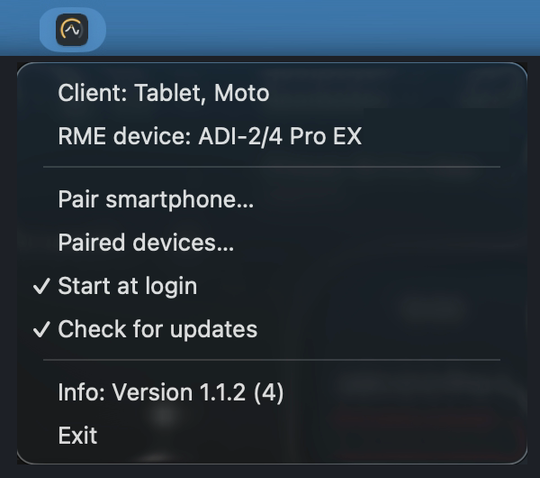 |

| Eintrag | Wirkung |
| --- | --- |
| Status | Zeigt, ob der Host bereit ist, ein Smartphone verbunden ist, kein ADI-2 gefunden wurde oder USB-MIDI belegt ist. |
| Smartphone koppeln… | Zeigt einen 6-stelligen Code und einen QR-Code. Der Code gilt 2 Minuten und nur einmal. |
| Gekoppelte Geräte… | Listet gekoppelte Smartphones; **Widerrufen** entzieht einem Smartphone den Zugriff. |
| Bei Anmeldung starten / Mit Windows starten | Startet den Host automatisch nach der Anmeldung am Computer. |
| Beenden | Beendet den Host. |

Unter Windows muss der Host beim ersten Start im privaten Netzwerk durch die Firewall zugelassen werden.

### Koppeln und verbinden

1. Am Host **Smartphone koppeln…** wählen.
2. In der App auf dem Verbindungsbildschirm **Über Host verbinden** öffnen. Gefundene Hosts erscheinen in der Liste; sonst Adresse und Port von Hand eingeben.
3. Den QR-Code scannen oder den Code eingeben.

Danach verbindet sich die App bei jedem Start automatisch mit diesem Host. Eine direkte USB-Verbindung am Smartphone hat Vorrang. Dasselbe WLAN allein genügt nicht: Ohne Kopplung gibt der Host nichts weiter. In der Kopfzeile steht neben **Eigene Ansicht** das grüne Feld **HOST** mit dem Namen des Computers.

### Verhalten über den Host

Der Host öffnet USB-MIDI nur, solange ein gekoppeltes Smartphone verbunden ist, und gibt es danach wieder frei. Er fragt den ADI-2 laufend ab, weil das Gerät Änderungen aus anderer Software nicht von selbst meldet. Lautstärke erscheint dadurch fast sofort, EQ und die übrigen Werte nach etwa einer Sekunde; der EQ-Graph gleitet dabei zum neuen Stand.

Lauter wird es über den Host nur, solange die App im Vordergrund ist und sich laufend beim Host meldet, und höchstens mit der Geschwindigkeit der Lautstärkerampe. Bricht die Verbindung ab oder geht die App in den Hintergrund, stoppt jede Anhebung; nichts wird später nachgeholt. Leiser stellen, Stummschalten und Dim gehen immer sofort. Geräte-Setups und Werkseinstellungen lassen sich über den Host nicht laden, weil sich dabei Lautstärken unbemerkt erhöhen könnten. Der Analyzer steht über den Host noch nicht zur Verfügung.

## Ausgänge

Hier regeln Sie den Hörpegel und die Klangbearbeitung des gewählten Ausgangs.

**Ausgänge** öffnen und je nach Modell **Line Out**, **Phones**, **IEM**, **Phones 1/2** oder **Phones 3/4** wählen. Diese Auswahl bestimmt den Ausgang für Ring, EQ und zugehörige Einstellungen. Bei Pro-Modellen kann Phones 1/2 inaktiv sein, wenn **Dual Phones** ausgeschaltet ist. Die Ausgangswahl gedrückt halten, um die Kopfhörer-Konfiguration zu öffnen.

| Smartphone: Ausgänge | Tablet: Ausgänge, Hochformat |
| --- | --- |
| 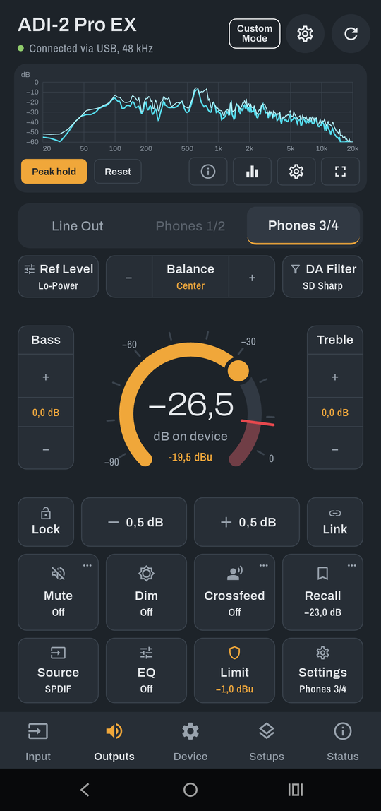 | 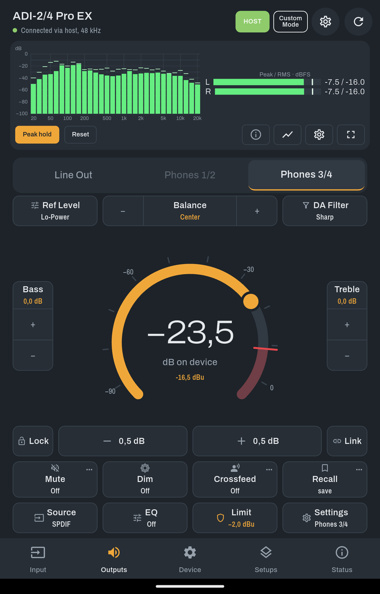 |

### Ring, Kanäle und Klangregler

Zum Regeln entlang des Lautstärkebogens ziehen. Die Bewegung ist relativ: Eine Berührung an anderer Stelle springt nicht auf deren absoluten Wert. Der gefüllte Bogen und die Zahl zeigen die aktuelle Geräteeinstellung. Ein hohler Zielpunkt und ein gestrichelter Bogen zeigen eine noch laufende Anhebung. Die rote Marke und Fläche zeigen die App-Obergrenze. Der kleinere dBu-Wert wird aus Lautstärke und Referenzpegel berechnet; er ist kein gemessener Audio-Spitzenwert. Beim DAC zeigt Line Out RCA- und XLR-Werte getrennt.

**− 0,5 dB** und **+ 0,5 dB** ändern die Lautstärke schrittweise; gedrückt halten wiederholt. Leiser geht sofort, lauter über eine Rampe. Loslassen des Rings oder einer gehaltenen Lautstärketaste stoppt eine noch nicht abgeschlossene Anhebung. **Anhebung angehalten** bietet **Hier stoppen** oder **Weiter anheben**. Auch Ausgangswechsel und der Wechsel der App in den Hintergrund stoppen Lautstärkerampen.

**Bal** verschiebt die Balance nach links oder rechts. Gedrückt halten des Balancewerts in der Standardansicht setzt auf die Mitte (**C**) zurück. **Bass** und **Treble** ändern die Klangverstärkung; ihre Beschriftungen gedrückt halten öffnet die Detaileinstellungen. Die Referenzpegel-Taste öffnet **Ref Level** / **Auto Ref Level**, die Filtertaste den **DA-Filter**. Beim Wechsel des Referenzpegels kann die Rückfrage einen Lautstärkeausgleich anbieten, um ähnlich laut zu bleiben.

### Ausgangstasten

| Regler | Antippen | Gedrückt halten / Details |
| --- | --- | --- |
| Mute | Ausgang stumm- oder freischalten | Einstellungen für Kopfhörer-/Line-Stummschaltung und Umschalten öffnen |
| Dim | Absenkung um 20 dB umschalten | Erklärung anzeigen; keine separate Dim-Konfiguration am Gerät |
| Loudness | Loudness umschalten | Bass-/Höhenanhebung und Low Vol Ref einstellen; volle Wirkung unterhalb Low Vol Ref, keine mehr 20 dB darüber |
| Crossfeed | Ausschalten oder letzte Stärke wieder einschalten | Aus oder Stärke 1–5 wählen |
| Recall | Ohne gespeicherten Wert aktuelle Lautstärke speichern, sonst über die Rampe wiederherstellen | Wert prüfen, ersetzen oder löschen |
| Lock | Geräteparameter Lautstärke sperren umschalten | In der eigenen Ansicht dessen Parameteransicht öffnen |
| Link | Ausgänge zum Koppeln wählen; aktiven Link antippen löst die Kopplung | Auswahl Link Volume erneut öffnen |
| Quelle | Eingangsquelle des Ausgangs wählen | Modell und Basic Mode bestimmen die Verfügbarkeit; „wie Line“ kennzeichnet die gemeinsame Quelle |
| EQ | Equalizer des Ausgangs öffnen | In der eigenen Ansicht kann EQ an/aus eine separate Kachel sein |
| Limit | Volume Limit öffnen | App-Lautstärkeschutz einstellen |
| Settings | Ausgangsparameter des Modells öffnen | Enthält verfügbare Referenz-, Filter-, Stereo-, Polaritäts- und weitere DSP-Einstellungen |

Gekoppelte Ausgänge ändern sich um denselben dB-Betrag; sie erhalten nicht zwangsläufig dieselbe absolute Lautstärke. Mindestens zwei Ausgänge auswählen. Jede Obergrenze gilt weiter. Recall stellt nur seinen eigenen Ausgang wieder her und folgt der Kopplung nicht. Lock ist ein Geräteparameter. Recall, Kopplung, Anstiegsgeschwindigkeit und Grenzen speichert die App je Modell. ADI-2 Pro und ADI-2 Pro EX teilen diese Lautstärkeoptionen. Ebenso teilen ADI-2/4 Pro SE und ADI-2/4 Pro EX ihre Lautstärkeoptionen. Der DAC hat einen eigenen Speicher.

### Ausgangseinstellungen im Detail

**Settings** öffnet die Parameter des gewählten Ausgangs. Gemeinsam mit den Haupttasten deckt die folgende Übersicht seine Klang- und Pegeleinstellungen ab.

| Einstellung | Wirkung und Verwendung |
| --- | --- |
| Quelle | Wählt, welches Eingangssignal dieser Ausgang wiedergibt. Bei Pro-Modellen bietet die App modellabhängig **Auto**, **AES**, **SPDIF**, **Analog**, **USB 1/2**, **USB 3/4**, beim ADI-2/4 Pro EX auch **ADAT 3/4**. **wie Line** bedeutet, dass die Quelle mit Line geteilt wird. |
| Ref Level | Bestimmt den analogen Referenzpegel bzw. bei Kopfhörern den Leistungsbereich **IEM**, **Lo-Power** oder **Hi-Power**, soweit vorhanden. Ein höherer Bereich kann bei gleichem Lautstärkewert mehr Ausgangsspannung liefern. |
| Auto Ref Level | Lässt das Gerät den passenden Referenzbereich wählen. In der Ref-Level-Auswahl aktiviert **Auto** diese Funktion; eine manuelle Wahl schaltet sie ab. |
| Lautstärke / Balance | Lautstärke regelt den Gesamtpegel, Balance das Verhältnis links/rechts. **C** steht für die Mitte. |
| Mute / Dim / Lautstärke sperren | Stummschalten, vorübergehend 20 dB absenken oder die Lautstärkebedienung sperren. Mute löscht den eingestellten Lautstärkewert nicht. |
| Mono | **An** führt beide Kanäle zu Mono zusammen; **nach Links** gibt das Monosignal links aus. **Aus** erhält Stereo. |
| Stereobreite | Ändert den Anteil des Seitensignals: 1,00 ist normale Breite, 0,00 Mono; negative Werte vertauschen die Seitenlage. |
| M/S-Proc | Aktiviert die Mitte-/Seite-Verarbeitung des Ausgangs. Nur für einen entsprechend aufgebauten Signalweg verwenden. |
| Polarität | Kehrt die Polarität für **Beide**, **Links** oder **Rechts** um. **Aus** belässt die ursprüngliche Polarität. |
| Crossfeed | Mischt für Kopfhörer einen Anteil des jeweils anderen Kanals hinzu. **Aus** trennt die Kanäle unverändert, 1–5 wählen die Stärke. |
| DA-Filter | Wählt den Rekonstruktionsfilter des D/A-Wandlers. Die angebotenen Filter hängen von Modell und Wandlerrevision ab; etwa **SD Sharp**, **SD Slow**, **Sharp**, **Slow**, **NOS**, **SD LD** oder **Brickwall**. Beim ersten Verbinden prüft die App einmalig je Gerät, ob SD LD vorhanden ist, stellt den vorherigen Filter wieder her und graut SD LD aus, falls das Gerät ihn nicht hat. |
| De-Emphasis | Steuert die Höhenkorrektur für Quellen mit Emphasis: **Auto**, **An** oder **Aus**. Für eine normale Quelle keine zusätzliche Korrektur erzwingen. |
| Dual EQ | Ermöglicht getrennte Bandparameter für links und rechts; Einzelheiten im EQ-Kapitel. |
| Bass/Treble | Schaltet die Bass-/Höhenbearbeitung gemeinsam ein oder aus. Gain, Frequenz und Q werden über die Klangregler bzw. im EQ eingestellt. |
| Loudness | Passt Bass-/Höhenanhebung an die Lautstärke an. **Loudness Bass** und **Loudness Höhen** bestimmen die maximale Anhebung; **Loudness Low Vol Ref** deren unteren Bezugspegel. |
| Dig. DC-Schutz | Wählt den digitalen Gleichanteilschutz: **Aus**, **An** oder **Filter**. Die App übermittelt die Wahl an das Gerät; dies ist keine eigene Messung der App. |
| Rear TRS Quelle | Ordnet bei ADI-2/4-Pro-Modellen die rückseitigen TRS-Ausgänge **Line 1/2** oder **Ph. 3/4** zu. Die auf Line und Phones 3/4 angezeigte Wahl kann denselben Geräteparameter bedienen. |
| Loopback zu USB | Leitet das Signal dieses Ausgangs an USB-Aufnahmekanäle. Einstellen unter **Gerät**, Erklärung im Loopback-Kapitel. |

**Hinweis:** Die Ref-Level-Taste bietet bei einer manuellen Änderung **Lautstärke ausgleichen (gleich laut bleiben)** an. Ein höherer Referenzpegel wird dann durch vorheriges Absenken des Lautstärkewerts ausgeglichen; bei einem niedrigeren Referenzpegel erfolgt das Nachregeln über die Rampe. Die App-Grenze kann den erreichbaren Wert beschränken. Beim DAC-IEM ist der Referenzpegel fest.

## Lautstärkeschutz

Dieses Kapitel erklärt, wie die App Anhebungen bremst und Ausgangspegel begrenzt.

### Obergrenze einstellen

**Limit → Volume Limit** öffnen und **Obergrenze aktiv** einschalten. Die Grenze in dBu einstellen; die Seite zeigt zusätzlich die entsprechende maximale Lautstärke am Gerät. Ein Wechsel des Ref-Level berechnet die zulässige Lautstärke neu und senkt sie vorher, falls nötig. Wird am Gerät über die Grenze gedreht, regelt die verbundene App zurück. Das setzt eine bestehende App-Verbindung voraus und ist kein dauerhafter Hardware-Limiter. Beim ADI-2 DAC bezieht sich die dBu-Grenze von Line Out auf RCA. XLR liegt 6 dB darüber.

**Lauter werden** bietet **Adaptiv**, **20**, **10** und **5 dB/s**. Adaptiv wird bei höherer Lautstärke langsamer. Die Geschwindigkeit gilt für alle Ausgänge. Auf derselben Seite stehen **Recall-Lautstärke** und **Gekoppelte Ausgänge**.

### Rampe, Recall und Link im Alltag

Die Rampe gibt Ihnen bei einer Anhebung Zeit zum Reagieren. **Adaptiv** bremst bei höheren Lautstärkewerten stärker; eine große Bewegung am Ring ist zunächst ein Zielauftrag. Leiser regelt die App sofort. Der Zielpunkt kann daher vor dem tatsächlich erreichten Ringwert liegen. Während einer Rampe werden automatische Rückleseabfragen aufgeschoben und kurz zuvor angeforderte, veraltete Lautstärkerückmeldungen ignoriert. Meldet das Gerät eine neue Lautstärke, die vom zuletzt gesendeten Wert abweicht, beendet die App die Rampe dieses Ausgangs, etwa beim Drehen am Gerät.

**Recall** merkt einen Lautstärkewert für genau einen Ausgang. Ohne gespeicherten Wert speichert Antippen den aktuellen Stand. Später ruft Antippen diesen Wert ab; eine Anhebung folgt der Rampe und wird am Limit begrenzt. Gedrückt halten öffnet die Verwaltung. Unter **Recall-Lautstärke → Aktuelle übernehmen** speichern Sie den aktuellen Wert; **Löschen** entfernt ihn.

**Link** koppelt Lautstärkeänderungen als Differenz. Steht Line Out auf −40 dB und ein zweiter Ausgang auf −50 dB, führt eine Anhebung um 2 dB zu −38 bzw. −48 dB, soweit die jeweiligen Grenzen es zulassen. Erreicht ein Ausgang sein Limit, kann sich der Abstand verändern. Recall arbeitet nur auf seinem eigenen Ausgang. Die Kopplung ist kein gemeinsamer EQ und schaltet keine Audioquelle um.

**Lock** schaltet **Lautstärke sperren** am Gerät. Die App deaktiviert die zugehörigen Lautstärkebedienelemente, wenn die Sperre gemeldet wird. Das ist von der App-Obergrenze und von **UI sperren** zu unterscheiden.

**Vorsicht:** Die dBu-Obergrenze wird aus Referenzpegel und Lautstärkewert berechnet. Sie misst weder den Schalldruck am Kopfhörer noch den Pegel im Raum. Ohne laufende Verbindung kann die App einen am Gerät erhöhten Wert nicht zurückregeln. Beim Laden eines Geräte-Setups kann das Gerät selbst Lautstärken abrufen; prüfen Sie zuvor **Lautstärke mit Setup laden**.

## Player und Status unter der Kopfzeile

Hier wählen Sie, welche Zusatzinformation über dem Ausgangsbedienfeld erscheint.

Unter **App-Einstellungen → Anzeige unter der Kopfzeile** zwischen **Player**, **Status**, **Analyzer** und **nichts** wählen. Dieser Bereich gehört zu Ausgänge. Die eigene Ansicht verwendet die in ihrer Layoutseite gespeicherte Auswahl.

**Player** nutzt die aktive Android-Mediensitzung. Über den angebotenen Einstellungslink Benachrichtigungszugriff erteilen. Die Leiste kann Medieninformationen und Cover zeigen, vorheriger/nächster, Wiedergabe/Pause und Stopp senden sowie durch Antippen der Informationen den Player öffnen. Die Verfügbarkeit hängt von der Medien-App ab. Eine Musikbibliothek enthält sie nicht. Ohne verwendbaren Player-Inhalt erscheint gegebenenfalls die vorgesehene Status-Ersatzanzeige oder die Leiste klappt ein. Andere Plattformen bieten diese Anbindung derzeit nicht.

**Status** zeigt kompakt den Zustand der Digitaleingänge sowie Clock- und Sample-Rate-Informationen. Antippen öffnet die vollständige Statusseite.

| Smartphone: Player |
| --- |
| 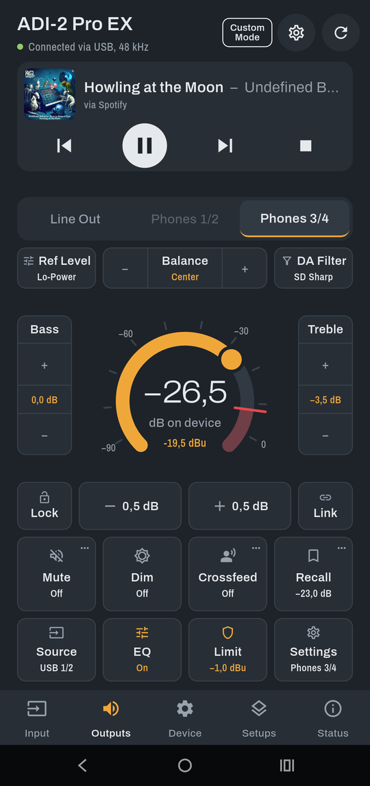 |

**Erlauben** öffnet die Android-Einstellung für den Benachrichtigungszugriff. **Nicht mehr fragen** blendet die Nachfrage der App aus. Die Player-Leiste steuert eine andere Medien-App; sie ändert weder die ADI-2-Quelle noch die Kalibrierung. Für Analyzer oder Musikaufnahme müssen Wiedergabequelle und USB-Routing weiterhin zusammenpassen.

## Eingang

Hier passen Sie das analoge Eingangssignal vor der weiteren Verteilung im Gerät an.

**Eingang** steht bei Modellen mit Analogeingang bereit. **Equalizer (Eingang)** öffnet dessen EQ. Die Seite zeigt die unterstützten Eingangsparameter des gewählten Modells, etwa **Ref Level**, **Auto Ref Level**, **Trim Gain Links**, **Trim Gain Rechts**, **Phase Invert**, **M/S-Proc**, **AD-Filter**, **Dual EQ**, **AD-Wandlung** und **DC-Filter**. RIAA-Regler sind modellabhängig. Änderungen wirken im Eingangsweg; ausgangsspezifische Bearbeitung erfolgt unter Ausgänge.

| Smartphone: Eingang | Tablet: Eingang, Hochformat |
| --- | --- |
| 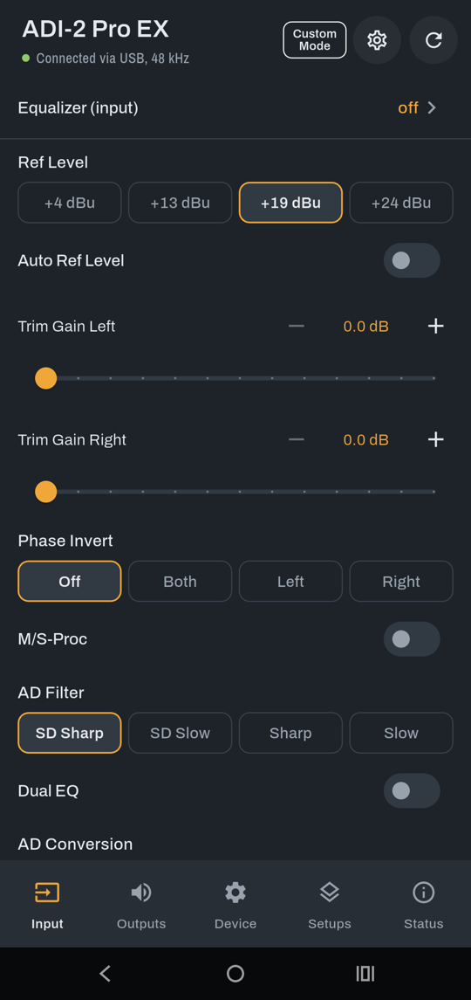 | 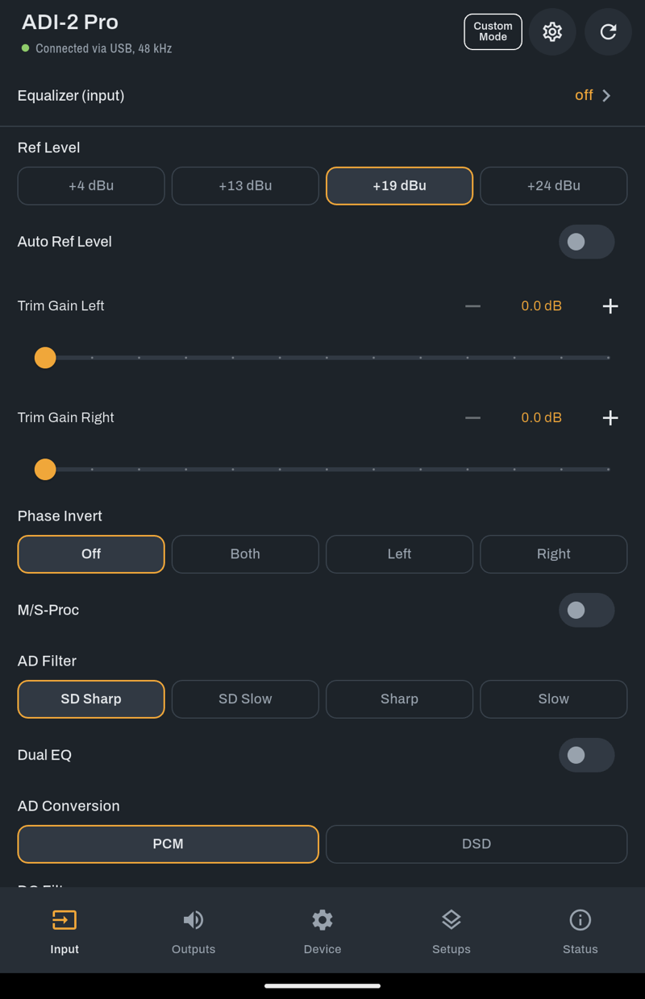 |

### Eingangsparameter verstehen

Die Tabelle erklärt die angebotenen Regler; sichtbar sind nur die vom Modell gemeldeten Werte.

| Einstellung | Wirkung und Verwendung |
| --- | --- |
| Ref Level | Legt den analogen Eingangsbereich fest. Wählen Sie einen zur Quelle passenden Bereich, um Übersteuerung zu vermeiden und den Wandler sinnvoll auszusteuern. Beim ADI-2/4 Pro EX reicht die Auswahl von −35 bis +24 dBu. |
| Auto Ref Level | Überlässt die Umschaltung des Eingangsreferenzpegels dem Gerät. |
| Trim Gain Links / Trim Gain Rechts | Hebt den jeweiligen Eingangskanal um 0 bis 6 dB in 0,5-dB-Schritten an, etwa zum Abgleich ungleicher Quellenpegel. |
| Phase Invert | Kehrt die Polarität beider oder eines Eingangskanals um; **Aus** lässt sie unverändert. |
| M/S-Proc | Schaltet die Verarbeitung von Mitte-/Seite-Signalen im Eingangsweg ein. Für gewöhnliches Links-/Rechts-Stereo ausgeschaltet lassen. |
| AD-Filter | Wählt den Filter der A/D-Wandlung: **SD Sharp**, **SD Slow**, **Sharp** oder **Slow**. Das ist kein parametrisches EQ-Band. |
| Dual EQ | Erlaubt unterschiedliche EQ-Kurven für den linken und rechten Eingang. Bearbeiten über **Equalizer (Eingang)**. |
| AD-Wandlung | Wählt **PCM** oder **DSD** als Format der A/D-Wandlung. |
| DC-Filter | Wählt die Gleichanteilfilterung des Eingangs. Je Modell stehen **Auto**, **ADC**, **RME** oder **keiner** zur Verfügung; die App bietet die tatsächlich gemeldete Auswahl an. |
| RIAA-Modus | Aktiviert die Entzerrung für ein entsprechendes Phonosignal und wählt deren Verstärkung. Beim ADI-2/4 Pro SE: **Aus** oder +14 bis +38 dB; beim ADI-2/4 Pro EX zusätzlich **0 dB**. |
| RIAA Mono Bass | Fasst den Bassbereich im RIAA-Betrieb zu Mono zusammen. |
| Bal. Impedanz | Wählt beim ADI-2/4 Pro EX die symmetrische Eingangsimpedanz **94 k** oder **47 k**, passend zur angeschlossenen Quelle. |

**Hinweis:** Der Eingangs-EQ bearbeitet das Eingangssignal. Wer nur den Klang eines Kopfhörers verändern möchte, wählt dessen Ausgangs-EQ.

## Gerät

Hier ändern Sie geräteweite Signal-, Clock-, Kopfhörer- und Anzeigeeinstellungen.

**Gerät** bietet oben **Backup sichern / laden** und **Loopback zu USB**, danach die vom Modell gemeldeten Parameter. Zu weiteren Reglern und **Setup** nach unten scrollen. Die folgenden Tabellen erklären die Einstellungen; nicht jedes Modell bietet jede Zeile.

| Smartphone: Gerät | Tablet: Gerät, Hochformat |
| --- | --- |
| 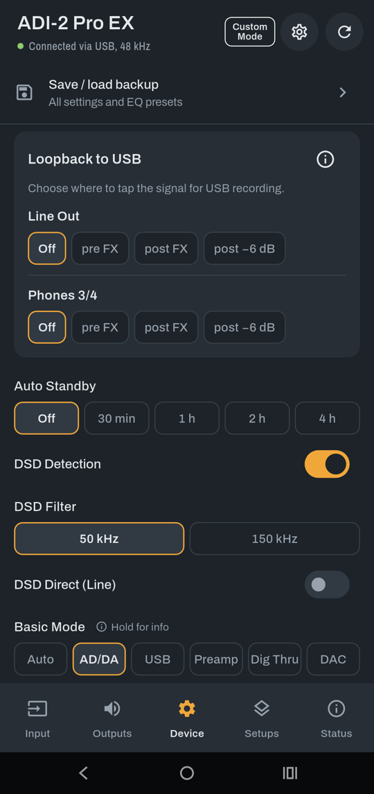 | 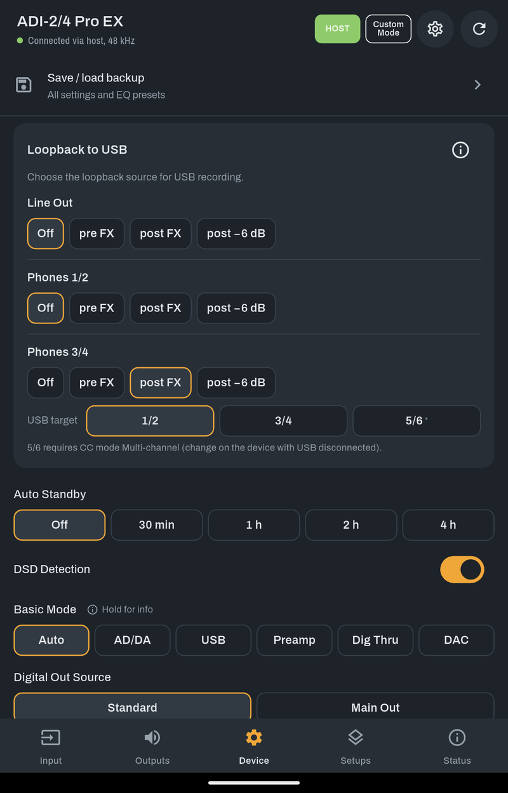 |

### Signal, Clock und Kopfhörer

Diese Einstellungen legen Betriebsart, digitale Verteilung und das Verhalten der Buchsen fest.

| Einstellung | Wirkung und Verwendung |
| --- | --- |
| Basic Mode | Wählt bei Pro-Modellen die grundlegende Betriebsart. Antippen schaltet um; gedrückt halten erklärt die Betriebsart im Signalplan. |
| Digital Out Quelle | **Standard** verwendet die Verteilung der jeweiligen Betriebsart. **Main Out** legt das bearbeitete Main-Out-Signal auf die digitalen Ausgänge. In **Dig Thru und Preamp** ist die Auswahl am Gerät und in der App ausgegraut und nicht wählbar. |
| Dual Phones | Aktiviert zusätzlich **Phones 1/2**, etwa für einen zweiten Kopfhörer. |
| Bal. TRS Phones | Konfiguriert die beiden Kopfhörerbuchsen für einen symmetrischen Kopfhörer; Auswahl **Aus**, **An** oder **Auto**. Nur mit der dafür passenden Verkabelung verwenden. |
| Toggle Phones/Line | Bestimmt die am Umschalten beteiligten Ausgänge: **Aus**, **Ph 1/2**, **Ph 3/4**, **1/2+3/4**, **alle eingesteckt** oder **Line/Digit.**. Die Aktion **Ausgänge umschalten** im Custom Mode nutzt diese Konfiguration. |
| Line stumm bei Ph 1/2 / Line stumm bei Ph 3/4 | Schaltet Line beim Einstecken in die jeweilige Kopfhörerbuchse automatisch stumm. Phones 1/2 hängt dabei auch von **Dual Phones** ab. |
| Line stumm bei | DAC-Auswahl für automatische Line-Stummschaltung bzw. Umschalten: **Aus**, **Phones**, **Toggle Ph/Line** oder **Toggle eingesteckt**. |
| Clock-Quelle | Legt den Taktgeber fest. **Intern** verwendet den internen Takt, **Auto** die automatische Wahl; externe Quellen sind modellabhängig **AES**, **SPDIF**, **SPDIF coax** oder **Optical**. Den tatsächlichen Zustand unter **Status** prüfen. |
| SPDIF-Eingang | Wählt bei Pro-Modellen **Auto**, **Coax** oder **Optical** für den SPDIF-Eingangsweg. |
| SRC-Modus | Schaltet den Sample-Rate-Converter aus oder auf **AES In** bzw. **SPDIF In**. So kann eine digitale Eingangsquelle an einen anderen Gerätetakt angepasst werden. |
| SRC Gain dig. | Wählt **0 dB** oder **-3 dB** für den digitalen SRC-Weg; die Absenkung schafft Pegelreserve. |
| Optical Out Quelle | Wählt **SPDIF** oder **ADAT** als Format des optischen Ausgangs. |
| DSD-Erkennung | Aktiviert die Erkennung von DSD-Signalen. |
| DSD-Filter | Wählt die DSD-Filtergrenze **50 kHz** oder **150 kHz**. |
| DSD Direct (Line) | Aktiviert den direkten DSD-Weg für Line bei Geräten, die diesen Parameter anbieten. Dabei ist die übliche PCM-DSP-Bearbeitung nicht der Signalweg; nicht jedes Modell bzw. jede Wandlerrevision bietet diese Wahl. |

### Anzeige, Bedienung und Tasten

Diese Regler betreffen die Oberfläche und Bedienung am ADI-2; die App-Anzeige stellen Sie separat unter **App** ein.

| Einstellung | Wirkung und Verwendung |
| --- | --- |
| Auto-Standby | Wählt **Aus**, **30 min**, **1 h**, **2 h** oder **4 h** als Standby-Zeitvorgabe des Geräts. |
| Display-Modus | Wählt **Standard** oder **Dunkel** für das Gerätedisplay. |
| Meter-Farbe | Wählt **Grün**, **Cyan**, **Amber**, **Mono**, **Rot** oder **Orange** für die Geräte-Pegelanzeige. Der App-Analyzer kann dieser Farbe mit **Wie Gerät** folgen. |
| Horizontales Meter | Wählt den Anzeigepunkt bzw. die Ansicht **Post-FX**, **Pre-FX**, **Dual** oder **Post-FX dBu** am Gerät. |
| AutoDark | Schaltet die automatische Verdunkelung des Gerätedisplays ein oder aus. |
| Lautstärke-Bildschirm | Schaltet die Lautstärkeansicht am Gerät ein oder aus. |
| UI sperren | Sperrt die Gerätebedienung gemäß **Aus**, **Remote**, **Tasten** oder **Tasten+Remote**. Nicht mit der einzelnen Ausgangslautstärkesperre verwechseln. |
| Tasten neu belegen | Wählt **Aus**, **An** oder **IR-Fernbedienung** für die Geräte-Tastenzuordnung. |
| Taste VOL / Taste I/O / Taste EQ / Taste SETUP | Öffnet die Funktionsliste für die jeweilige Gerätetaste. Wählen Sie z. B. einen Setup-Abruf, Mute, eine Klangfunktion, einen Filter oder ein EQ-Preset. Die Funktionsnamen bleiben wie am Gerät englisch. |
| Fernbedienung Taste 5 / Fernbedienung Taste 6 / Fernbedienung Taste 7 | Ordnet bei Pro-Modellen den zusätzlichen Fernbedienungstasten eine Funktion aus derselben modellabhängigen Liste zu; beim DAC fehlen diese drei Regler. |
| Lautstärke mit Setup laden | Bestimmt im Bereich **Setup**, ob ein Geräte-Setup auch die Lautstärke abruft. Vor dem Laden kontrollieren. |

**Hinweis:** Die Sample Rate wird unter **Status** angezeigt. Auf der Geräteseite gibt es dafür keinen frei einstellbaren Regler.

### Funktionen der Tastenbelegung

Die Funktionslisten erlauben die folgenden Zuordnungen. Die App zeigt je Modell nur die dafür vorgesehenen Einträge; mit einer Zuordnung legen Sie die spätere Tastenaktion fest, ohne sie sofort auszuführen.

| Funktionsnamen in der Auswahl | Aktion der belegten Taste |
| --- | --- |
| Default, Setup 1 bis Setup 9 | Ruft die Standardkonfiguration bzw. das angegebene Geräte-Setup ab. Dabei **Lautstärke mit Setup laden** beachten. |
| EQ Preset 1 bis EQ Preset 9 | Ruft das angegebene Geräte-EQ-Preset ab; die Tastenliste bietet die ersten neun der insgesamt 20 Slots. |
| Mono, Mono to L, Mono 1/2, Mono 3/4, Mono all, Mono 1/2 to L, Mono 3/4 to L, Mono all to L | Schaltet die Mono-Funktion für den bezeichneten Weg bzw. die Mono-Ausgabe nach links. |
| Mute, Mute 1/2, Mute 3/4, Mute all | Schaltet die Stummschaltung für den angegebenen Umfang. |
| Loudness, Loudness 1/2, Loudness 3/4, Loudness all | Schaltet die lautstärkeabhängige Klangkorrektur für den angegebenen Umfang. |
| EQ enable, EQ In 1/2, EQ Out 1/2, EQ Out 3/4, EQ Out all | Schaltet den bezeichneten EQ; **In** ist Eingang, **Out** Ausgang. |
| B/T enable, B/T Out 1/2, B/T Out 3/4, BT all | Schaltet die Bass-/Treble-Bearbeitung. |
| EQ+B/T+Ld, EQ+B/T+Ld 1/2, EQ+B/T+Ld 3/4, EQ+B/T+Ld 1-4 | Schaltet die kombinierte EQ-, Bass-/Treble- und Loudness-Bearbeitung für den bezeichneten Umfang. |
| Toggle Ph/Line, Polarity, AutoDark, Dim bzw. DIM, Toggle View | Löst das konfigurierte Ausgangsumschalten aus, schaltet Polarität, automatische Displayverdunkelung oder Dim bzw. wechselt die Geräteansicht. |
| Crossfeed 1 bis Crossfeed 5 | Ruft die angegebene Crossfeed-Stärke ab. |
| DA SD Sharp, DA SD Slow, DA Sharp, DA Slow, DA NOS, DA SD LD, DA SD LD (Brickwall), Brickwall | Wählt den entsprechenden D/A-Filter; die konkrete Liste hängt vom Modell ab. |
| Source AES, Source SPDIF coax, Source Optical, Source Analog, Source USB 1/2 | Wählt die angegebene Eingangsquelle. |
| RIAA Mode +, RIAA Mode -, RIAA Mono Bass | Wechselt bei ADI-2/4-Pro-Modellen die RIAA-Modusstufe auf-/abwärts bzw. schaltet Mono-Bass. |

Bei Pro-Funktionsnamen bezeichnen **1/2** und **3/4** die jeweiligen Wege, **all** mehrere Wege und **1-4** beide Ausgangspaare. Beim DAC fehlen diese getrennten Pro-Zuordnungen. Welche dieser Funktionen auf eine Taste gelegt wird, speichert das Gerät.

## Basic Mode und Signalplan

Der Signalplan hilft Ihnen, einen passenden Betriebsmodus zu verstehen und den Weg einer Quelle zu einem Ausgang nachzuvollziehen.

| Smartphone: Signalplan |
| --- |
| 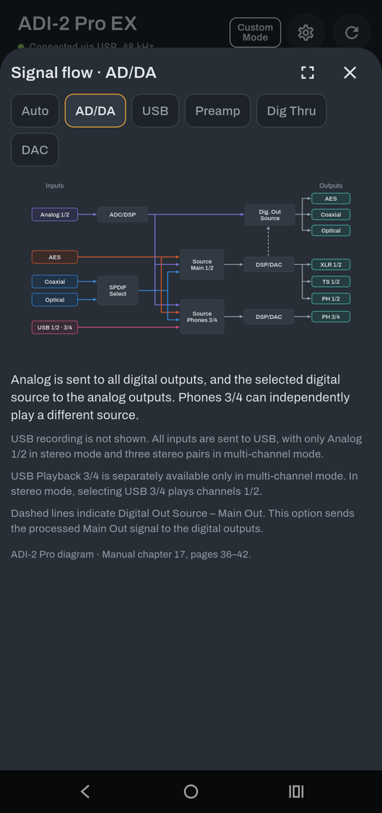 |

### Öffnen und lesen

Öffnen Sie **Gerät → Basic Mode** und halten Sie eine der Modustasten lange gedrückt. Auch eine **Basic Mode**-Direktkachel in der eigenen Ansicht öffnet bei langem Drücken den Plan. Kurzes Antippen der Basic-Mode-Taste außerhalb des Plans schaltet dagegen die Betriebsart am Gerät um.

Im Fenster **Signalplan** wechseln Sie zwischen **Auto**, **AD/DA**, **USB**, **Preamp**, **Dig Thru** und **DAC**. **Vollbild** vergrößert die Zeichnung; **Vollbild schließen** führt zurück, **Schließen** beendet den Plan. Unter der Zeichnung stehen Erläuterungen; bei Bedarf nach unten scrollen. Bei eingeschalteter automatischer Vollbildansicht genügt das Drehen ins Querformat. In **USB** lässt sich zusätzlich **Stereo · 2/2** oder **Mehrkanal · 6/8** betrachten. Diese Ansicht startet mit Stereo; sie liest den tatsächlichen CC-Mode nicht aus.

**Hinweis:** Jede Auswahl innerhalb des Plans ändert nur die angezeigte Erklärung. Sie schaltet weder Basic Mode noch CC-Mode am angeschlossenen Gerät um. Die Zeichnungen erläutern ADI-2-Pro-Signalwege. Sie sind keine Live-Messung und keine Bestätigung des Routings aller unterstützten Modelle.

| Element im Plan | So lesen Sie es |
| --- | --- |
| Eingänge links | **Analog 1/2**, **AES**, **Coaxial**, **Optical** und **USB** sind mögliche Signalquellen. USB-Paarangaben bezeichnen die vom Host kommenden Wiedergabekanäle. |
| ADC/DSP | Das analoge Signal wird digitalisiert und durch die Eingangsverarbeitung geführt. |
| SPDIF Auswahl | Wählt den koaxialen oder optischen SPDIF-Zweig. |
| Quelle Main 1/2 / Quelle Phones 3/4 | Ein Auswahlpunkt für das jeweilige Ausgangssignal. Mehrere eingezeichnete Zuleitungen zeigen Auswahlmöglichkeiten, keinen Summenmischer. |
| DSP/DAC | Ausgangsverarbeitung und anschließende D/A-Wandlung vor den analogen Buchsen. |
| Dig. Out Source | Verteilung zu den digitalen Ausgängen; die genaue Quelle hängt von Betriebsart und **Digital Out Quelle** ab. |
| Ausgänge rechts | **XLR 1/2** und **TS 1/2** sind die gezeichneten Line-Buchsen, **PH 1/2** und **PH 3/4** die Kopfhörerwege. **AES**, **Coaxial** und **Optical** sind Digitalausgänge. |
| USB Rec | Ein Weg vom Gerät zum Host, also zur Aufnahme. Nicht mit USB-Wiedergabe links verwechseln. |
| Durchgezogene Pfeillinien | Die im Schema vorgesehenen Verbindungen. Folgen Sie einem Pfeil von Quelle über Auswahl und Verarbeitung bis zum Ziel. Die Linien markieren keine gerade gemessene Aktivität. |
| Gestrichelte Pfeillinien | Der zusätzliche Weg bei **Digital Out Quelle → Main Out**: das bearbeitete Main-Out-Signal gelangt an die Digitalausgänge. Das ist kein Fehler oder unterbrochenes Kabel. |
| Farben | Violett kennzeichnet Analog, Orange AES, Blau SPDIF, Rosa USB; neutrale Linien verbinden weitere Verarbeitungsstufen, die Ausgangskästen sind türkis. Entscheidend sind Beschriftung und Pfeilrichtung. |

### Auto

| Signalplan: Auto |
| --- |
| 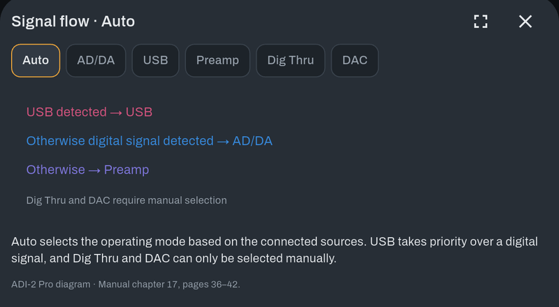 |

**Auto** lässt das Gerät die Grundbetriebsart nach den angeschlossenen Quellen bestimmen. Die App zeigt dazu einen Entscheidungsablauf: erkanntes USB führt zu USB, andernfalls ein erkanntes Digitalsignal zu AD/DA, andernfalls zu Preamp. USB hat also Vorrang. Dig Thru und DAC müssen Sie ausdrücklich wählen.

Beispiel: Sie verwenden abwechselnd eine analoge Quelle und USB-Wiedergabe. Auto erklärt, warum das Anstecken des USB-Hosts den Grundmodus ändern kann. Der Ablauf im Plan stellt die Regel dar, nicht eine laufend aktualisierte Erkennung.

### AD/DA

| Signalplan: AD/DA |
| --- |
| 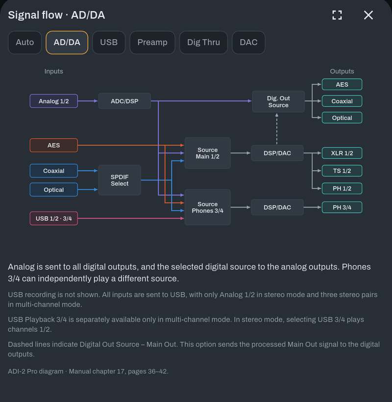 |

**AD/DA** verbindet zwei Wandleraufgaben: Das analoge Eingangssignal geht zu den Digitalausgängen; eine gewählte digitale Quelle lässt sich über die analogen Ausgänge hören. Phones 3/4 kann eine andere Quelle wiedergeben als Main 1/2. Die Quellauswahl im Plan zeigt, wo Sie den jeweiligen Hörweg bestimmen.

Beispiel: Sie digitalisieren ein analoges Zuspielgerät und hören gleichzeitig einen digitalen Zuspieler über Line ab. Für einen getrennten Kopfhörervergleich können Sie Phones 3/4 auf eine andere Quelle stellen.

### USB

| Signalplan: USB |
| --- |
| 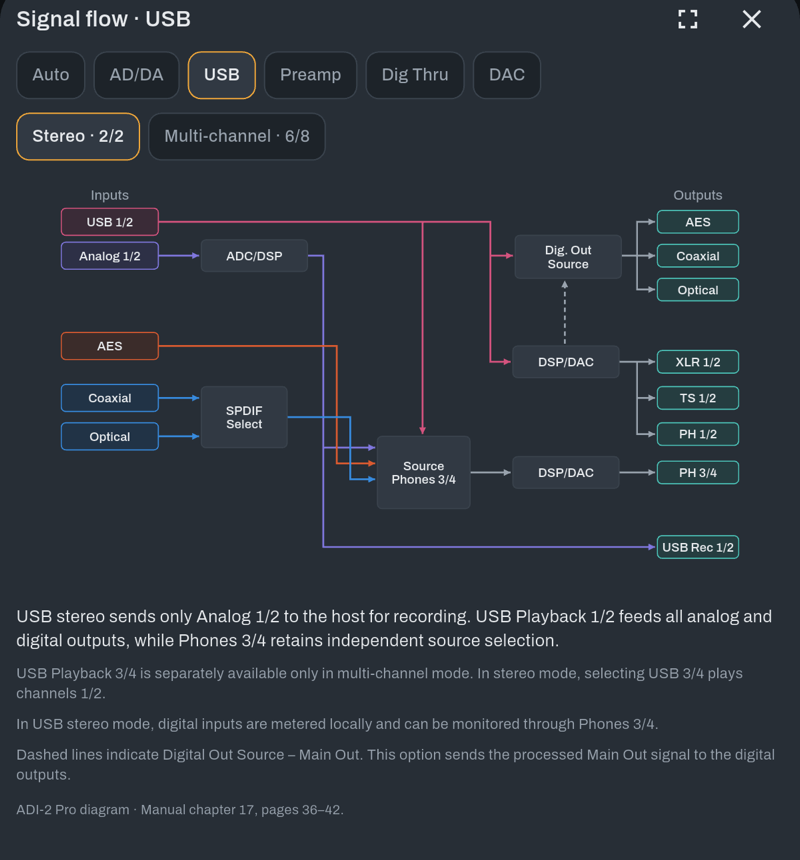 |

**USB** dient der Wiedergabe vom USB-Host und der Aufnahme zum Host. Im Stereo-Schema speist USB Playback 1/2 die analogen und digitalen Ausgänge; Analog 1/2 gelangt zurück zu USB Rec 1/2. Phones 3/4 bleibt in seiner Quelle umschaltbar. Digitale Eingänge können in diesem Stereo-Betrieb lokal angezeigt und auf Phones 3/4 abgehört werden, werden aber im gezeichneten Standardweg nicht als eigene USB-Aufnahmepaare übertragen.

Beispiel: Ein Host spielt Musik über USB ab, während eine Aufnahme-App den Analogeingang aufnimmt. Wenn mehrere digitale Quellen getrennt aufgenommen oder Ausgänge getrennt bespielt werden sollen, betrachten Sie das Mehrkanal-Schema.

### Preamp

| Signalplan: Preamp |
| --- |
| 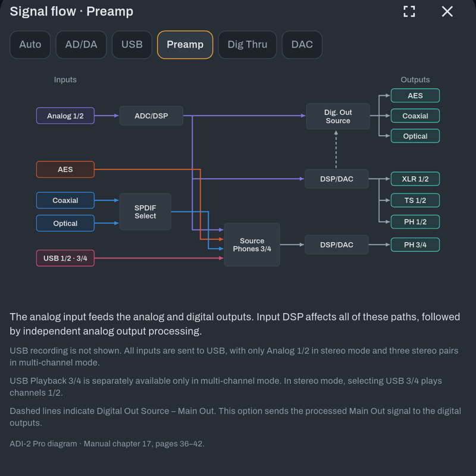 |

**Preamp** nimmt den Analogeingang als Hauptquelle für die analogen und digitalen Ausgänge. Die Eingangsverarbeitung liegt vor dieser Verteilung. Die analogen Ausgangswege behalten anschließend ihre eigene Verarbeitung. Phones 3/4 besitzt im Schema weiterhin eine separate Quellauswahl. **Digital Out Quelle** ist in Preamp am Gerät und in der App ausgegraut und nicht wählbar.

Beispiel: Eine analoge Quelle soll über Line und Kopfhörer hörbar sein und zusätzlich digital weitergegeben werden. Eine Korrektur am Eingangs-EQ betrifft den gemeinsamen Eingangsweg; die Kopfhörerkorrektur gehört in den Ausgangs-EQ.

### Dig Thru

| Signalplan: Dig Thru |
| --- |
| 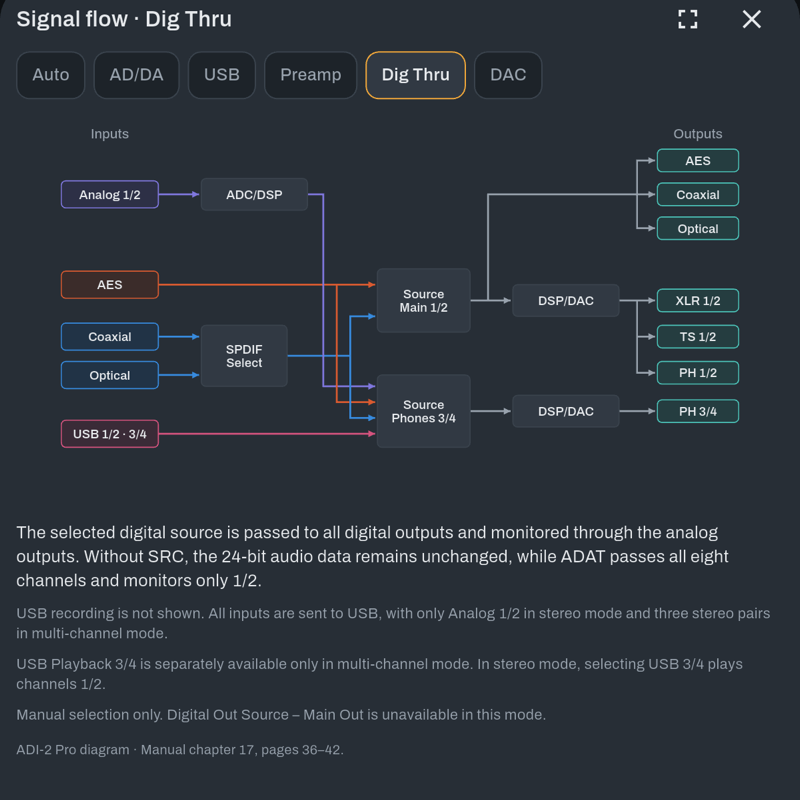 |

**Dig Thru** reicht die gewählte digitale Quelle an die Digitalausgänge weiter und erlaubt zugleich analoges Abhören. Ohne SRC bleiben die 24-Bit-Audiodaten auf dem Durchschleifweg unverändert. Bei ADAT zeigt die Erläuterung die Weitergabe aller acht Kanäle; analog abgehört wird 1/2. Der gestrichelte Main-Out-Weg ist hier nicht verfügbar.

Beispiel: Sie geben eine digitale Quelle an ein weiteres Digitalgerät weiter und möchten sie gleichzeitig über Kopfhörer kontrollieren. Diesen Modus wählen Sie manuell.

### DAC

| Signalplan: DAC |
| --- |
| 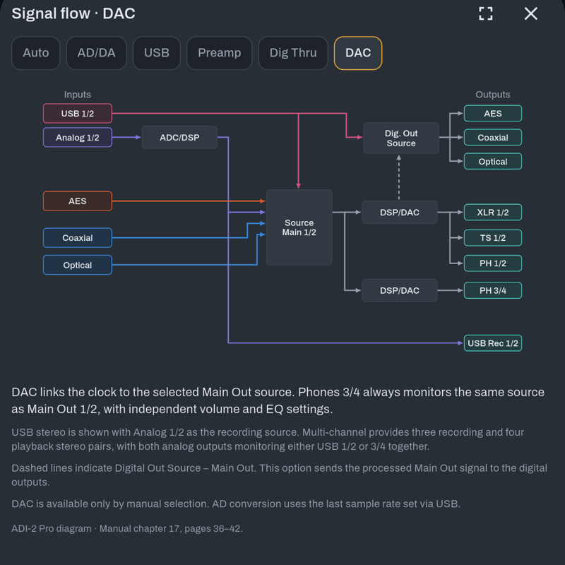 |

**DAC** bindet die Clock an die gewählte Main-Out-Quelle. Main 1/2 und Phones 3/4 hören dieselbe Quelle, behalten aber getrennte Lautstärken und EQs. Koaxial und optisch erscheinen hier als eigene Auswahlmöglichkeiten. Die A/D-Wandlung nutzt die zuletzt über USB gesetzte Sample Rate.

Beispiel: Eine digitale Quelle soll gleichzeitig Lautsprecher und Kopfhörer mit jeweils eigener Klangkorrektur versorgen. Wählen Sie DAC manuell. **DAC** bezeichnet hier eine Betriebsart der Pro-Modelle; das Gerätemodell **ADI-2 DAC** ist davon zu unterscheiden.

### Stereo und Mehrkanal unterscheiden

Die Zahlen geben USB-Kanäle aus Sicht des Hosts an: Aufnahme zuerst, Wiedergabe danach. **Stereo · 2/2** bedeutet ein Stereopaar in jede Richtung; **Mehrkanal · 6/8** drei Aufnahme- und vier Wiedergabepaare. Die folgende Zuordnung beschreibt den gezeichneten USB-Standardweg vor einer abweichenden Loopback-Zuweisung.

| Richtung | Stereo · 2/2 | Mehrkanal · 6/8 |
| --- | --- | --- |
| Aufnahme zum Host | 1/2: Analog | 1/2: Analog; 3/4: AES; 5/6: SPDIF (ADAT) |
| Wiedergabe vom Host | 1/2 für die Ausgangswege | 1/2: Analog 1/2; 3/4: Analog 3/4; 5/6: AES; 7/8: SPDIF (ADAT) |

Bei USB-Mehrkanal hört Phones 3/4 mit Quelle Auto USB 1/2 und kann z. B. auf USB 3/4 gestellt werden. USB 3/4 ist nur im Mehrkanalbetrieb ein eigener Wiedergabestrom; im Stereobetrieb spielt diese Auswahl 1/2. Mit **Digital Out Quelle → Main Out** ersetzt das bearbeitete Main-Signal die separaten Digital-Wiedergabewege 5/6 und 7/8. Das Mehrkanal-Schema ist bis 192 kHz vorgesehen.

Die Stereo-/Mehrkanal-Umschalter zeigt die App nur beim USB-Plan. Der DAC-Plan zeigt USB-Stereo und erläutert Mehrkanal im Text: Beide analogen Ausgänge können dort gemeinsam USB 1/2 oder USB 3/4 hören. Einige andere Pläne lassen USB-Aufnahmewege weg; das bedeutet nicht, dass es keine Aufnahme gibt. Für die tatsächliche Umstellung des CC-Mode USB trennen und am Gerät **SETUP → Options → Device Mode / DSD → CC-Mode** verwenden.

## Loopback zu USB

Mit Loopback geben Sie ein Ausgangssignal intern an die USB-Aufnahme zurück, um es aufzunehmen oder im Analyzer zu betrachten.

Ein Kabel vom analogen Ausgang zurück zum Eingang ist dafür nicht nötig. Loopback ist ein digitaler Abgriff im Gerät. Unter **Gerät → Loopback zu USB** wählen Sie für jeden angebotenen Ausgang den Abgriff und bei Modellen mit Eingang das **USB-Ziel**. **Info** erläutert die Auswahl.

| Abgriff | Was bei USB ankommt | Beispiel |
| --- | --- | --- |
| Aus | Kein Loopback dieses Ausgangs; das normale Aufnahmesignal des USB-Paars bleibt verfügbar, sofern kein anderer Loopback es ersetzt. | Wieder den Analogeingang auf USB 1/2 aufnehmen. |
| pre FX | Das Signal vor EQ und Effekten des Ausgangs. | Eine Quelle ohne deren Ausgangsklangkorrektur aufnehmen. |
| post FX | Das Signal nach EQ/Effekten, vor der Ausgangslautstärke. Loudness bleibt von deren Einstellung abhängig. | Die Klangbearbeitung aufnehmen oder im Analyzer vergleichen. |
| post −6 dB | Der Post-FX-Abgriff um 6 dB abgesenkt. | Zusätzliche Reserve auf dem USB-Aufnahmeweg; der Analyzer zeigt entsprechend 6 dB weniger. |

**USB-Ziel** bezeichnet das Aufnahmekanalpaar am Host, nicht den Ausgang, den Sie hören. Die Auswahl erscheint, sobald Loopback eingeschaltet ist. Bei **Aus** wird das Zielpaar nicht im Gerätewert gespeichert; beim erneuten Einschalten prüfen und gegebenenfalls neu wählen.

Modelle mit Eingang bieten **1/2**, **3/4** und **5/6**; beim DAC ist es **1/2**. Paar 5/6 benötigt **CC-Mode Multi-channel** und ist bei erkanntem Stereo-Modus gesperrt. Die CC-Mode-Erkennung ist derzeit Android-spezifisch; ein anwählbares Ziel auf einer anderen Plattform bestätigt daher nicht dessen Verfügbarkeit. Den CC-Mode bei getrennter USB-Verbindung am Gerät unter **SETUP → Options → Device Mode / DSD → CC-Mode** ändern.

**Vorsicht:** Loopback ersetzt das normale Aufnahmesignal des Zielpaars. Wer gleichzeitig Analog aufnehmen möchte, muss dessen Aufnahmepaar freihalten oder die Aufnahme anders planen. Eine Aufnahme-App, die ihr Eingangssignal wieder auf denselben Wiedergabeweg schickt, kann eine Rückkopplung erzeugen; Software-Monitoring dafür ausschalten.

### Beispiel: Musik aufnehmen

So nehmen Sie den Klang eines Ausgangs mit seiner Bearbeitung auf:

1. Schließen Sie den ADI-2 an den aufnehmenden USB-Host an und wählen Sie am gewünschten Ausgang die tatsächliche Musikquelle.
2. Wählen Sie für diesen Ausgang unter **Loopback zu USB** den Abgriff **post FX** und ein vom Host verfügbares **USB-Ziel**, beispielsweise **1/2**. Für zusätzliche Reserve können Sie **post −6 dB** wählen.
3. Wählen Sie in der Aufnahme-Anwendung am selben Host das entsprechende ADI-2-Eingangspaar und starten Sie die Aufnahme. Die Fernbedienungs-App selbst enthält keinen Audiorecorder. Das Mobilgerät und ein Computer können nicht gleichzeitig die direkte USB-Host-Rolle an demselben Anschluss übernehmen.
4. Prüfen Sie nach der Aufnahme den Loopback-Zustand und wählen Sie **Aus**, wenn Sie wieder das ursprüngliche Eingangssignal aufnehmen möchten.

### Beispiel: Analyzer speisen

Der App-Analyzer liest ausschließlich **USB 1/2**. Wählen Sie für den zu betrachtenden Ausgang **post FX** und **USB-Ziel → 1/2**, oder nutzen Sie die Quell-/Loopback-Auswahl im Analyzer. Spielen Sie ein Signal über die gewählte Ausgangsquelle ab. Eine Route auf 3/4 oder 5/6 erreicht den App-Analyzer nicht. Für eine Pegelkalibrierung gelten zusätzlich die vollständige Checkliste und die Regeln im Analyzer-Kapitel.

## EQ und Vollbild-Graph

Hier formen Sie den Frequenzgang eines Ausgangs oder des Analogeingangs und speichern passende Klangkurven.

**EQ** eines Ausgangs oder **Equalizer (Eingang)** öffnen. Die obere Auswahl wählt ein Geräte-Preset oder die verfügbaren manuellen/temporären/Filter-Einträge. Der Schalter aktiviert den EQ. **Dual EQ** ermöglicht getrennte Bearbeitung für links/rechts; **Links** oder **Rechts** wählen. Ohne Dual EQ wird der gemeinsame EQ bearbeitet.

Band **1–5**, **Bass** oder **Treble** wählen. Punkte im Graphen seitwärts für Frequenz, auf/ab für Gain ziehen. Die Bandregler bieten **Gain**, **Frequenz**, **Q** und die jeweils zulässigen Filtertypen (**Peak**, Shelf, Hochpass oder Tiefpass). **Bass/Treble in Kurve** ändert die gezeichnete Kurve; die Aktivierung der Bass-/Treble-Bearbeitung ist ein eigener Schalter. **Clear** fragt vor dem Zurücksetzen des EQ nach. **Als Preset speichern** schreibt in einen gewählten Geräteslot und überschreibt ihn nach Bestätigung. Nach dem Speichern auf der Live-Seite wählt die App das gespeicherte Preset automatisch für diesen Kanal.

Das Vollbildsymbol im Graphen öffnet den größeren Editor. Mit **EQ-Graph im Querformat automatisch im Vollbild** kann das Drehen des Smartphones bei geöffnetem EQ-Graphen automatisch ins Vollbild wechseln. Änderungen auf der Live-EQ-Seite werden ans Gerät gesendet; das Speichern eines Presets ist eine eigene Aktion.

| Smartphone: Equalizer | Tablet: Equalizer |
| --- | --- |
| 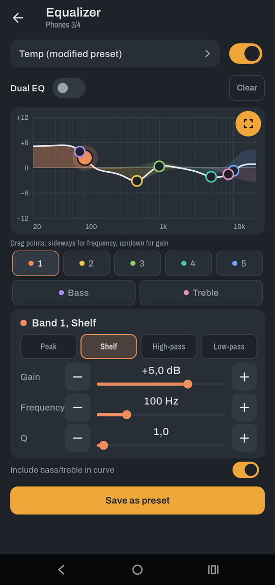 | 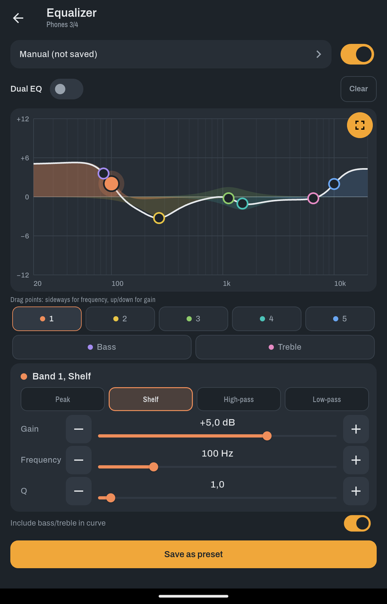 |

### Bänder, Filter und Q verstehen

Jedes Band verändert einen Teil des Frequenzbereichs. **Frequenz** bestimmt dessen Lage, **Gain** die Anhebung oder Absenkung und **Q** die Form: Beim Peak-Filter wirkt ein kleiner Q-Wert breit, ein großer gezielt in einem schmalen Bereich. Bei Shelf- und Passfiltern verändert Q die Form des Übergangs. Gain lässt sich von −12 bis +12 dB in 0,5-dB-Schritten einstellen; Q in 0,1-Schritten. Schieberegler und Minus/Plus-Tasten erlauben genaue Werte. Bei einem Hoch-/Tiefpass ist Gain ohne Wirkung und wird ausgeblendet oder deaktiviert.

| Band | Frequenzbereich | Q | Filtertypen in der Oberfläche |
| --- | --- | --- | --- |
| 1 | 20 Hz–20 kHz | 0,5–9,9 | **Peak**, **Shelf**, **Hochpass**, **Tiefpass** |
| 2 und 3 | 20 Hz–20 kHz | 0,5–9,9 | **Peak** |
| 4 | 200 Hz–20 kHz | 0,5–5,0 | **Peak** |
| 5 | 200 Hz–20 kHz | 0,5–5,0 | **Peak**, **Shelf**, **Tiefpass** |
| Bass | 20–150 Hz | 0,5–1,5 | Fester tiefer Shelf |
| Treble | 3–10 kHz | 0,5–1,5 | Fester hoher Shelf |

**Peak** hebt oder senkt einen Bereich um die Mittenfrequenz. **Shelf** verschiebt einen ganzen Bereich unterhalb der Grenzfrequenz bei Band 1 bzw. oberhalb bei Band 5. **Hochpass** dämpft tiefere, **Tiefpass** höhere Frequenzen. Bass und Treble sind zusätzliche Shelf-Regler; im Vollbild heißen deren Typanzeigen **Low-Shelf** und **High-Shelf**.

Die waagerechte Graphachse zeigt Frequenz, die senkrechte dB-Anhebung. Die Kurve ist eine aus den EQ-Parametern berechnete Filterkurve, kein gemessenes Spektrum. Wählen Sie einen Punkt oder ein Band, ziehen Sie seitwärts für Frequenz und auf/ab für Gain. Q stellen Sie am Regler ein. Der Vollbildeditor verwendet dieselben Werte wie die darunterliegende Ansicht.

### Dual EQ und Bass/Treble

Mit **Dual EQ** bearbeiten Sie die fünf Bänder für **Links** und **Rechts** getrennt, beispielsweise für unterschiedliche Kanal-Korrekturen. Prüfen Sie vor einer Änderung die gewählte Seite. Ohne Dual EQ wird der gemeinsame EQ bearbeitet. **Bass** und **Treble** bleiben gemeinsame Klangregler und folgen nicht der Links-/Rechts-Auswahl.

**Bass/Treble in Kurve** blendet deren Anteil in die berechnete Kurve ein oder aus. Dieser Anzeigeschalter aktiviert die Bearbeitung nicht. Dazu dient **Bass/Treble** bzw. der Schalter bei einem gewählten Bass-/Treble-Band. Auch der EQ-Hauptschalter und Loudness sind eigene Funktionen. Eine sichtbare Kurve allein sagt daher nicht, welche Bearbeitung gerade hörbar ist.

### Live-EQ, Auswahl und Speichern

Auf der Live-EQ-Seite gehen Änderungen direkt an den gewählten Gerätekanal; sie landen nicht automatisch in einem gespeicherten Preset. Die obere Auswahl zeigt **Manuell (nicht gespeichert)**, **Temp (geändertes Preset)**, die Gerätespeicher **Preset 1–20**, **Zurückgesetzt (linear)** oder **Rumpelfilter**. Temp kennzeichnet einen bearbeiteten Presetstand. Ein anderes Geräte-Preset auszuwählen verändert den Live-EQ.

**Clear** setzt nach Rückfrage die Bandwerte beider Seiten einschließlich Bass/Treble auf die Standardwerte mit 0 dB Gain. Gespeicherte Presets bleiben erhalten; EQ an/aus, Bass/Treble an/aus und die Presetwahl bleiben unverändert. Der **EQ-Preset-Editor** unter Setups arbeitet dagegen zunächst in einem eigenen Puffer.

Beispiel: Wählen Sie am Ausgang Band 2 als **Peak**, 500 Hz, −2 dB und Q 1,0 für eine breite Absenkung. Hören Sie leise und vergleichen Sie mit dem EQ-Schalter. Wenn Sie die Kurve behalten möchten, wählen Sie **Als Preset speichern**, einen Geräteslot und einen Namen, prüfen Sie das Überschreiben und bestätigen Sie. Eine Anhebung kann die digitale Reserve verkleinern; bei Übersteuerung Gain reduzieren.

## Setups und EQ-Preset-Editor

Hier bereiten Sie EQ-Presets getrennt vom Live-EQ vor und verwalten deren Speicherplätze.

**Setups** enthält **EQ-Preset-Editor**, **EQ-Presets (1–20)**, **Geräte-Setups 1–9** und **Weiteres**. Unter den Editor scrollen, um die Geräteslots zu erreichen.

Editor und Zwischenablage gelten nur, solange die Seite offen ist. Beim Wechsel des Haupttabs geht ein ungesicherter Entwurf verloren. Vorher ins Gerät oder in die App-Bibliothek speichern.

| Smartphone: EQ-Preset-Editor | Tablet: EQ-Preset-Editor |
| --- | --- |
| 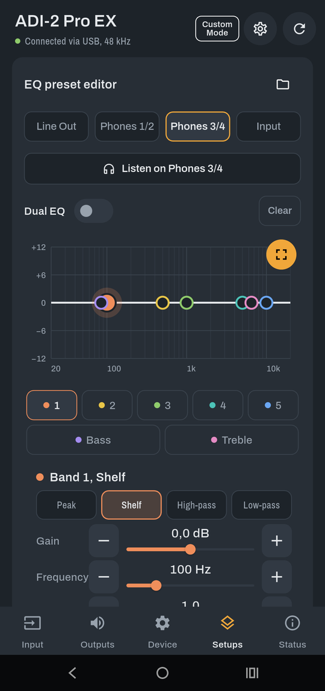 | 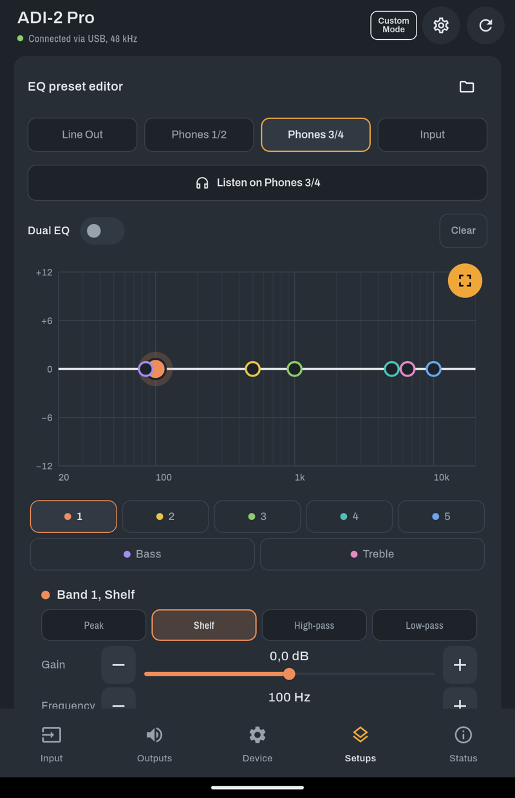 |

1. Im Editor den Zielausgang oder Eingang auswählen.
2. Eines der **EQ-Presets (1–20)** antippen, um seinen Inhalt in den Editor zu laden. **Neu einlesen** liest die Geräte-Presets erneut. **Nicht eingelesen** bedeutet, dass deren Inhalt noch fehlt.
3. Bänder und Dual EQ wie auf der Live-EQ-Seite bearbeiten. **Kopieren** und **Einfügen** übertragen den Editorinhalt. Gedrückt halten eines Presetslots bearbeitet seinen Namen im Editor; erst **Ins Gerät speichern** schreibt das bearbeitete Preset und den Namen.
4. **Auf … anhören** aktivieren, um den Editor-EQ zum gewählten Ziel zu senden. Beim Anhören wirken Änderungen, das Laden eines anderen Presets oder der Zielwechsel auf das jeweilige Ziel. Ausschalten stoppt weitere Editor-Schreibvorgänge; es stellt den vorherigen EQ nicht wieder her.
5. **Ins Gerät speichern** überschreibt den gewählten Geräte-EQ-Slot. Das Menü **Datei** bietet **In App-Bibliothek speichern**, **Aus App-Bibliothek laden**, **Importieren** und **Teilen**. Bibliothekseinträge können geladen, umbenannt, geteilt und gelöscht werden. Diese App-Presets sind von Geräteslots getrennt.

**Geräte-Setups 1–9** bietet **Laden** und **Speichern** vollständiger Gerätekonfigurationen. Speichern fragt vor dem Überschreiben nach. Diese Geräte-Setups sind von EQ-Presets und den vier Layout-Slots der eigenen Ansicht zu unterscheiden. **Weiteres** öffnet Backup und Offline-Übertragung. Offline steht dort das lokale Zurücksetzen statt der Aktionen für ein angeschlossenes Gerät.

### Beispiel: ein Preset sicher vorbereiten

So behalten Sie Kontrolle darüber, wann ein Entwurf hörbar und wann er gespeichert wird:

1. Lassen Sie **Auf … anhören** zunächst aus und laden Sie einen eingelesenen Geräteslot oder unter **Datei → Aus App-Bibliothek laden** ein App-Preset. Ein neuer Ladevorgang ersetzt den Editorinhalt; bewahren Sie einen benötigten Entwurf vorher in der Bibliothek auf.
2. Ändern Sie die Bänder. **Clear** setzt hier den Editor zurück; mit aktivem Anhören wird auch der zurückgesetzte Inhalt ans Ziel gesendet. **Kopieren** legt eine Kopie des gesamten Editor-EQs einschließlich Dual EQ in der App-Zwischenablage ab; **Einfügen** übernimmt sie und sendet sie bei aktivem Anhören ebenfalls ans Ziel.
3. Wählen Sie den richtigen Zielkanal und eine niedrige Hörlautstärke, dann schalten Sie **Auf … anhören** zum Vergleichen ein. Der Editor sendet Bandwerte und Dual EQ; kontrollieren Sie am Ziel zusätzlich, ob EQ bzw. Bass/Treble eingeschaltet sind. Anhören ist keine Rückgängig-Funktion.
4. Speichern Sie den Entwurf mit **Datei → In App-Bibliothek speichern** unter einem Namen. Das belegt keinen der 20 Geräteslots. **Importieren** lädt eine EQ-Preset-JSON-Datei dieser App in die Bibliothek und den Editor; beliebige Textlisten oder fremde Presetformate werden nicht eingelesen.
5. Für einen dauerhaften Gerätespeicher wählen Sie den gewünschten Presetslot, bearbeiten bzw. laden Sie den gewünschten Inhalt und nutzen **Ins Gerät speichern**. Achtung: Die Slotwahl lädt zunächst dessen Inhalt in den Editor. Ein Bibliotheksentwurf lässt sich danach erneut laden. Das Speichern allein aktiviert ihn nicht als Live-Preset; dafür anhören oder auf der Live-Seite auswählen.

**Teilen** exportiert ein einzelnes App-EQ-Preset als Datei. Im Bibliotheksmenü können Sie einen Eintrag laden, umbenennen, teilen oder nach Rückfrage löschen. Löschen dort entfernt nur den App-Eintrag. App-Presets enthalten Bandwerte einschließlich Bass/Treble und Dual EQ, keine Lautstärke, Quelle oder vollständige Gerätekonfiguration.

## Setups, Backups und Offline-Modus

Dieses Kapitel hilft Ihnen, für eine Klangkurve, eine Gerätekonfiguration oder ein App-Layout den richtigen Speicherweg zu wählen.

### Was wird wo gespeichert?

| Speicherweg | Inhalt und Ort | Wann verwenden? |
| --- | --- | --- |
| Live-Einstellungen | Der aktuelle Zustand des angeschlossenen Geräts. | Direkt hören und bedienen; für einen späteren Abruf zusätzlich speichern. |
| Geräte-Setups 1–9 | Gerätekonfiguration im ADI-2. | Unterschiedliche Betriebs- und Hörkonfigurationen am Gerät abrufen. |
| EQ-Presets 1–20 | EQ-Kurven in den Geräteslots. | Eine Klangkorrektur ohne vollständigen Setup-Wechsel laden. |
| App-Bibliothek | Benannte EQ-Presets im App-Speicher, einzeln teilbar. | EQ-Entwürfe sammeln und zwischen Installationen als Datei austauschen. |
| Backup | Aktuelle Geräteparameter, die 20 EQ-Presets und gelesene Setup-Namen als Datei im App-Speicher. | Einen Geräte-Arbeitsstand außerhalb des Geräts sichern. Die Inhalte der neun Setup-Slots werden nicht ausgelesen. |
| Offline-Stand | Lokal vorbereitete aktuelle Parameter je Modell. | Ohne Hardware arbeiten und später auf dasselbe Modell übertragen. |
| Eigene Ansicht, Slots 1–4 | Kacheln, Farben, Ausgangsseiten und Zusatzanzeige je Modell in der App. | Bedienoberflächen wechseln; kein Speicher für Geräteeinstellungen. |

ADI-2 Pro und ADI-2 Pro EX teilen Offline- und Layout-Speicher. ADI-2/4 Pro SE und ADI-2/4 Pro EX haben dafür getrennte Speicher, teilen aber ihre Lautstärkeoptionen. Diese Optionen umfassen Grenzen, Recall, Kopplung und Anstiegsgeschwindigkeit und sind nach Geräte-Modell-ID gespeichert. Der DAC hat eigene Speicher.

### Geräte-Setups und Backup bedienen

Unter **Gerät** im unteren Bereich **Setup** einen Slot auswählen, dann **Laden** oder **Speichern**. Gedrückt halten eines Slots benennt ihn um. Speichern überschreibt den Geräteslot nach Bestätigung. **Werkseinstellung** setzt die aktuellen Geräteeinstellungen nach Bestätigung zurück. **Lautstärke mit Setup laden** kann beim Laden eines Setups die Lautstärke ändern; diese Option vor dem Abrufen prüfen. Bei aktivem **Lautstärke mit Setup laden** warnen **Gerät → Setup → Laden** und **Laden** im Langdruckmenü einer Custom-Setup-Kachel vor dem Laden. **Laden** auf der Seite **Setups** und ein kurzer Druck auf eine Direkt-Setup-Kachel führen den Abruf ohne diese Rückfrage aus.

**Backup sichern / laden** unter Gerät oder **Setups → Weiteres** öffnen. **Jetzt sichern** liest Geräteeinstellungen und die 20 EQ-Presets in ein App-Backup. Gespeicherte Backups lassen sich teilen, importieren, wiederherstellen oder aus der App löschen. Mit **Teilen** eine Kopie außerhalb des App-Speichers ablegen. Wiederherstellen erfordert ein angeschlossenes passendes Modell. Die Rückfrage bietet **Auch die 20 EQ-Presets überschreiben** als Option. Lautstärken werden nur übernommen, wenn sie leiser als aktuell sind. Die App-Grenzen gelten auch mit dem neuen Ref Level. Ein höherer Ref Level kann den Ausgang lauter machen, auch wenn die Lautstärke nicht steigt. Ausgänge vorher leiser stellen oder eine Obergrenze aktivieren. Das Gerätebackup ist von Layouts der eigenen Ansicht und App-Einstellungen getrennt; es archiviert nicht die neun gespeicherten Geräte-Setup-Slots.

### Backup wiederherstellen oder Offline-Stand übertragen

Zum Wiederherstellen importieren Sie bei Bedarf die Backup-JSON-Datei, tippen den gespeicherten Eintrag an oder wählen **Wiederherstellen** im Menü. Prüfen Sie Modell und Datum sowie die Option für EQ-Presets. Belegte Presets aus dem Backup überschreiben bei aktivierter Option die entsprechenden Geräteslots; leere Backup-Presets löschen keinen Geräteslot. Gesicherte Setup-Namen können wiederhergestellt werden, aber nicht deren Slot-Inhalte. **Löschen** entfernt nur die Backup-Datei aus der App; eine zuvor geteilte Kopie bleibt erhalten.

Offline-Übertragung verwendet dagegen den je Modell gespeicherten Offline-Stand und keine Backup-Datei. Ein verbundenes Gerät wird nicht schon durch das Öffnen der App mit diesem Stand überschrieben. Wählen Sie dafür ausdrücklich **Setups → Weiteres → Offline-Einstellungen übertragen**. Auch unveränderte Ausgangswerte des Offline-Modus können aktuelle Gerätewerte ersetzen. Die Einzelheiten und Ausschlüsse stehen unter Erste Schritte.

**Vorsicht:** „Lautstärken nur leiser“ beim Wiederherstellen und Übertragen bezieht sich auf die gespeicherten Lautstärkewerte. Andere übernommene Einstellungen, etwa Referenzpegel, Quelle oder EQ, können den hörbaren Pegel verändern. Beginnen Sie leise und kontrollieren Sie den Signalweg nach der Übernahme. Ein Backup ersetzt keine Sicherung der App-Layouts, Lautstärkeschutz-Einstellungen oder der gesamten App-Bibliothek.

## Status

Hier prüfen Sie, welche Quellen das Gerät erkennt und welche Betriebs- und Ausgangseinstellungen es meldet.

**Status** zeigt Betriebsart, Clock und Sample Rate, Digitaleingänge mit Synchronisations- und Formatdaten, USB-Zustand und **Output State** je Ausgang. **dBFS** oder **dBu** wählen die Darstellung der Ausgangslautstärke. Das sind Gerätezustand und berechneter Ausgangspegel, nicht die Live-Peak-/RMS-Audiomessung des Analyzers. Aktive DSP-Funktionen erscheinen als Kennzeichnungen. Vom Gerät gemeldete Überstrom-, DC- oder Stromversorgungswarnungen stehen oben; vor dem Weiterhören am Gerät prüfen.

| Smartphone: Status | Tablet: Status, Hochformat |
| --- | --- |
| 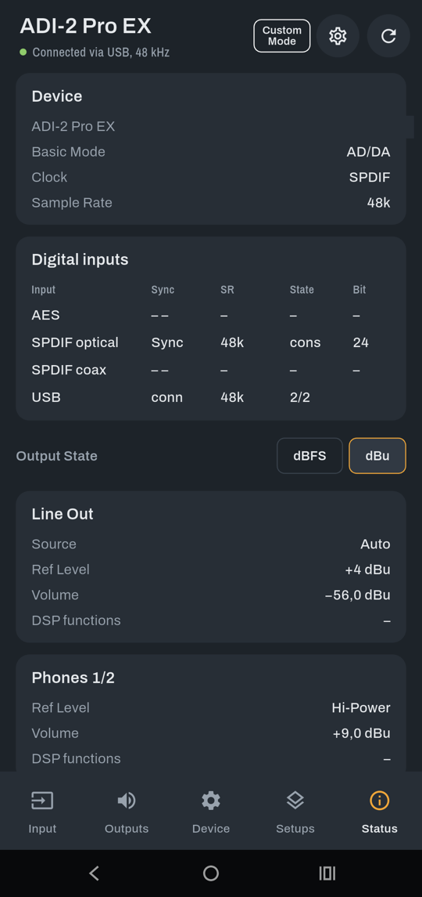 | 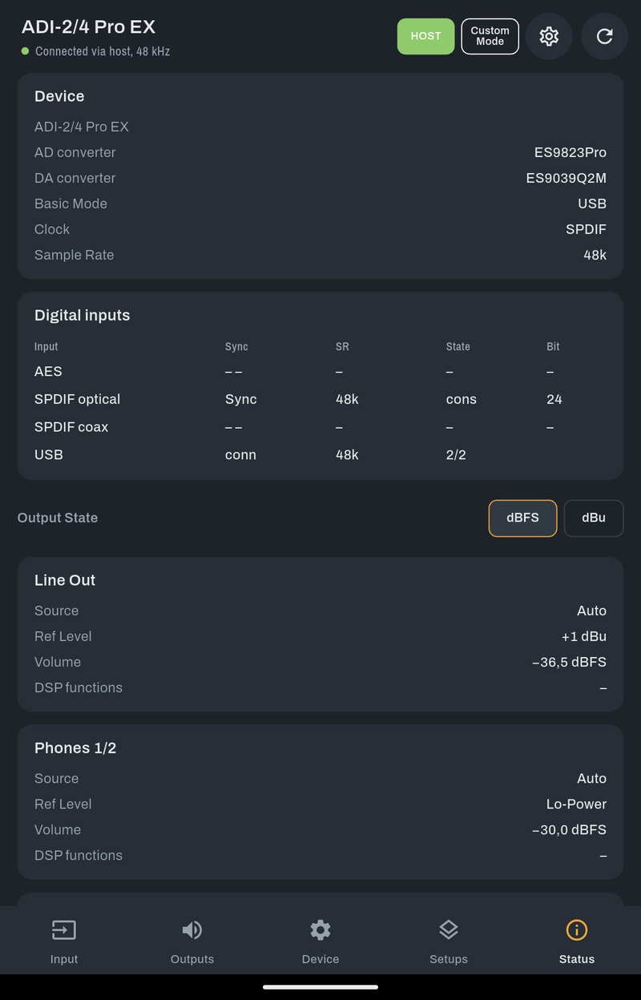 |

### Statusangaben einordnen

Die Tabelle **Digitale Eingänge** hilft beim Eingrenzen eines fehlenden Signals.

| Anzeige | Bedeutung |
| --- | --- |
| Sync | Der Digitaleingang ist erkannt und synchron zum Gerätetakt. |
| Lock | Ein Digitalsignal ist erkannt, aber nicht als synchron gemeldet. Clock-Quelle und gegebenenfalls SRC prüfen. |
| – – / – | Keine entsprechenden Daten für diesen Eingang gemeldet. Bei SPDIF wird nur der gewählte optische oder koaxiale Zweig mit Daten angezeigt. |
| SR / Bit | Gemeldete Sample Rate und Wortbreite des Digitaleingangs. |
| pro / cons / DSD | Gemeldetes professionelles/Consumer-Format bzw. DSD. **Non-Audio** kennzeichnet ein als Nicht-Audio gemeldetes Signal; **Emphasis** eine entsprechende Kennung. |
| USB conn | Die App zeigt eine bestehende Geräteverbindung an. Die USB-Zeile ersetzt keine Erkennung des tatsächlichen Stereo-/Mehrkanal-CC-Mode. |
| Output State | Quelle, Ref Level, Lautstärke sowie Kennzeichnungen für Mute, Lock, Dim und aktive DSP-Funktionen je Ausgang. |

Die gewählte Basic-Mode-Einstellung kann **Auto** heißen, während Status die daraus tatsächlich gewählte Betriebsart meldet. Ein dBu-Wert unter Output State ist aus Gerätewerten berechnet; er zeigt keinen aufgenommenen Musikpegel. Für eine echte Audioanzeige öffnen Sie den Analyzer.

## ADI-2 DAC

Dieses Kapitel erklärt die Abweichungen der DAC-Oberfläche von den Pro-Modellen.

Der ADI-2 DAC hat keinen Analogeingang, deshalb fehlt die Seite Eingang. Seine Ausgänge sind Line Out, Phones und IEM. Line Out zeigt RCA- und XLR-Werte getrennt.

| DAC: Ausgänge | DAC: Gerät |
| --- | --- |
| 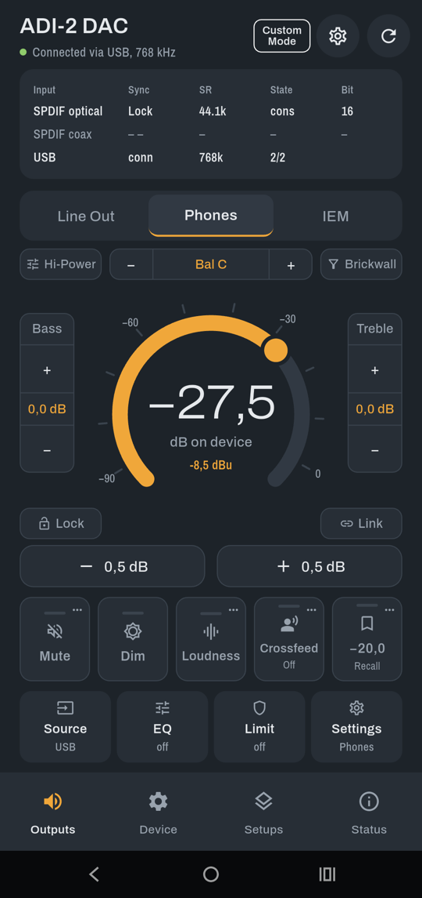 | 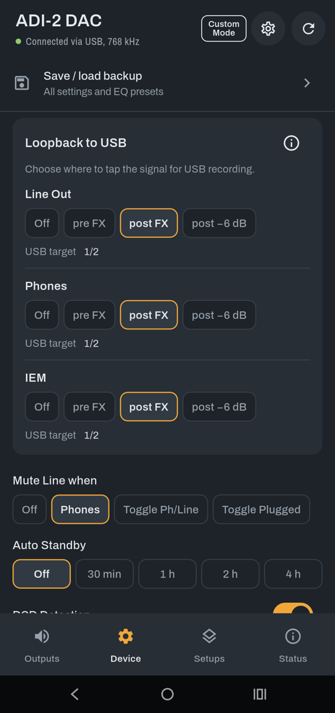 |

| DAC: Setups | DAC: Status |
| --- | --- |
| 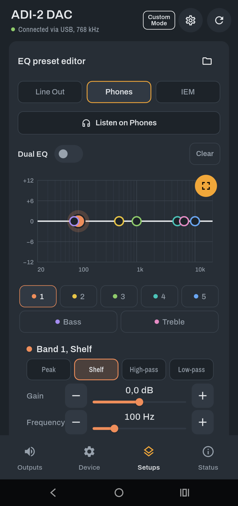 | 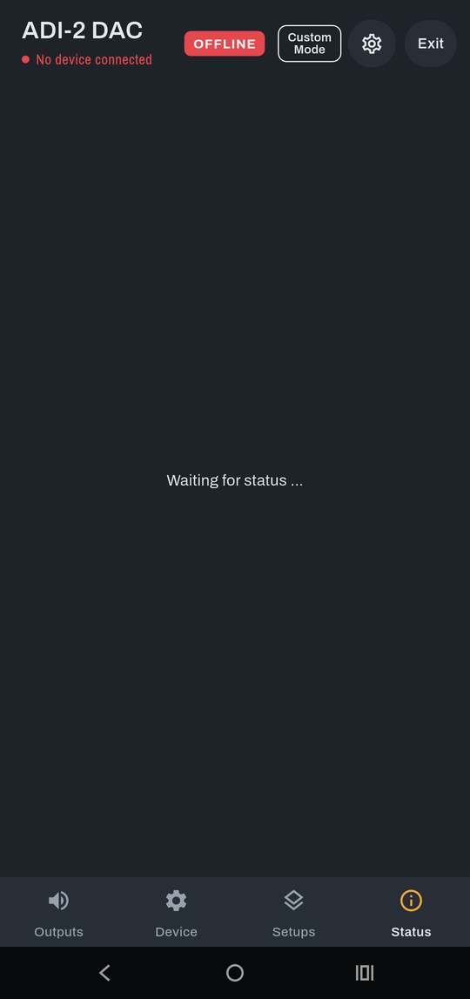 |

Bei **Quelle** stehen **Auto**, **SPDIF coax**, **Optical**, **USB**, **USB (Rec coax)** und **USB (Rec opt.)** zur Verfügung. Die letzten beiden wählen USB-Wiedergabe mit dem jeweils angegebenen Digitaleingang für die USB-Aufnahme. Loopback kann diese Aufnahme auf 1/2 wiederum ersetzen.

Der IEM-Ausgang hat in der App einen festen Referenzpegel von −3 dBu. Am Line-Ausgang liegen die angezeigten XLR-Referenzwerte 6 dB über RCA. **Line stumm bei** steuert das Verhalten beim Einstecken von Kopfhörern. Mit **Automatisch zum aktiven Ausgang wechseln** kann die App-Ausgangsauswahl der vom DAC gemeldeten aktiven Buchse folgen. Die Pro-Basic-Modes und deren Direktkacheln werden beim DAC nicht angeboten. Für diesen Teststand gelten weiterhin die Einschränkungen am Anfang des Handbuchs.

## Eigene Ansicht (Custom Mode)

Hier bauen Sie ein eigenes Bedienfeld mit den Reglern und Direktaktionen, die Sie häufig brauchen.

**Eigene Ansicht** in der Kopfzeile schaltet auf das gespeicherte Kachellayout um. Die normalen Navigationsseiten bleiben erreichbar. Zum Einrichten **App-Einstellungen → Eigene Ansicht einrichten → Bearbeiten** öffnen. Zuerst ein Gerät anschließen oder offline ein Modell wählen.

| Smartphone: Eigene Ansicht | Tablet: Eigene Ansicht, Hochformat |
| --- | --- |
| 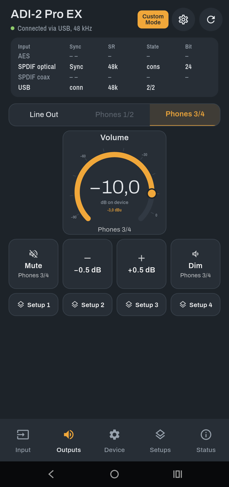 | 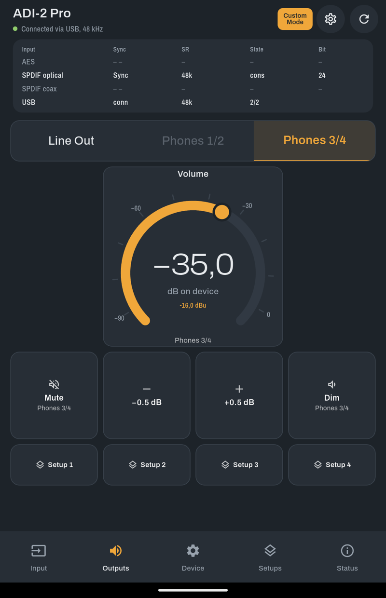 |

| Editor der eigenen Ansicht |
| --- |
| 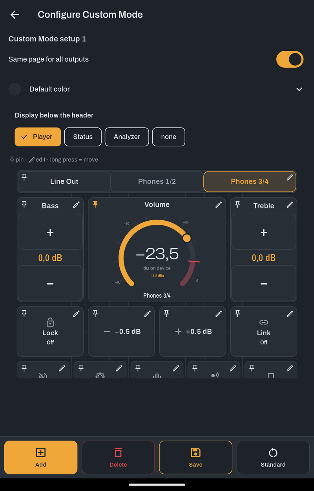 |

Es gibt vier Layout-Slots je Modellvariante. ADI-2 Pro und ADI-2 Pro EX teilen diese Slots. Eine Slot-Vorschau in den App-Einstellungen antippen und die Aktivierung bestätigen. Leere Slots verwenden bis zur ersten Bearbeitung das Standardlayout. Im Editor speichert **Speichern** das aktuelle Layout mit optionalem Namen in einen gewählten Slot. **Löschen** entfernt Kacheln und Namen; der Slot ist danach frei und zeigt das Standardlayout. **Standard** ersetzt die Kacheln durch das Standardlayout, der Name bleibt erhalten. Beide Aktionen fragen vorher nach.

Mit **Hinzufügen** Ring, Lautstärkeschritte, Ausgangswahl, Klang-/Ausgangsregler oder Direkt-Knöpfe einfügen. Direkt-Knöpfe können Geräte-Setups, EQ-Presets, eine bestimmte Quelle, einen Basic Mode oder eine Lautstärke abrufen, Ausgänge umschalten oder ein App-EQ-Preset anwenden. Ein Bibliotheks-Preset wird als Kopie in der Kachel gespeichert; spätere Bibliotheksänderungen aktualisieren diese Kopie nicht automatisch. Je nach Kachel kann das Ziel **Gewählter Ausgang** oder ein fester Ausgang sein.

Über das Bearbeitungssymbol Beschriftung, Kachelfarbe, Ziel und Größe ändern. Die Breitenauswahl bietet je nach Größenregeln des Kacheltyps Bruchteile von einem Fünftel bis zur vollen Breite. Höhen sind in halben Zeilen bis zu zwei Zeilen möglich, ebenfalls abhängig vom Kacheltyp. Für weitere Breiten seitlich wischen. Im Editor eine Kachel lange drücken und auf dem Raster verschieben. Fixieren hält ihre Rasterposition fest. Bei Kollisionen können fixierte Kacheln mit Hinweis an die nächste freie Position rücken. Eine **Standardfarbe** wählen oder einzelne Kachelfarben überschreiben.

**Für alle Ausgänge gleich** verwendet eine gemeinsame Seite. Für getrennte Ausgangsseiten ausschalten. Im Editor den Ausgang wählen oder zwischen Ausgangsseiten wischen. **Auf andere Ausgänge kopieren …** überschreibt nach Bestätigung die gewählten Zielseiten. Jede Seite hat ihre eigene **Anzeige unter der Kopfzeile**.

Außerhalb des Editors öffnet langes Drücken die passenden Details, etwa Loudness-Parameter, Crossfeed-Stärke, Recall-Verwaltung, Ausgangsoptionen oder den Basic-Mode-Signalplan. Gedrückt halten der Lautstärketasten wiederholt die Änderung und öffnet kein Menü. Eine gehaltene Geräte-Setup-Kachel bietet Laden, Speichern des aktuellen Zustands und Umbenennen. Lautstärkerampen, Grenzen und Gerätesperren gelten weiter.

### Welche Kacheln gibt es?

Der Katalog **Hinzufügen** gruppiert die verfügbaren Funktionen. Das Ziel **Gewählter Ausgang** folgt Ihrer Ausgangswahl; ein fest eingestellter Ausgang bleibt auch bei einem Seitenwechsel das Ziel dieser Kachel.

| Kacheln | Bedienung im fertigen Layout |
| --- | --- |
| Lautstärke, −0,5 dB, +0,5 dB | Ring ziehen bzw. schrittweise regeln; gehaltene Schritttasten wiederholen. |
| Ausgangswahl | Wählt den in der App bedienten Ausgang. Gedrückt halten öffnet bei Pro-Modellen die Kopfhörer-Konfiguration. |
| Mute, Dim, Loudness, Crossfeed | Schalten die entsprechende Funktion. Langes Drücken öffnet Details bzw. bei Dim die Erklärung. |
| Recall, Link, Lock | Merken/abrufen, koppeln oder Lautstärke sperren. Langes Drücken öffnet die zugehörige Verwaltung bzw. Parameteransicht. |
| Bass, Treble, Bal | Werte mit Minus/Plus ändern; langes Drücken öffnet Details. Anders als in der Standardansicht öffnet langes Drücken auf Bal hier den Balanceregler. |
| Ref Level, DA-Filter, Quelle | Wählen einen Parameterwert; je nach Kachelgröße als Auswahlsegmente oder über einen Dialog. Langes Drücken öffnet die passende Auswahl. |
| EQ an/aus, EQ-Seite öffnen | EQ schalten bzw. den Live-Editor öffnen. Beide führen bei langem Drücken zum Live-EQ. |
| Limit, Settings | Öffnen den Lautstärkeschutz bzw. die Ausgangseinstellungen, auch bei langem Drücken. |
| Setup laden | Ruft das konfigurierte Geräte-Setup 1–9 ab. Gedrückt halten bietet Laden, Speichern der aktuellen Einstellungen und Umbenennen. |
| EQ-Preset laden | Wählt ein Geräte-EQ-Preset 1–20 für das Ziel. Gedrückt halten öffnet dessen Live-EQ-Seite. |
| Quelle direkt wählen | Setzt die in der Kachel gespeicherte Quelle für das Ziel. Keine zusätzliche Langdruckaktion. |
| Ausgänge umschalten | Löst die Geräte-Umschaltaktion gemäß dessen Toggle-/Mute-Konfiguration aus. Gedrückt halten öffnet **Mute und Umschalten**. |
| Basic Mode wählen | Setzt den gespeicherten Modus bei Pro-Modellen. Gedrückt halten öffnet den Signalplan. |
| Lautstärke auf X dB | Fordert den gespeicherten Lautstärkewert von −114,5 bis +6 dB für das Ziel an. Anhebungen nutzen die Rampe und das Limit. Keine zusätzliche Langdruckaktion. |
| App-EQ-Preset | Wendet die gespeicherte Kopie eines Bibliotheks-EQs einschließlich Dual EQ am Ziel an, ohne einen Geräteslot zu überschreiben. Prüfen Sie EQ an/aus am Ziel. Keine zusätzliche Langdruckaktion. |

**Vorsicht:** Ein kurzer Druck auf eine Direktkachel führt ihre Aktion sofort aus. Eine Setup-Kachel kann damit auch im Setup gespeicherte Lautstärken laden, wenn **Lautstärke mit Setup laden** eingeschaltet ist. Prüfen Sie Quelle, Ziel und diese Geräteoption vor dem Einsatz.

### Raster und Speichern verstehen

Die Vorschau im Editor dient dem Einrichten: Antippen bearbeitet die Kachel, langes Drücken und Ziehen verschiebt sie. Mit dem Pin-Symbol fixieren oder lösen Sie ihre Position; das Bearbeitungssymbol öffnet Größe, Beschriftung, Farbe, Ziel und gegebenenfalls den direkten Aktionswert. **Entfernen** löscht nur die Kachel.

Die Breite ist ein Anteil des ganzen Bedienfelds, keine feste Pixelzahl. Als Größenmaß gilt **Quadrat = ¼ Breite · Höhe 1**; Höhe 0,5 ist halb so hoch, Höhe 2 doppelt so hoch. Der Ring braucht mindestens halbe Breite. Seine Höhe folgt der Breite, damit er beim Breiterziehen auch größer wird: halbe Breite ergibt Höhe 2, ¾ Höhe 3, volle Breite Höhe 4. Nicht verfügbare Kombinationen sind deaktiviert. Freie Kacheln werden im verfügbaren Raster angeordnet; das Pin-Symbol reserviert eine Position. Bei Größenänderungen kann die App kollidierende fixierte Kacheln versetzen und meldet das.

Bearbeitungen werden im aktiven Modell-/Layout-Slot gespeichert. **Speichern** legt den aktuellen Gesamtentwurf im gewählten Layout-Slot mit optionalem Namen ab; dies ist keine Gerätespeicherung. Wenn Sie ein bestehendes Layout behalten möchten, sichern Sie es vor dem Umbauen in einem anderen Slot. Eine gemeinsame Seite kann später wieder in Ausgangsseiten aufgeteilt werden; bereits angelegte getrennte Seiten bleiben beim vorübergehenden Wechsel zur gemeinsamen Seite erhalten.

### Beispiel: ein Kopfhörer-Bedienfeld bauen

So richten Sie eine Seite für einen Kopfhörerausgang ein:

1. Verbinden Sie das Gerät oder wählen Sie dessen Offline-Modell. Öffnen Sie **App → Eigene Ansicht einrichten → Bearbeiten**. Sichern Sie bei Bedarf das vorhandene Layout mit **Speichern** in einem anderen Slot.
2. Schalten Sie **Für alle Ausgänge gleich** aus und wählen Sie den gewünschten Kopfhörerausgang. Die Seite beginnt mit einer Kopie der gemeinsamen Seite, sofern für diesen Ausgang noch keine eigene existiert.
3. Behalten oder ergänzen Sie über **Hinzufügen** einen Lautstärkering mit halber Breite und Höhe 2. Entfernen Sie nicht benötigte Kacheln über deren Bearbeitungsdialog.
4. Fügen Sie **Mute**, **Recall** und **EQ-Seite öffnen** hinzu. Stellen Sie als Ziel **Gewählter Ausgang** ein, damit die Regler beim Wechsel auf eine andere Ausgangsseite deren Ausgang bedienen. Für eine ständig erreichbare Line-Stummschaltung könnten Sie dagegen eine eigene Mute-Kachel fest auf Line Out richten.
5. Ziehen Sie die Kacheln an passende Plätze und fixieren Sie wichtige Positionen. Wählen Sie eine **Standardfarbe** und unter **Anzeige unter der Kopfzeile** z. B. **Status**.
6. Nutzen Sie **Speichern**, wählen Sie einen der vier Layout-Slots und vergeben Sie optional einen Namen. Verlassen Sie den Editor und aktivieren Sie bei Bedarf die entsprechende Slot-Vorschau in den App-Einstellungen.
7. Wechseln Sie über **Eigene Ansicht** zum fertigen Bedienfeld. Prüfen Sie zuerst bei niedriger Lautstärke, ob jede Kachel den vorgesehenen Ausgang bedient. Für ähnliche Seiten nutzen Sie **Auf andere Ausgänge kopieren …**; die ausgewählten Zielseiten werden dabei überschrieben.

## Analyzer

Der Analyzer macht das aufgenommene USB-Audiosignal als Spektrum sowie als Peak- und RMS-Pegel sichtbar.

Unter **Anzeige unter der Kopfzeile** den **Analyzer** wählen oder am Tablet im Querformat den **Zusatzbereich** verwenden. Die Aufnahmeberechtigung auf Nachfrage erteilen. Die App analysiert USB-Audio bei sichtbarem Analyzer. Auf Android muss die App dabei im Vordergrund sein. Am Mac läuft der Analyzer auch in einem sichtbaren Fenster ohne Fokus weiter. Die Aufnahme stoppt, wenn der Analyzer verborgen wird oder eine andere Seite darüber liegt. Die App speichert das Audio nicht und verwendet kein Smartphone-Mikrofon.

**macOS:** Das ADI-2 direkt per USB am Mac anschließen und die Mikrofonberechtigung für die App erteilen. Der Analyzer wählt das ADI-2 ausdrücklich als Eingang; ohne dieses Gerät erfolgt keine Aufnahme. Bei mehreren passenden ADI-2-Eingängen startet die Aufnahme ebenfalls nicht, weil die Gerätewahl dann nicht eindeutig ist. Die Standard-Audiogeräte des Macs bleiben unverändert. Die gemeinsame Dart-Signalverarbeitung liefert dieselben Bandauflösungen und Anzeigen wie iOS. Es gibt keine Audiodateien und kein Mithören. Der Mac-Analyzer ist noch nicht auf echter Hardware geprüft.

### Plattformen und Grenzen

Auf **Android** verarbeitet die App USB-Audio und prüft die Aufnahmeroute. Eine Meldung über das Smartphone-Mikrofon oder ein anderes Aufnahmegerät bedeutet, dass keine gültige ADI-2-Aufnahme vorliegt; solche Werte nicht zum Kalibrieren verwenden. Mit **Berechtigung erteilen** erlauben Sie den Zugriff, mit **Erneut versuchen** starten Sie nach Beheben einer Unterbrechung neu.

Am Mac ist der Analyzer auf echter Hardware noch nicht bestätigt.

### Quelle und Loopback

Aufgenommen wird **USB 1/2**. Ist dort Loopback aktiv, zeigt der Analyzer den zugewiesenen Ausgang; andernfalls können Modelle mit Eingang den Analogeingang zeigen. Die Informationszeile nennt Route und Aufnahme-Sample-Rate. In den Quellen-/Loopback-Reglern **Automatisch (aktiver Ausgang)** oder einen bestimmten Ausgang wählen. **Abgriff** bietet **Aus**, **pre FX**, **post FX** und **post −6 dB**. Loopback auf USB 1/2 ersetzt dort die Aufnahme des Analogeingangs und erfordert beim ersten Verwenden eine Bestätigung. Konkurrierende Ausgangs-Loopbacks auf USB 1/2 werden deaktiviert; Routen auf anderen Paaren bleiben erhalten. Beim DAC folgt Automatisch dem vom Gerät gemeldeten aktiven Ausgang, bei Pro-Modellen dem in der App gewählten Ausgang. Bei sichtbarem Analyzer folgt eine bestätigte automatische Route einem Ausgangswechsel nach etwa einer Sekunde. Bloßes erneutes Öffnen des Analyzers überschreibt keine bestehende Route.

Für den Vergleich mit dem Gerät **post FX** verwenden: nach EQ/Effekten und vor Volume. Loudness bleibt lautstärkeabhängig. pre FX liegt vor diesen Effekten; post −6 dB senkt die USB-Werte um 6 dB. Die Post-Pegelmesser am Gerät liegen nach Volume und messen deshalb an einer anderen Stelle.

### Anzeige und Messwerte

- **Linien** und **Balken** bestimmen die Spektrumsdarstellung. Die Frequenzachse reicht von 20 Hz bis 20 kHz; die Balken decken 25 Hz–20 kHz ab. **Bandauflösung** bietet **1/3 Oktave**, **1/6 Oktave** und **1/12 Oktave**. Zum Vergleich mit dem Gerät Balken und 1/3 Oktave verwenden.
- **Peak hold** hält Spitzenanzeigen fest. **Ballistik** bietet **schnell**, **mittel** und **langsam**. Linien/Balken, Peak hold und Ballistik bleiben beim Drehen und nach einem Neustart der App erhalten.
- **Pegelbereich** wählt 60, 80 oder 100 dB vertikalen Bereich.
- **Analyzer-Farbe** bietet **Wie Gerät**, **Grün**, **Cyan**, **Amber**, **Mono**, **Rot** und **Orange**.
- **Peak / RMS · dBFS** zeigt die aufgenommenen L-/R-Audiopegel einschließlich gespeichertem Kalibrier-Offset. Ein voll ausgesteuerter Sinus hat 0 dBFS Peak und etwa −3 dBFS RMS. Übersteuerung wird gesondert angezeigt. Spektrumsbänder beziehen einen voll ausgesteuerten Sinus bei Bandmitte auf 0 dB. Filter und Ballistik können vom Gerät abweichen; dessen tiefstes Band erfasst auch Gleichanteile.

**Analyzer-Einstellungen** öffnet diese Optionen und die Kalibrierung. Im Vollbild blendet **Nur Spektrum** die Bedienleiste aus; **Bedienleiste anzeigen** holt sie zurück. Die folgenden Vollbildaufnahmen zeigen Querformat. Am Tablet behält das Vollbild die aktuelle Ausrichtung.

| Smartphone: Linien, kompakt | Smartphone: Balken, kompakt |
| --- | --- |
|  | 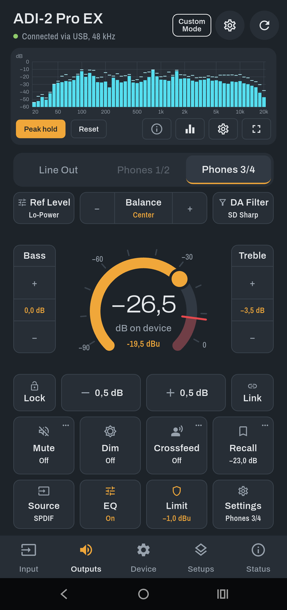 |

| Tablet: Linien, Hochformat | Tablet: Balken, Hochformat |
| --- | --- |
| 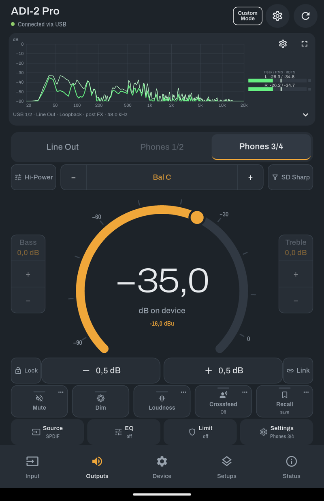 | 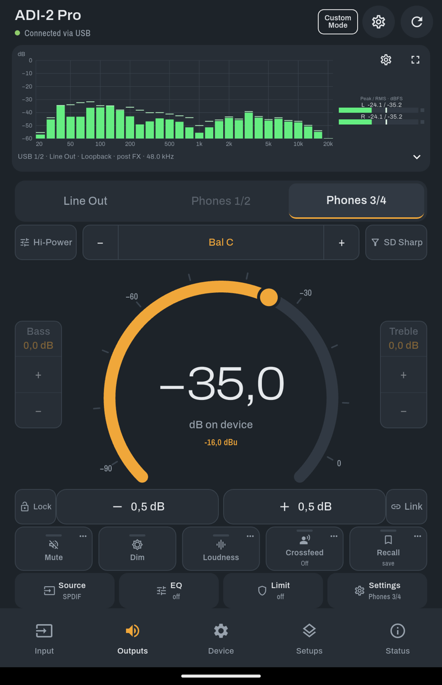 |

| Tablet: Analyzer-Einstellungen | Smartphone: Linien, Vollbild im Querformat |
| --- | --- |
| 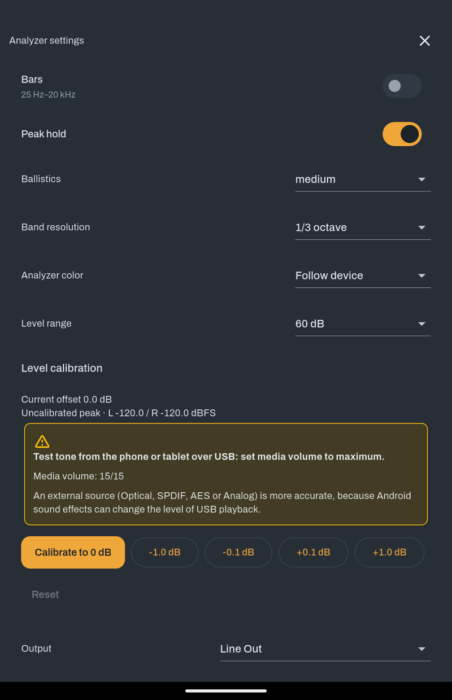 | 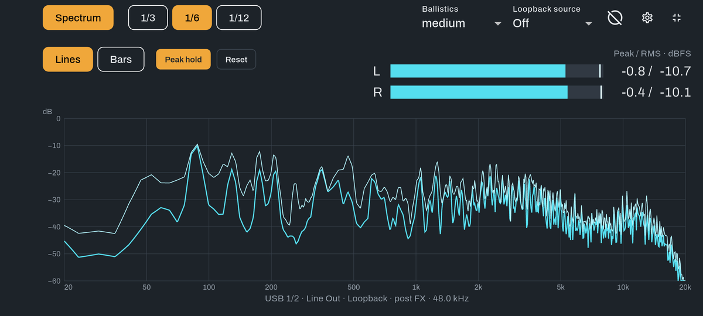 |

| Smartphone: Balken, Vollbild im Querformat | Tablet: Linien, Vollbild im Querformat |
| --- | --- |
| 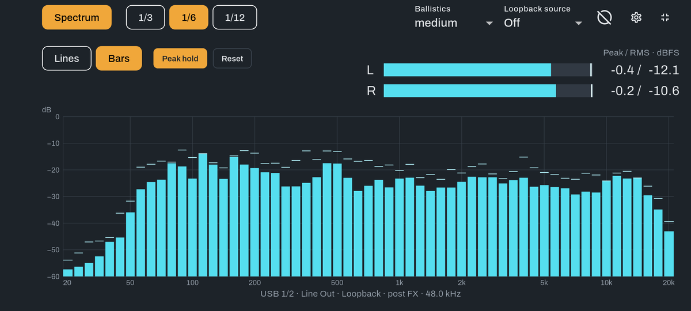 | 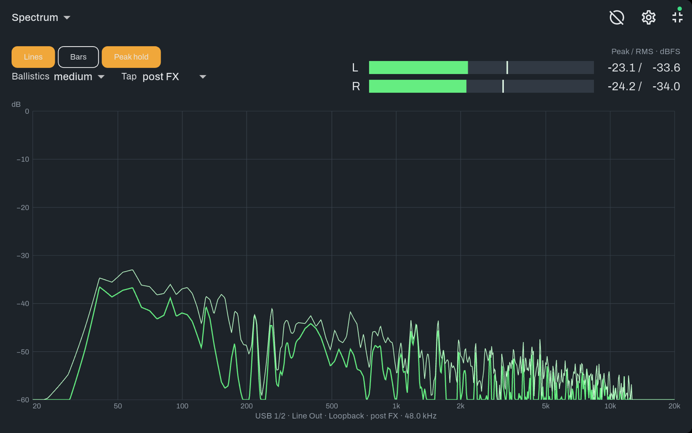 |

| Tablet: Balken, Vollbild im Querformat |
| --- |
| 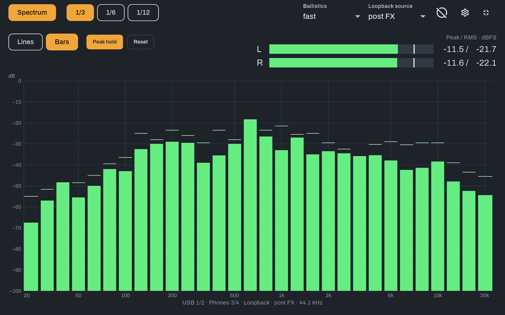 |

### Ein Spektrum sinnvoll beurteilen

Links liegen tiefe, rechts hohe Frequenzen; ein höherer Ausschlag bedeutet mehr Pegel in diesem Bereich. **Linien** zeigen einen kontinuierlicheren Spektrumsverlauf, **Balken** fassen Energie in Frequenzbändern zusammen. Eine feinere **Bandauflösung** teilt einen Frequenzbereich in mehr, schmalere Bänder; Werte unterschiedlicher Bandbreite sind daher nicht unmittelbar gleichzusetzen.

**Peak** beschreibt Spitzenwerte, **RMS** einen gemittelten Effektivpegel. Eine Musikquelle kann bei gleichem Peak einen anderen RMS-Wert haben. **Peak hold** hält die Spektrumspitzen kurz fest: nach etwa einer Sekunde fallen die Markierungen wieder ab. **Ballistik** beeinflusst, wie schnell die Spektrumsanzeige zurückfällt; **langsam** erleichtert das Beobachten, **schnell** folgt Änderungen rascher. **Pegelbereich** vergrößert oder verkleinert nur den sichtbaren dB-Ausschnitt, nicht die Aufnahmeverstärkung.

Tippen Sie auf den kompakten Analyzer oder **Vollbild**, um ihn zu vergrößern. Die Informationszeile lässt sich bei verkürzter Anzeige aufklappen. **Nur Spektrum** verbirgt die Bedienleiste; Antippen der Fläche oder **Bedienleiste anzeigen** holt sie zurück. Diese Anzeigeaktionen ändern keine Geräte-EQs.

**Hinweis:** Ein Kalibrier-Offset verschiebt die Pegelanzeige, verbessert aber weder die Frequenzauflösung noch einen durch Android-Effekte veränderten Frequenzgang. Ein Unterschied zum Gerätemeter ist nicht automatisch ein Fehler: erst Abgriff, Darstellung, Bandauflösung und Kalibrierung angleichen.

### Pegelkalibrierung: warum und wie

Bei USB-Aufnahme kann ein geräteabhängiger Pegelversatz entstehen. Android-Klangeffekte können außerdem Pegel und Frequenzgang des vom Smartphone über USB abgespielten Audios verändern. Die App kann sie nicht abschalten; manche Geräte verarbeiten USB-Audio selbst dann weiter, wenn ein Effekt ausgeschaltet erscheint. Ein einzelner Kalibrier-Offset korrigiert Pegel, aber keine frequenzabhängige Verfärbung.

Für eine noch unbeantwortete Gerätekombination schlägt die App selbst **Analyzer kalibrieren?** vor. Die Antwort wird gespeichert. Später erreichen Sie die Kalibrierung jederzeit manuell über die Analyzer-Einstellungen.

1. Vor einem voll ausgesteuerten Testsignal alle Hörausgänge **stummschalten**. Wenn verfügbar, eine externe Quelle über Optical, SPDIF, AES oder Analog verwenden, um die Wiedergabeverarbeitung des Smartphones zu umgehen.
2. Aktive ADI-2-USB-Aufnahme starten. Den gemessenen Ausgang mit **Loopback zu USB** und **post FX** auf USB 1/2 legen und das auf der Seite Gerät prüfen. Den **DA-Filter** auf **SD Sharp** stellen, die für diese Kalibrierung verlangte Filtereinstellung, und EQ sowie alle Effekte im Messweg ausschalten.
3. Einen stabilen Sinus mit 0 dBFS gleich auf L und R einspeisen. Kommt er von Android über USB, die Android-Medienlautstärke auf Maximum stellen. Bei externer Quelle hat diese Lautstärkeeinstellung keinen Einfluss. Bei USB-Wiedergabe ausdrücklich **USB Playback 1/2** verwenden. Bei Pro-Modellen am gemessenen Ausgang **USB 1/2** wählen. Die Quellenangabe USB allein genügt im Mehrkanalbetrieb nicht.
4. **Analyzer-Einstellungen → Pegelkalibrierung → Auf 0 dB kalibrieren → Messung starten** öffnen. Die App misst die unkalibrierten Spitzen etwa zwei Sekunden.
5. Den vorgeschlagenen Offset prüfen und speichern. Er gehört zur angezeigten Gerätekombination. Manuelle Tasten für ±1,0 und ±0,1 dB ändern ihn; **Zurücksetzen** setzt ihn nach Bestätigung auf 0 dB.

Beide Kanäle müssen über −60 dBFS liegen, dürfen höchstens 1 dB voneinander abweichen und müssen je Kanal innerhalb ±0,5 dB stabil bleiben. Offsets außerhalb −40 bis +40 dB oder eine zu kurze/unterbrochene Aufnahme werden ohne Speichern abgewiesen. Nach Änderungen am Quellweg oder an Android-Effekten die Kalibrierung erneut prüfen. Den Testton beenden, bevor die Hörlautstärke wiederhergestellt wird.

Für den **eingebauten Testton (Android und macOS)** im Dialog **Auf 0 dB kalibrieren** die Option **Testton der App verwenden** einschalten. Die App spielt 1 kHz mit 0 dBFS während der Messung über USB-Wiedergabe 1/2 ab, höchstens 3,6 Sekunden lang. Automatisch geprüft werden Verbindung, Stummschaltung aller Ausgänge, USB-Quelle des gemessenen Ausgangs, Loopback post FX auf USB 1/2 ohne widersprechende Route, SD Sharp sowie ausgeschalteter EQ, Loudness und Crossfeed. Bass/Treble blockiert nur bei aktiver Bearbeitung und Bass- oder Treble-Gain ungleich null. Auf Android muss die Medienlautstärke verfügbar und auf Maximum sein. Vor dem Start und während der Ausgabe werden frische Mute- und Lautstärkewerte jedes Ausgangs angefordert. **Alle Ausgänge stummschalten** erledigt das Stummschalten. Die manuellen Vorbereitungen in der Checkliste bleiben erforderlich. Am ADI-2/4 Pro EX ist die Kalibrierung mit dem eingebauten Testton noch nicht bestätigt.

Auf macOS wird ausschließlich das aufnehmende ADI-2 ausdrücklich als Ausgabegerät gewählt und die Route vor dem hörbaren Teil sowie während der Ausgabe geprüft. Bei Trennung oder einer ungültigen Route stoppt der Ton; er wechselt nicht auf die Mac-Lautsprecher. Der feste Puffer enthält 250 ms Stille am Anfang und 20 ms Ein-/Ausblenden und endet auch ohne Antwort der App von selbst. Nur die Bedingung zur Android-Medienlautstärke entfällt auf macOS; alle anderen Checklistenpunkte und die frische Bestätigung der Gerätewerte bleiben erforderlich. Die Kalibrierung wird getrennt nach Mac, USB-Modell und verfügbarer Seriennummer gespeichert. Der Mac-Testton ist nur bei Geräte-Sample-Raten von **44,1–192 kHz** verfügbar. Nach dem Ton bleiben die Ausgänge stumm. Jeder Ausgang über −30 dB wird abgesenkt. Erst zwei aufeinanderfolgende Abfragen mit frischen Mute- und Lautstärkewerten jedes Ausgangs und bestätigten Lautstärken von höchstens −30 dB schließen die Prüfung ab. Ohne ausreichende Gerätebestätigung bleibt der Testton gesperrt bzw. wird abgebrochen. Die Ausgänge bleiben stumm. Lautstärke am Gerät prüfen.

**Hinweis:** Ohne Testton der App benötigen Sie einen extern erzeugten, bekannten Vollpegelsinus. Erkennt die App bei USB-Wiedergabe eine zu niedrige Android-Medienlautstärke, zeigt sie **Trotzdem kalibrieren** zur ausdrücklichen Bestätigung. Damit würde auch diese Absenkung in den Offset eingehen; für den beschriebenen Referenzabgleich Medienlautstärke zuerst auf Maximum stellen. Beim eingebauten Testton lässt sich diese Bedingung nicht übergehen. Ist **Messung starten** nicht verfügbar, die angezeigten Bedingungen und die aktuelle Aufnahmeroute prüfen. Nach einem Wechsel der Gerätekombination wird ein alter Offset nicht als allgemeiner Korrekturwert übernommen.

### Checkliste für die Kalibrierung

Manuell vor beiden Messwegen vorbereiten

- [ ] Alle Ausgänge sind stummgeschaltet.
- [ ] Die **Quelle** des gemessenen Ausgangs passt zum Signalweg. Für USB-Töne **USB Playback 1/2** verwenden und bei Pro-Modellen die Ausgangsquelle **USB 1/2** wählen. Für eine externe Quelle deren tatsächlichen Eingang wählen.
- [ ] **Loopback zu USB** steht beim gemessenen Ausgang auf **post FX** und USB 1/2. Das auf der Seite Gerät prüfen.
- [ ] Der **DA-Filter** steht auf **SD Sharp**.
- [ ] EQ, Loudness und Crossfeed sind beim gemessenen Ausgang aus. Bass/Treble ausschalten oder beide Gains auf null stellen.
- [ ] Bei einem Ton über USB steht die Android-Medienlautstärke auf Maximum (auf macOS entfällt dieser Punkt).
- [ ] Einen früheren, nicht gemessenen Offset manuell zurücksetzen. Die App prüft das nicht als Startbedingung.

Für ein extern erzeugtes Signal

- [ ] Den bekannten Vollpegelsinus auf L und R starten und den stabilen Pegel im Analyzer manuell prüfen.

Für den eingebauten Ton

- [ ] Kein weiteres Testsignal einspeisen. USB-Wiedergabe 1/2 vorbereiten und die Testton-Option einschalten.
- [ ] Die automatisch angezeigten Startbedingungen erfüllen. Ein stabiler Pegel wird erst während der Messung bewertet.
- [ ] Am Mac liegt die Geräte-Sample-Rate zwischen 44,1 und 192 kHz.

Nach der Messung

- [ ] Der vorgeschlagene Offset ist plausibel und gespeichert.
- [ ] Der Testton ist beendet.
- [ ] Die Lautstärke ist gesenkt, bevor die Ausgänge wieder eingeschaltet werden.

### Regeln für die Kalibrierung

1. Nie einen voll ausgesteuerten Ton abspielen, solange ein Ausgang nicht stumm ist.
2. −120 dBFS bedeutet kein Signal. Dann den Signalweg korrigieren und nicht kalibrieren.
3. Nur Offsets aus einer echten Messung mit genau dieser Gerätekombination speichern.
4. Den echten Gerätezustand auf der Seite Gerät prüfen und nicht die gemerkte App-Auswahl.
5. Nach einer Änderung von Signalweg, ADI-2, Smartphone, Tablet oder Mac oder den Android-Effekten neu kalibrieren.

## Tablet-Ansichten

Hier nutzen Sie die größere Bildschirmfläche für parallele Bedienung und Anzeigen.

Im Hochformat bleiben die Navigation unten und größere Regler sowie Seiteninhalte erhalten. Der Analyzer bleibt eingebettet über Ausgänge. Sein Vollbildknopf öffnet ein Vollbild im Hochformat.

Im Querformat liegt die Navigation links. Ausgänge belegt die linke Inhaltsspalte; rechts schaltet **Zusatzbereich** zwischen **EQ**, **Analyzer**, **Status** und **Player** um. EQ folgt dem gewählten Ausgang. Die Analyzer-Route folgt ihrer automatischen oder festen Quellwahl. Die eigene Ansicht ist in der linken Spalte nutzbar. Eingang, Gerät, Setups und Status verwenden breitere Seitenlayouts. Im jeweiligen Inhalt scrollen, um weitere Regler zu erreichen.

| Ausgänge und EQ | Ausgänge und Status |
| --- | --- |
| 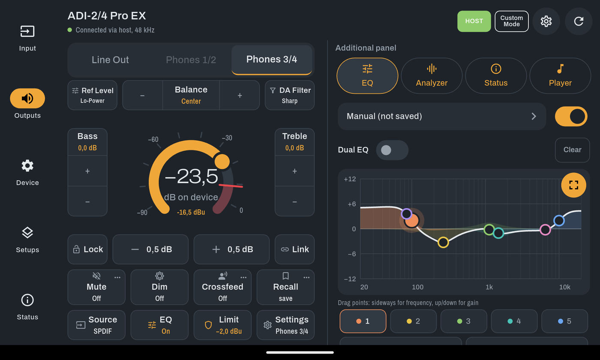 | 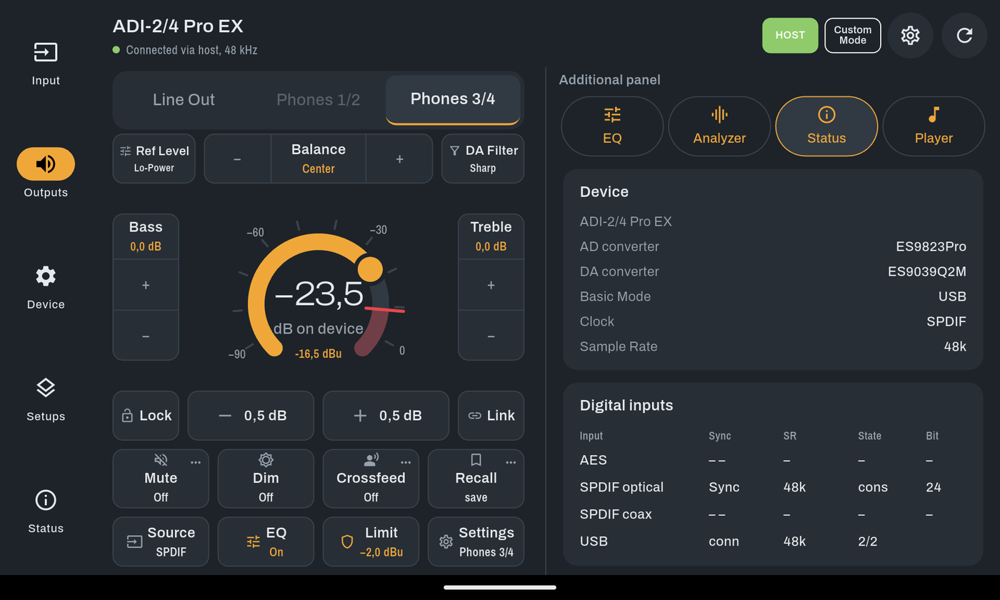 |

| Ausgänge und Analyzer-Linien | Ausgänge und Analyzer-Balken |
| --- | --- |
| 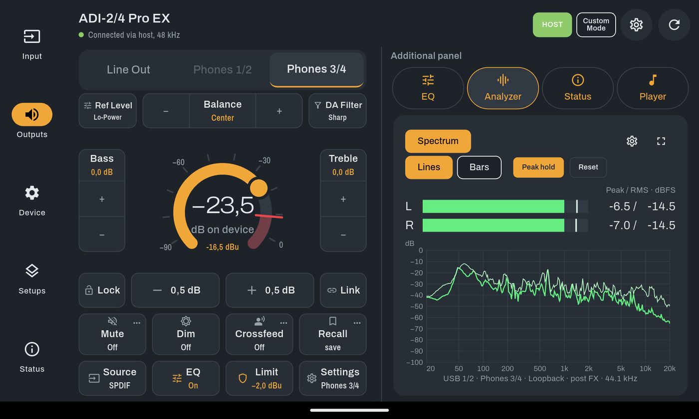 | 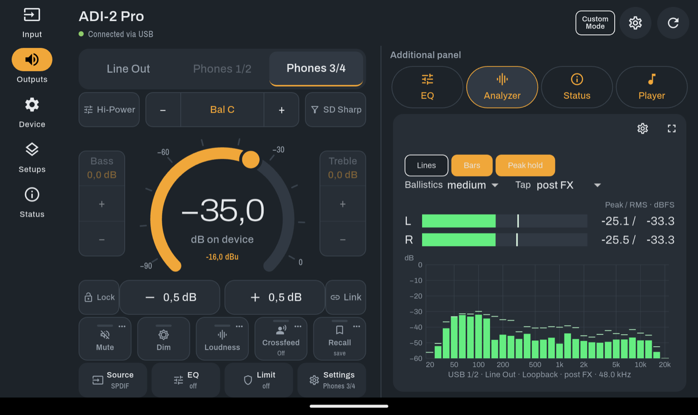 |

| Eigene Ansicht und Zusatzbereich | Eingang, Querformat |
| --- | --- |
| 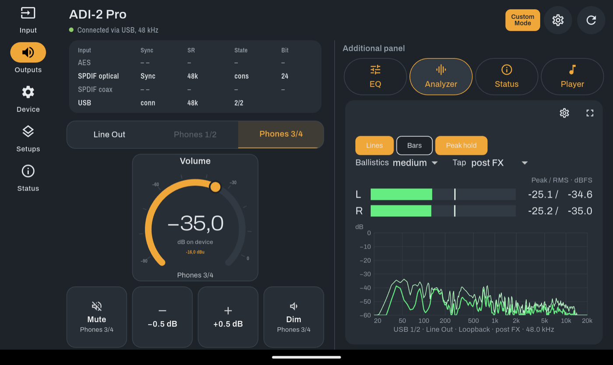 | 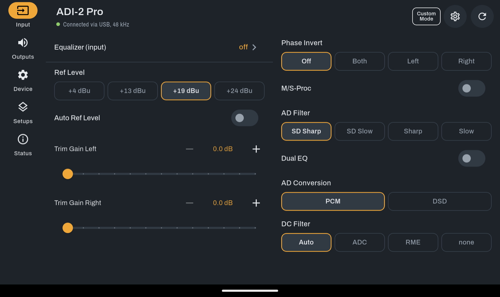 |

| Gerät, Querformat | Setups, Querformat |
| --- | --- |
| 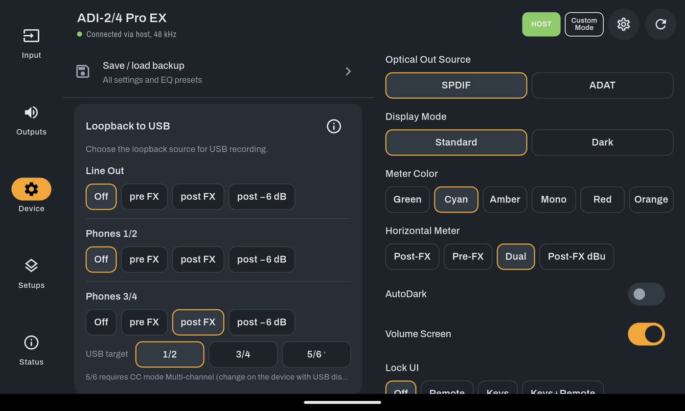 | 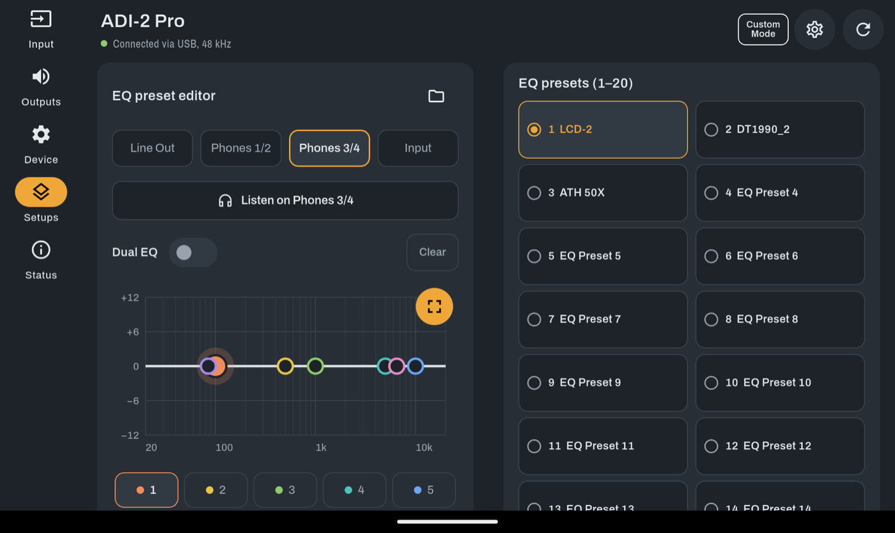 |

| Status, Querformat |
| --- |
| 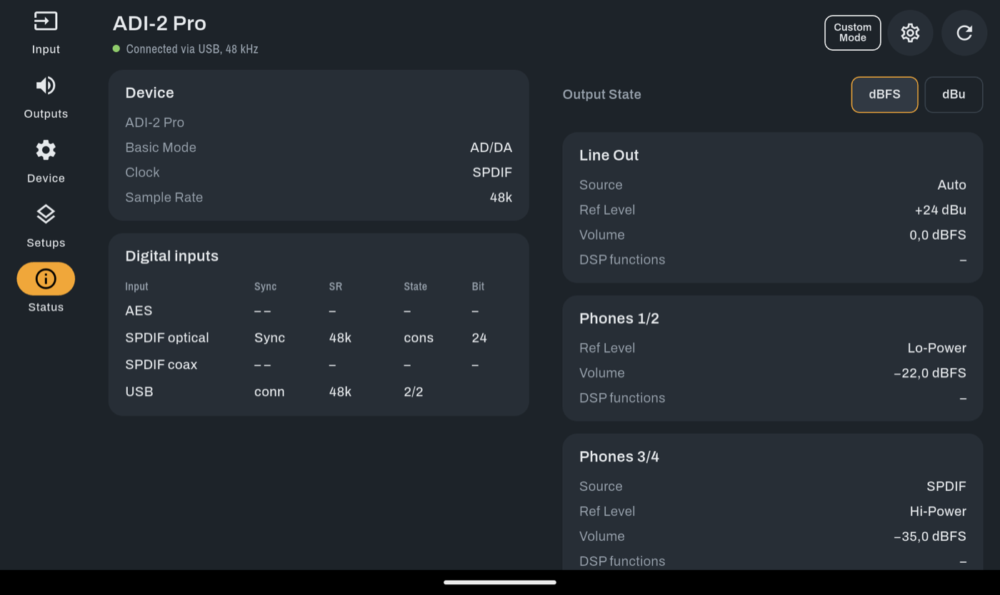 |

## App-Einstellungen

Hier passen Sie Sprache, Zusatzanzeigen und Bedienverhalten der App an.

Das Zahnrad (**App**) in der Kopfzeile öffnet **App-Einstellungen**:

- **Eigene Ansicht einrichten**, Editor und vier Slot-Vorschauen.
- **Sprache**: English oder Deutsch.
- **Anzeige unter der Kopfzeile**: Player, Status, Analyzer oder nichts.
- **Bandauflösung**, **Analyzer-Farbe** und **Pegelbereich**.
- **Automatisch zum aktiven Ausgang wechseln**: derzeit beim ADI-2 DAC, etwa beim Einstecken eines Kopfhörers.
- **EQ-Graph im Querformat automatisch im Vollbild**: am Smartphone für EQ-Graph und Analyzer, an Smartphone und Tablet für die Signalpläne der Basic Modes.
- **Über die App**, Version und **Marken und Rechtliches**, dort auch **Open-Source-Lizenzen**.

Das sind App-Voreinstellungen. Die Seite Gerät steuert den angeschlossenen ADI-2 selbst.

Der ADI-2 Pro EX wird an seiner Seriennummer erkannt und in der App entsprechend angezeigt. Die Seite **Status** nennt unter **Gerät** außerdem die verbauten AD- und DA-Wandler, sobald sie feststehen.

| Smartphone: App-Einstellungen |
| --- |
| 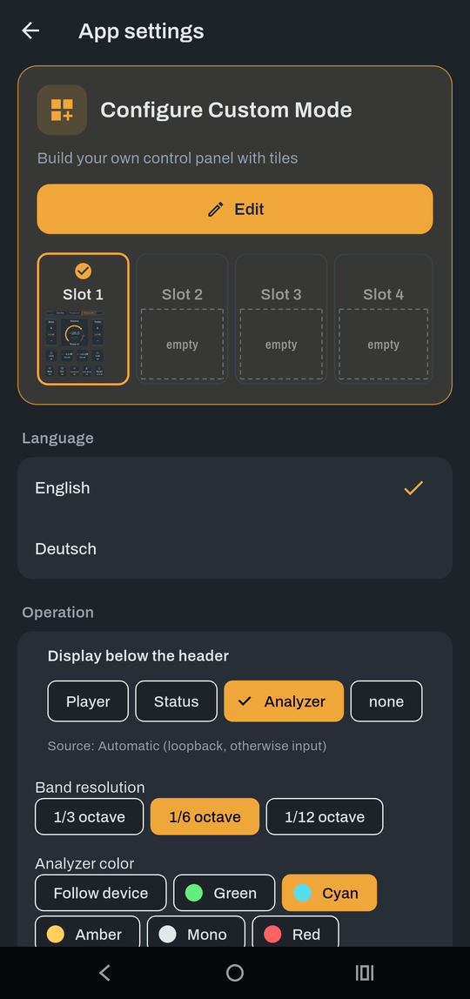 |

## Glossar

Dieses Glossar erklärt die Begriffe, die beim Einstellen und beim Lesen der Anzeigen vorkommen.

| Begriff | Bedeutung in diesem Handbuch |
| --- | --- |
| ADC / DAC, AD / DA | Analog-Digital- bzw. Digital-Analog-Wandler; AD/DA bezeichnet die Wandlungsrichtung. DAC kann auch die Pro-Betriebsart oder das Gerätemodell bezeichnen. |
| Basic Mode | Grundbetriebsart der Pro-Modelle, die die grundlegenden Signalwege bestimmt. |
| Clock / Sample Rate | Takt und Anzahl der Audio-Abtastwerte pro Sekunde, etwa 48 kHz. Digitale Geräte benötigen einen zueinander passenden Takt. |
| CC-Mode | USB-Class-Compliant-Betrieb mit Stereo- oder Mehrkanal-Kanalbelegung. Am Gerät bei getrennter USB-Verbindung ändern. |
| DSP / FX | Digitale Signalverarbeitung bzw. Effekte, z. B. EQ und Crossfeed. |
| dB | Verhältnis zweier Pegel. Ein Lautstärkewert ist keine direkte Aussage über den Schalldruck am Ohr. |
| dBFS | Digitaler Pegel bezogen auf Vollaussteuerung. Beim Analyzer ist 0 dBFS Peak die digitale Vollaussteuerung; bei der Ausgangsstatusanzeige handelt es sich um eine Darstellung des Lautstärkewerts. |
| dBu | Analoger Spannungspegel mit dem Bezug 0 dBu = etwa 0,775 V effektiv. Die App berechnet Ausgangswerte aus Referenzpegel und Lautstärke. |
| Ref Level | Analoger Bezugs-/Arbeitsbereich. Für dieselbe digitale Aussteuerung kann ein höherer Ausgangs-Ref-Level mehr Spannung liefern. |
| Gain / Frequenz / Q | Stärke, Lage und Form eines EQ-Filters; ein höheres Q macht einen Peak-Filter schmaler. |
| pre FX / post FX | Vor bzw. nach der betreffenden Effektbearbeitung. Beim Ausgangs-Loopback liegt post FX vor Volume; nach Bearbeitung bedeutet nicht nach Lautstärke. |
| Loopback | Interne Rückleitung eines Ausgangssignals auf USB-Aufnahmekanäle. |
| USB Playback / USB Rec | Vom Host zum Gerät abgespieltes bzw. vom Gerät zum Host aufgenommenes Audio. |
| Peak / RMS | Spitzenwert bzw. Effektivwert eines aufgenommenen Audiosignals. |
| Crossfeed | Beimischung des gegenüberliegenden Stereokanals für die Kopfhörerwiedergabe. |
| Dual EQ | Getrennte EQ-Bandparameter links/rechts; Bass/Treble bleiben gemeinsame Klangregler. |
| Loudness / Low Vol Ref | Lautstärkeabhängige Bass-/Höhenanhebung und der Lautstärkebezug für deren volle Wirkung. |
| PCM / DSD | Unterschiedliche digitale Audioformate. Die angebotenen Wandlungs- und Direct-Optionen hängen vom Gerät ab. |
| SRC | Sample-Rate-Converter zum Anpassen einer digitalen Eingangsquelle an den Gerätetakt. |
| M/S | Mitte/Seite als Alternative zur Links-/Rechts-Stereodarstellung. |
| RIAA | Entzerrung für entsprechend vorentzerrte Phonosignale; nicht für normale Line-Quellen einschalten. |
| Preset / Setup / Layout | Einzelne EQ-Kurve, Gerätekonfiguration oder Anordnung der App-Kacheln. Dies sind verschiedene Speicherwege. |
| Rampe / Recall / Limit | Langsamer Lautstärkeanstieg, gespeicherte Abruflautstärke und obere App-Pegelgrenze. |
| Kalibrier-Offset | Gemessener Korrekturwert der Analyzer-Pegelanzeige für eine bestimmte Gerätekombination. |

## Fehlerbehebung

Hier finden Sie gezielte Prüfungen für Verbindungs-, Bedien- und Messprobleme.

| Problem | Prüfen |
| --- | --- |
| Kein Gerät gefunden | Datenkabel, direkte Verbindung, OTG-/Host-Unterstützung, USB-Berechtigung; neu verbinden und Erneut suchen |
| USB-Gerät gefunden, keine MIDI-Antwort | MIDI Control im oben genannten Modellmenü einschalten; gegebenenfalls neu verbinden |
| Regler fehlen oder sind gesperrt | Modell/Ausgang, Dual Phones, gemeinsame Quelle im Basic Mode und Lautstärke sperren |
| Lautstärke steigt nicht weiter | Loslassen stoppt die Rampe; Fortsetzungsfrage, Lock, Limit und Grenzen gekoppelter Ausgänge prüfen |
| Line Out unerwartet stumm | Eingesteckte Kopfhörer und Line-Stummschalt-/Toggle-Einstellungen; Mute gedrückt halten |
| Analyzer verlangt Berechtigung | Aufnahmeberechtigung für ADI-2-USB-Audio erteilen |
| Mac-Testton nicht verfügbar | Geräte-Sample-Rate auf 44,1–192 kHz einstellen und die angezeigten Startbedingungen prüfen |
| Gerätebestätigung für Testton fehlt | Ausgänge stumm lassen, Lautstärke am Gerät prüfen und Verbindung sowie frische Mute-/Lautstärkerückmeldungen aller Ausgänge prüfen |
| Kein Analyzer-Signal | USB-1/2-Route, aktive Quelle, Loopback-Abgriff und tatsächliches Quellaudio; Paar 3/4 oder 5/6 speist den Analyzer nicht |
| USB-Aufnahme unterbrochen oder nicht verfügbar | USB neu verbinden, gegebenenfalls andere Aufnahmeprogramme schließen, zum Analyzer zurückkehren und Erneut versuchen; gemeldete Aufnahmeroute prüfen |
| Analyzer weicht vom Gerät ab | post FX, Balken, 1/3 Oktave vergleichen; Kalibrierung, Medienlautstärke, Android-Effekte und Geräte-Pegelmesser nach Volume beachten |
| Kalibrierung abgewiesen | Stabiles, gleiches Signal auf beiden Kanälen, ausreichender Pegel und unterbrechungsfreie USB-Aufnahme; angezeigten Grund lesen |
| Player fehlt | Nur Android; Benachrichtigungszugriff, aktive Mediensitzung und Player als Kopfzeileninhalt prüfen |
| Signalplan zeigt einen anderen Modus | Der Plan ist eine Erklärung; unter Gerät den tatsächlichen Basic Mode und unter Status die gemeldete Betriebsart prüfen |
| USB-Ziel 5/6 ohne Signal | CC-Mode Multi-channel am Gerät bei getrennter USB-Verbindung einstellen; die App-Erkennung ist nur auf Android verfügbar |
| Preset-Editor verändert den Klang nicht | Anhören, Zielkanal sowie dessen EQ- und Bass/Treble-Schalter prüfen; Speichern allein aktiviert kein Live-Preset |
| Alter EQ kommt nach Anhören nicht zurück | Anhören ausschalten stoppt nur weitere Übertragungen; den vorherigen EQ selbst erneut laden |
| Custom-Kachel bedient den falschen Ausgang | Gewählter Ausgang oder festes Ziel im Kacheldialog sowie aktuelle Ausgangsseite prüfen |
| Backup-Wiederherstellung abgewiesen | Passendes angeschlossenes Modell, Backupformat dieser App und kompatible App-Version verwenden |

Bei Supportfragen ADI-2-Modell, App-Version, Mobilgerät, Betriebssystemversion, Verbindung und reproduzierbare Schritte nennen. Persönliche Angaben vor öffentlichen Beiträgen aus Screenshots und Diagnosen entfernen.

## Lizenz und Rechtliches

Hier finden Sie die Lizenzangabe und die Zuordnung der genannten Marken.

Kostenlose freie Software unter **GPL-3.0**. © 2026 Markus Rass. [Lizenzhinweise des Projekts](README.de.md#lizenz-und-marken).

RME ist eine eingetragene Marke von RME Intelligent Audio Solutions. ADI-2 Pro ist eine Marke von RME Intelligent Audio Solutions; ADI-2 und ADI-2 Remote sind Produktnamen von RME. Alesis und ADAT sind eingetragene Marken der Alesis Corp.; ADAT optical ist eine Marke der Alesis Corp. Apple, iPhone, Mac und macOS sind Marken der Apple Inc. Android ist eine Marke der Google LLC. Direct Stream Digital und DSD sind Marken der jeweiligen Inhaber (Sony / Philips). Alle weiteren Marken und Produktnamen gehören ihren jeweiligen Inhabern und werden nur zur Bezeichnung kompatibler Geräte und Funktionen verwendet.
