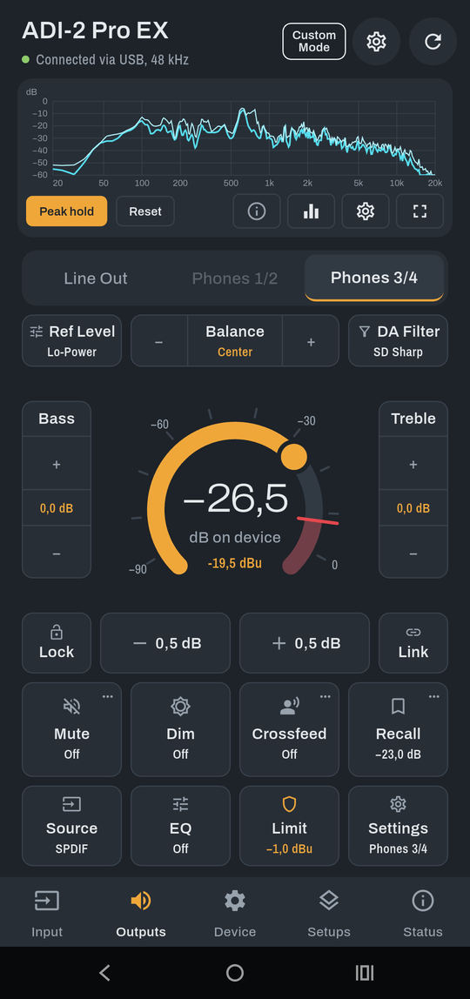
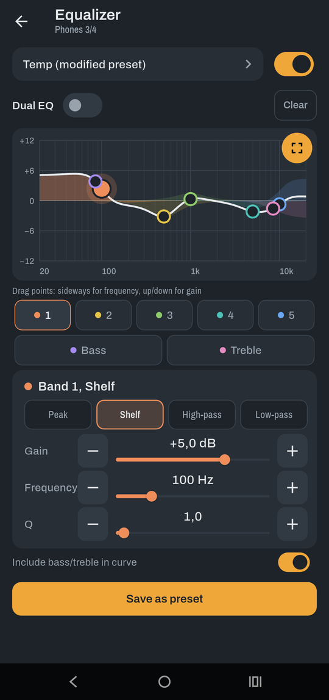
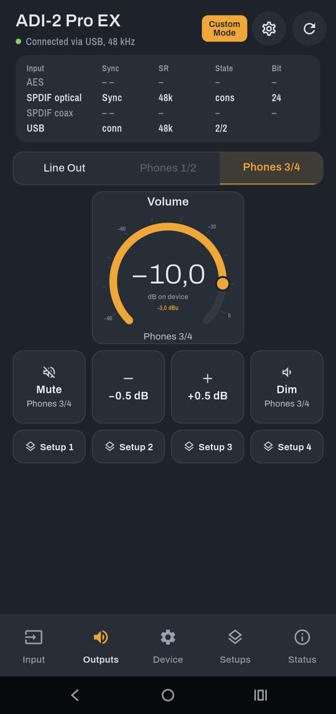
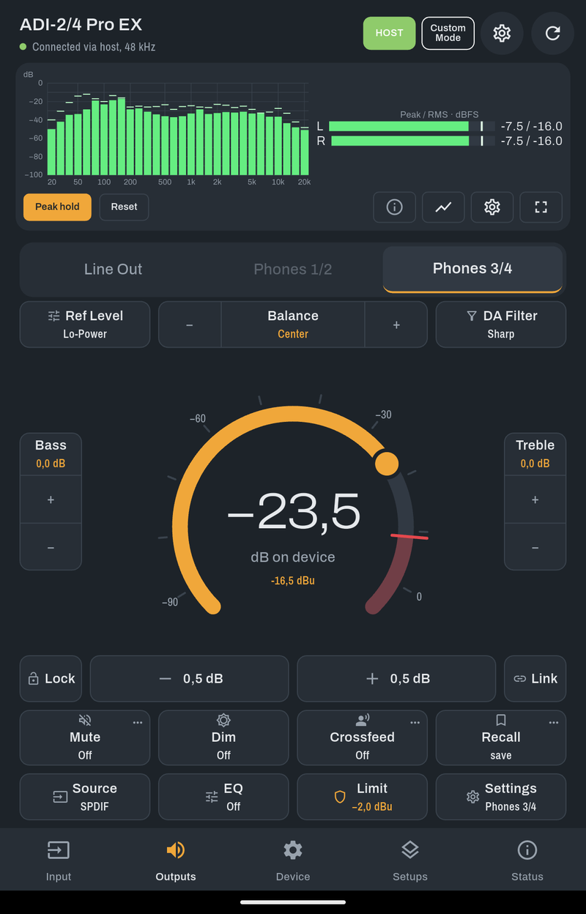
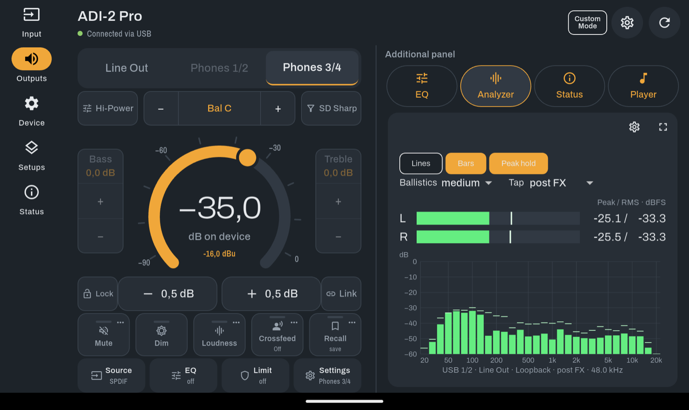
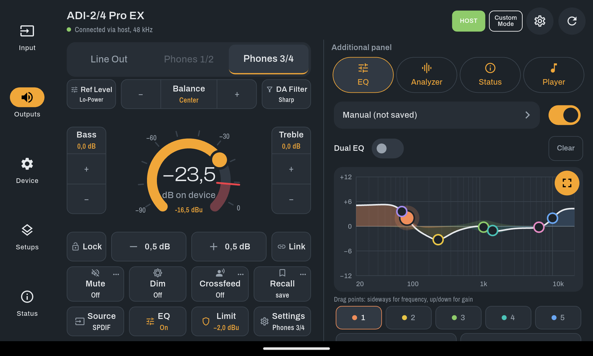
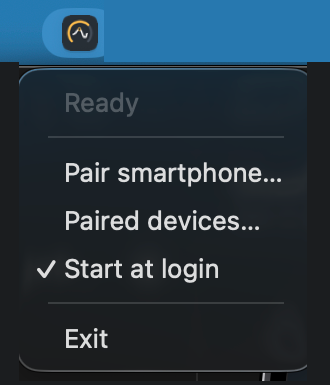
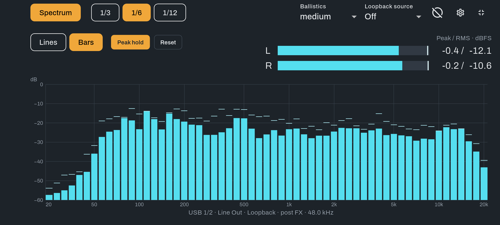
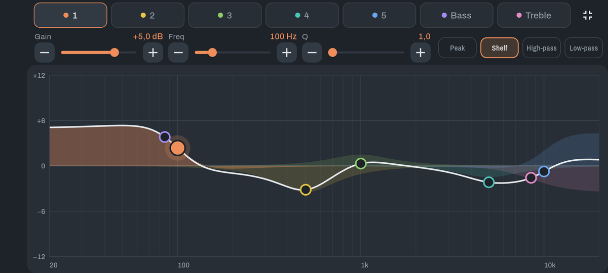

# Remote for ADI-2

[English](../README.md)

Remote for ADI-2 ist eine kostenlose Flutter-App zur direkten Steuerung kompatibler ADI-2-Audiointerfaces per USB-MIDI vom Smartphone oder Tablet. Sie bietet Ausgangs- und Geräteeinstellungen, einen EQ-Editor, Setups, Backups, ein anpassbares Bedienfeld und einen USB-Audio-Analyzer. Version **1.1.0 (2)**. © 2026 Markus Rass.

## Screenshots

Android-Smartphone und -Tablet; die Bilder zeigen die englische Oberfläche. Aufbau und verfügbare Regler hängen vom Gerätemodell ab.

| Smartphone: Ausgänge | Smartphone: EQ | Smartphone: Eigene Ansicht |
| --- | --- | --- |
|  |  |  |

| Tablet: Hochformat | Tablet: Ausgänge und Analyzer | Tablet: Ausgänge und EQ |
| --- | --- | --- |
|  |  |  |

| Mac: Host in der Menüleiste | Mac: Menü des Hosts |
| --- | --- |
|  |  |

| Smartphone: Analyzer im Vollbild | Smartphone: EQ im Vollbild |
| --- | --- |
|  |  |

## Funktionen

- Lautstärkering, 0,5-dB-Schritte, Balance, Bass/Treble, Mute, Dim, Loudness und Crossfeed, soweit verfügbar.
- Langsames Anheben der Lautstärke, Volume Limit je Ausgang in dBu, Recall, Lock und gekoppelte Ausgangslautstärken.
- Eingangs- und Geräteeinstellungen, Loopback zu USB, Signalpläne der Basic Modes und Gerätestatus.
- Parametrischer Fünfband-EQ mit Bass/Treble, Dual EQ und Vollbild-Graph.
- Geräte-Setups 1–9, EQ-Presets 1–20, EQ-Preset-Editor, App-Bibliothek, Import und Teilen.
- Gerätebackups und Offline-Einstellungen je Modell mit ausdrücklicher Übertragung.
- Eigene Ansicht mit vier Layout-Slots je Modell, bearbeitbaren Kacheln und gemeinsamen oder getrennten Ausgangsseiten.
- USB-Analyzer mit Linien oder Balken, Oktavauflösungen, Peak hold, Ballistik und Pegelkalibrierung.
- Deutsche und englische Oberfläche; seitliche Navigation und Zusatzbereich am Tablet im Querformat.
- Android-Player-Steuerung über Benachrichtigungszugriff bei verfügbarer aktiver Mediensitzung.
- Steuerung per WLAN über den Hintergrund-Host für Mac und Windows, Kopplung per Code oder QR-Code.

## Geräte und Teststand

Unterstützt werden ADI-2 Pro, ADI-2 Pro EX, ADI-2/4 Pro SE, ADI-2/4 Pro EX und ADI-2 DAC. Getestet ist die App mit allen diesen Modellen auf Android-Smartphone und Android-Tablet sowie mit dem ADI-2 DAC am Mac. Die Kalibrierung mit eingebautem Testton ist am ADI-2/4 Pro EX noch nicht bestätigt, der Analyzer am Mac ebenfalls noch nicht. Eine iPhone-Version ist geplant.

Die macOS-App enthält einen USB-Analyzer mit derselben Dart-Signalverarbeitung wie Android, einschließlich 1/3-, 1/6- und 1/12-Oktavbändern und Pegelkalibrierung je Mac/ADI-2-Kombination. Aufnahme und eingebauter Testton wählen ausschließlich das angeschlossene ADI-2; die Standard-Audiogeräte des Macs werden nicht geändert. Für die Aufnahme ist die Mikrofonberechtigung erforderlich. Der Mac-Analyzer ist noch nicht auf echter Hardware geprüft.

## Verbindung per USB

Den ADI-2 mit einem datenfähigen USB-Kabel direkt am Mobilgerät anschließen. Android benötigt USB-Host-Unterstützung, meist über einen USB-OTG-Adapter.

Am ADI-2 **MIDI Control → ON** einstellen:

- DAC: **SETUP → Options → Remap Keys / Diag → MIDI Control**.
- ADI-2 Pro / ADI-2/4 Pro: **SETUP → Options → Device Mode / DSD → MIDI Control**.

USB-Berechtigungsdialog bestätigen. Die App sucht automatisch; bei Bedarf **Erneut suchen** antippen oder das Gerät unter **MIDI-Geräte** auswählen. Alternativ steuert das Smartphone den ADI-2 per WLAN über einen Mac oder Windows-PC mit dem Hintergrundprogramm **Remote for ADI-2 Host**, siehe [Steuerung über einen Computer (Host)](BENUTZERHANDBUCH.md#steuerung-über-einen-computer-host).

## Aus dem Quellcode bauen und installieren

Flutter mit einem Dart-SDK passend zu `^3.13.7` und den von `flutter doctor` genannten Plattformwerkzeugen installieren. Android benötigt Android-SDK und passendes JDK. Für die Installation am Android-Gerät Entwickleroptionen und USB-Debugging aktivieren. Diese Installationsverbindung ist von der späteren USB-Verbindung zum ADI-2 zu unterscheiden.

Im Repository ausführen:

```sh
flutter doctor
flutter pub get
flutter analyze
flutter test
flutter devices
flutter run
```

Bei Nachfrage das angeschlossene Mobilgerät auswählen. Für einen lokalen Android-Release-Build:

```sh
flutter build apk --release
flutter install --release
```

Die APK entsteht unter `build/app/outputs/flutter-apk/app-release.apk`. Hier wird keine vorgefertigte APK oder Store-Version angeboten. Falls Analyse oder Build in einem Verzeichnis mit Nicht-ASCII-Zeichen scheitern, einen Checkout in einem Verzeichnis mit reinem ASCII-Namen versuchen.

## Dokumentation und Grenzen

- [Benutzerhandbuch](BENUTZERHANDBUCH.md) / [User guide](USER_GUIDE.md)
- [Windows/macOS-Host: technische Notizen](HOST_PLAN.de.md) / [Host in English](HOST_PLAN.md)

Android-Klangeffekte können über USB abgespieltes Audio verändern. Die App kann diese Effekte nicht abschalten. Die Analyzer-Kalibrierung kann einen Pegelversatz korrigieren, aber keinen veränderten Frequenzgang rückgängig machen. Die Anzeige folgt dem gewählten Abgriff; für den Vergleich mit dem Gerät **post FX** verwenden.

Lautstärkegrenzen werden von der verbundenen App durchgesetzt. Sie sind keine dauerhafte Hardware-Schutzeinstellung.

## Lizenz und Marken

Kostenlose freie Software unter **GPL-3.0**. © 2026 Markus Rass. Lizenzbedingungen: [GNU GPL Version 3](https://www.gnu.org/licenses/gpl-3.0.html). Hinweise zu fremden Open-Source-Bestandteilen stehen unter **App-Einstellungen → Marken und Rechtliches → Open-Source-Lizenzen**.

RME ist eine eingetragene Marke von RME Intelligent Audio Solutions. ADI-2 Pro ist eine Marke von RME Intelligent Audio Solutions; ADI-2 und ADI-2 Remote sind Produktnamen von RME. Alesis und ADAT sind eingetragene Marken der Alesis Corp.; ADAT optical ist eine Marke der Alesis Corp. Apple, iPhone, Mac und macOS sind Marken der Apple Inc. Android ist eine Marke der Google LLC. Direct Stream Digital und DSD sind Marken der jeweiligen Inhaber (Sony / Philips). Alle weiteren Marken und Produktnamen gehören ihren jeweiligen Inhabern und werden nur zur Bezeichnung kompatibler Geräte und Funktionen verwendet.
