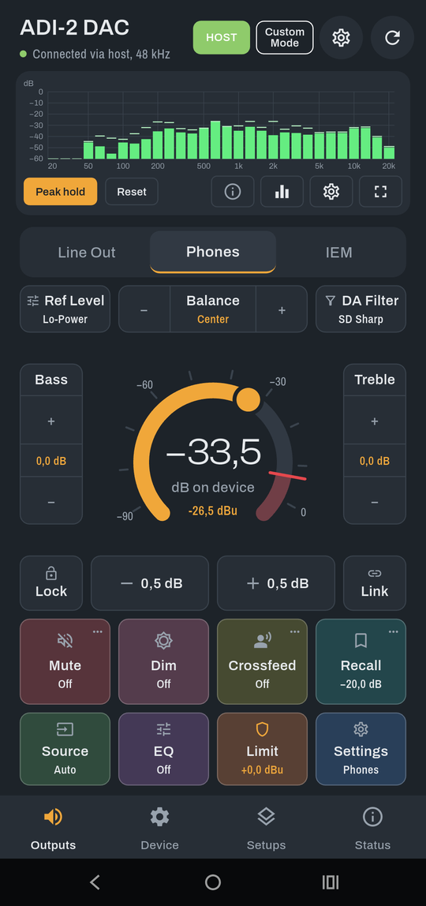
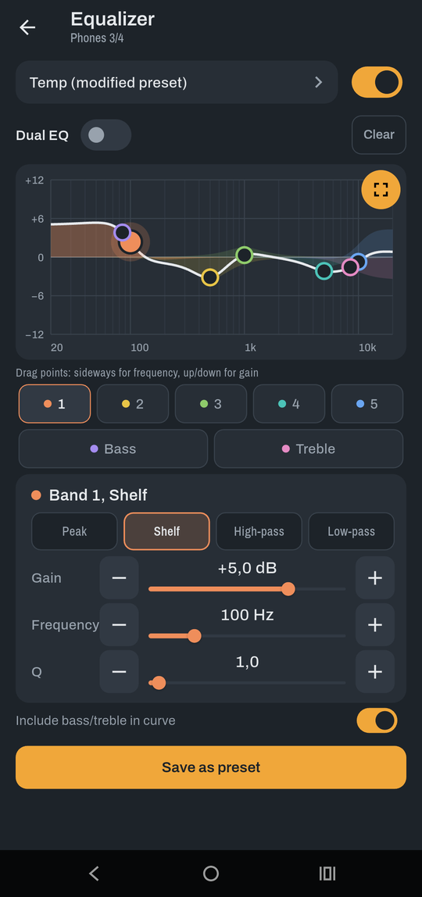
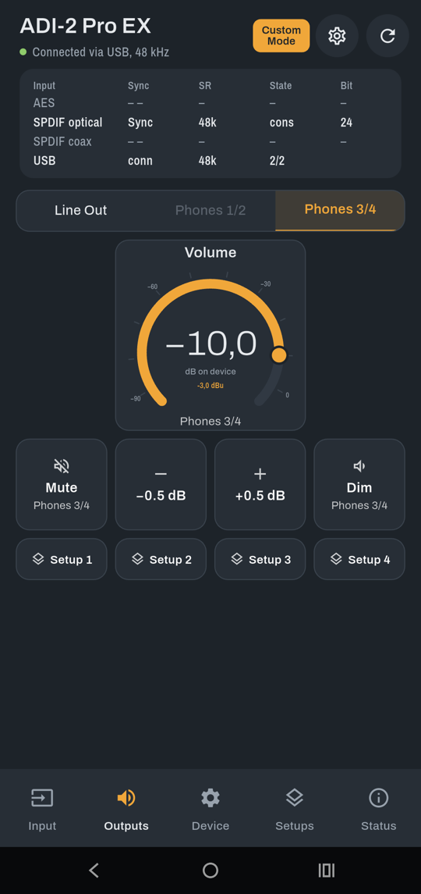
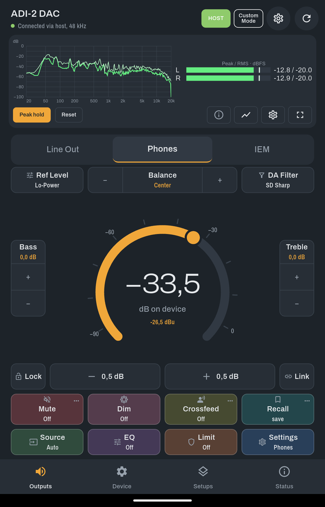
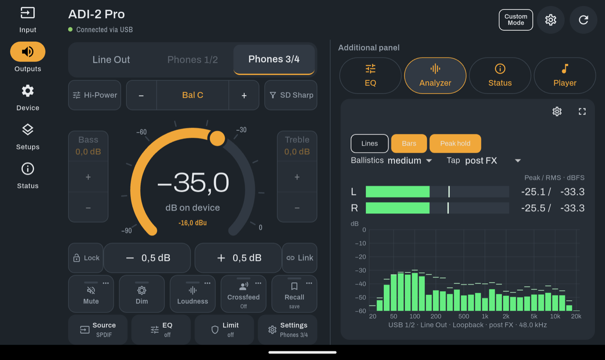
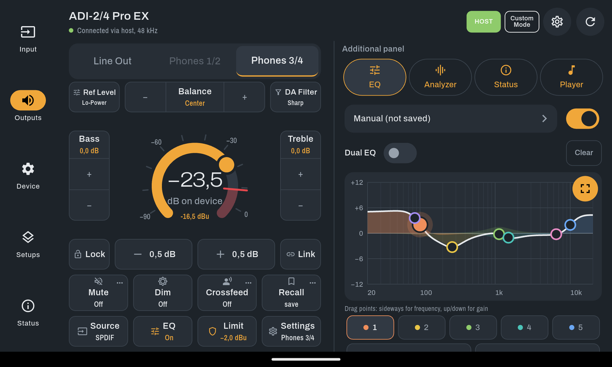
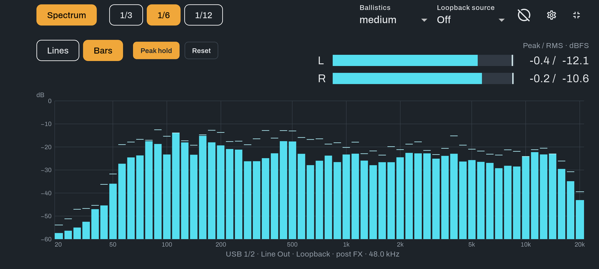
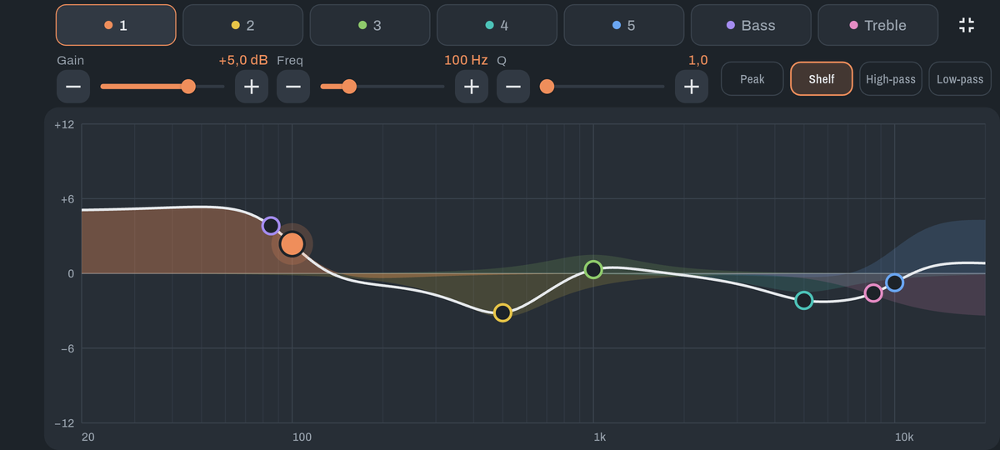
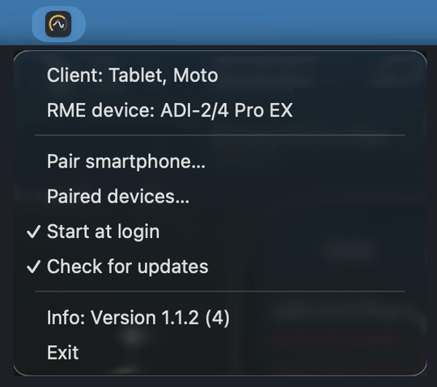

# Remote for ADI-2

[English](../README.md)

Remote for ADI-2 ist eine kostenlose Flutter-App zur direkten Steuerung kompatibler ADI-2-Audiointerfaces per USB-MIDI vom Smartphone, Tablet oder Computer. Sie bietet Ausgangs- und Geräteeinstellungen, einen EQ-Editor, Setups, Backups, ein anpassbares Bedienfeld und einen USB-Audio-Analyzer. Version **1.3.0 (10)**. © 2026 Markus Rass.

## Download

### Android und Computer

| Was | Datei | Für | Installation |
| --- | --- | --- | --- |
| **App** | [Remote-for-ADI-2-Android-1.3.0.apk](https://github.com/kahuna34/remote-for-ADI-2/releases/download/v1.3.0/Remote-for-ADI-2-Android-1.3.0.apk) | Android-Smartphone oder -Tablet | [Anleitung](install/de/android.md) |
| **Host für Mac** | [Remote-for-ADI-2-Host-macOS-1.3.0.zip](https://github.com/kahuna34/remote-for-ADI-2/releases/download/v1.3.0/Remote-for-ADI-2-Host-macOS-1.3.0.zip) | Mac, an dem der ADI-2 per USB hängt; mit eigener Oberfläche zur Bedienung am Computer | [Anleitung](install/de/host-mac.md) |
| **Host für Intel-Mac** | [Remote-for-ADI-2-Host-Intel-Mac-1.3.0.zip](https://github.com/kahuna34/remote-for-ADI-2/releases/download/v1.3.0/Remote-for-ADI-2-Host-Intel-Mac-1.3.0.zip) | Alternative für Intel-Macs, deren Oberfläche flackert oder Streifen zeigt (anderer Grafik-Renderer) | [Anleitung](install/de/host-mac.md#intel-mac) |
| **Host für Windows** | [Remote-for-ADI-2-Host-Windows-Setup-1.3.0.exe](https://github.com/kahuna34/remote-for-ADI-2/releases/download/v1.3.0/Remote-for-ADI-2-Host-Windows-Setup-1.3.0.exe) | Windows-PC (64 Bit), an dem der ADI-2 per USB hängt; mit eigener Oberfläche zur Bedienung am Computer | [Anleitung](install/de/host-windows.md) |
| **Linux** | [Remote-for-ADI-2-Linux-1.3.0.AppImage](https://github.com/kahuna34/remote-for-ADI-2/releases/download/v1.3.0/Remote-for-ADI-2-Linux-1.3.0.AppImage) | Linux-PC (x86_64), z. B. Linux Mint 22 / Ubuntu 24.04 | [Anleitung](install/de/linux.md) |

### iPhone

Die iPhone-App gibt es nicht im App Store. Sie wird mit deiner eigenen Apple-ID über AltStore/SideStore installiert oder auf einem Mac mit Xcode per Bauskript.

| Was | Datei | Für | Installation |
| --- | --- | --- | --- |
| **App (IPA)** | [Remote-for-ADI-2-iPhone-1.3.0.ipa](https://github.com/kahuna34/remote-for-ADI-2/releases/download/v1.3.0/Remote-for-ADI-2-iPhone-1.3.0.ipa) | iPhone ab iOS 15, über AltStore oder SideStore | [Anleitung](install/de/iphone-altstore.md) |
| **AltStore-Quelle** | `https://raw.githubusercontent.com/kahuna34/remote-for-ADI-2/main/apps.json` | In AltStore/SideStore unter Sources hinzufügen; Updates erscheinen dann dort | [Anleitung](install/de/iphone-altstore.md#3-remote-for-adi-2-installieren) |
| **AltServer** | [altstore.io](https://altstore.io) (offizieller Download) | Mac oder Windows-PC: installiert AltStore und hält die App signiert | [Anleitung](install/de/iphone-altstore.md#1-altserver-auf-dem-computer-installieren) |
| **Xcode-Paket** | [Remote-for-ADI-2-iPhone-Xcode-1.3.0.zip](https://github.com/kahuna34/remote-for-ADI-2/releases/download/v1.3.0/Remote-for-ADI-2-iPhone-Xcode-1.3.0.zip) | Mac mit Xcode, ohne AltStore | [Anleitung](install/de/iphone-xcode.md) |
| **Host für Mac / Windows** | [macOS](https://github.com/kahuna34/remote-for-ADI-2/releases/download/v1.3.0/Remote-for-ADI-2-Host-macOS-1.3.0.zip) · [Windows](https://github.com/kahuna34/remote-for-ADI-2/releases/download/v1.3.0/Remote-for-ADI-2-Host-Windows-Setup-1.3.0.exe) | Steuerung per WLAN; läuft neben AltServer | [Mac](install/de/host-mac.md) · [Windows](install/de/host-windows.md) |

Alle Dateien der aktuellen Version stehen auch auf der [Release-Seite](https://github.com/kahuna34/remote-for-ADI-2/releases/latest). Remote for ADI-2 Host bietet am Mac und unter Windows eine eigene Oberfläche zur direkten Bedienung des ADI-2 am Computer und ermöglicht die Steuerung per WLAN. Unter Linux vereint Remote for ADI-2 beide Funktionen. Ein Computer kann auch den ADI-2 an einem anderen Computer steuern (Host zu Host). Für die direkte USB-Verbindung am Smartphone genügt die App.

App und Host melden neue Versionen; die Prüfung ist abschaltbar und fragt nur bei GitHub nach der neuesten Version. Ein Download startet erst mit einem Klick auf Laden. Auf dem iPhone zeigt AltStore Updates aus der Quelle an.

**Smartphone und Host verbinden:** Im Menü des Hosts **Client koppeln…** wählen, in der App **Über Host verbinden** öffnen und den QR-Code scannen oder den Code eingeben. Bis zu vier Smartphones oder Tablets können gleichzeitig verbunden sein; jedes wird einmal gekoppelt. Einzelheiten stehen im [Benutzerhandbuch](BENUTZERHANDBUCH.md#steuerung-über-einen-computer-host).

[Datenschutzerklärung](DATENSCHUTZ.md)

## Screenshots

Android-Smartphone und -Tablet sowie der Host am Mac; die Bilder zeigen die englische Oberfläche. Aufbau und verfügbare Regler hängen vom Gerätemodell ab.

| Smartphone: Ausgänge | Smartphone: EQ | Smartphone: Eigene Ansicht |
| --- | --- | --- |
|  |  |  |

| Tablet: Hochformat | Tablet: Ausgänge und Analyzer | Tablet: Ausgänge und EQ |
| --- | --- | --- |
|  |  |  |

| Smartphone: Analyzer im Vollbild | Smartphone: EQ im Vollbild |
| --- | --- |
|  |  |

| Mac: Menü des Hosts |
| --- |
|  |

## Funktionen

- Lautstärkering, 0,5-dB-Schritte, Balance, Bass/Treble, Mute, Dim, Loudness und Crossfeed, soweit verfügbar.
- Langsames Anheben der Lautstärke, Volume Limit je Ausgang in dBu, Recall, Lock und gekoppelte Ausgangslautstärken.
- Eingangs- und Geräteeinstellungen, Loopback zu USB, Signalpläne der Basic Modes und Gerätestatus.
- Parametrischer Fünfband-EQ mit Bass/Treble, Dual EQ und Vollbild-Graph.
- Geräte-Setups 1–9, EQ-Presets 1–20, EQ-Preset-Editor, Import und Teilen.
- Gerätebackups und Offline-Einstellungen je Modell mit ausdrücklicher Übertragung.
- Eigene Ansicht mit vier Layout-Slots je Modell, bearbeitbaren Kacheln und gemeinsamen oder getrennten Ausgangsseiten.
- USB-Analyzer mit Linien oder Balken, Oktavauflösungen, Peak hold, Ballistik und Pegelkalibrierung.
- Deutsche und englische Oberfläche; seitliche Navigation und Zusatzbereich am Tablet im Querformat.
- Android-Player-Steuerung über Benachrichtigungszugriff bei verfügbarer aktiver Mediensitzung; auf dem iPhone zeigt die Player-Leiste Apple Music.
- Desktop-Oberfläche auf Mac, Windows und Linux: Desktop, „Nur Gerät“ und Kompakt, dazu eigene Analyzer- und Player-Fenster.
- Steuerung per WLAN und Host zu Host, Kopplung per Code oder QR-Code.
- Linux-Version mit Analyzer über PipeWire/PulseAudio, Player-Steuerung über MPRIS und Testsignalen am lokal angeschlossenen ADI-2.

## Geräte und Teststand

Unterstützt werden ADI-2 Pro, ADI-2 Pro EX, ADI-2/4 Pro SE, ADI-2/4 Pro EX und ADI-2 DAC. Getestet ist die App mit allen diesen Modellen auf Android-Smartphone und Android-Tablet, mit dem ADI-2 DAC am Mac sowie auf iPhone SE und iPhone 15 Pro Max. Die Kalibrierung mit eingebautem Testton ist am ADI-2/4 Pro EX noch nicht bestätigt. Die Desktop-Oberfläche und der Host-Analyzer wurden außerdem am Mac mit ADI-2 Pro und unter Linux Mint mit ADI-2 Pro geprüft; der Windows-Host wurde mit ADI-2 DAC geprüft. Einzelne Windows-Bedienabläufe stehen noch zur Prüfung aus.

Remote for ADI-2 Host nimmt für den Mac-Analyzer das angeschlossene ADI-2 über USB auf. Beim ersten Start des Analyzers die Mikrofonberechtigung erteilen; sie gilt für die USB-Aufnahme. Die Standard-Audiogeräte des Macs bleiben unverändert.

## Verbindung per USB

Den ADI-2 mit einem datenfähigen USB-Kabel direkt am Mobilgerät anschließen. Android benötigt USB-Host-Unterstützung, meist über einen USB-OTG-Adapter.

Am ADI-2 **MIDI Control → ON** einstellen:

- DAC: **SETUP → Options → Remap Keys / Diag → MIDI Control**.
- ADI-2 Pro / ADI-2/4 Pro: **SETUP → Options → Device Mode / DSD → MIDI Control**.

USB-Berechtigungsdialog bestätigen. Die App sucht automatisch; bei Bedarf **Erneut suchen** antippen oder das Gerät unter **MIDI-Geräte** auswählen. Alternativ steuert das Smartphone den ADI-2 per WLAN über einen Mac oder Windows-PC mit **Remote for ADI-2 Host** oder über das Linux-Programm **Remote for ADI-2**, siehe [Steuerung über einen Computer (Host)](BENUTZERHANDBUCH.md#steuerung-über-einen-computer-host).

## Aus dem Quellcode bauen und installieren

Flutter mit einem Dart-SDK passend zu `^3.13.7` und den von `flutter doctor` genannten Plattformwerkzeugen installieren. Android benötigt Android-SDK und passendes JDK. Für die Installation am Android-Gerät Entwickleroptionen und USB-Debugging aktivieren. Diese Installationsverbindung ist von der späteren USB-Verbindung zum ADI-2 zu unterscheiden.

Im Repository ausführen:

```sh
flutter doctor
flutter pub get
flutter analyze
flutter test
flutter devices
flutter run
```

Bei Nachfrage das angeschlossene Mobilgerät auswählen. Für einen lokalen Android-Release-Build:

```sh
flutter build apk --release
flutter install --release
```

Die APK entsteht unter `build/app/outputs/flutter-apk/app-release.apk`. Falls Analyse oder Build in einem Verzeichnis mit Nicht-ASCII-Zeichen scheitern, einen Checkout in einem Verzeichnis mit reinem ASCII-Namen versuchen.

## Dokumentation und Grenzen

- [Benutzerhandbuch](BENUTZERHANDBUCH.md) / [User guide](USER_GUIDE.md)
- [Computer-Steuerung: Host und Linux](HOST_PLAN.de.md) / [Host in English](HOST_PLAN.md)

Android-Klangeffekte können über USB abgespieltes Audio verändern. Die App kann diese Effekte nicht abschalten. Die Analyzer-Kalibrierung kann einen Pegelversatz korrigieren, aber keinen veränderten Frequenzgang rückgängig machen. Die Anzeige folgt dem gewählten Abgriff; für den Vergleich mit dem Gerät **post FX** verwenden.

Lautstärkegrenzen werden von der verbundenen App durchgesetzt. Sie sind keine dauerhafte Hardware-Schutzeinstellung.

## Lizenz und Marken

Kostenlose freie Software unter **GPL-3.0**. © 2026 Markus Rass. Lizenzbedingungen: [GNU GPL Version 3](https://www.gnu.org/licenses/gpl-3.0.html). Hinweise zu fremden Open-Source-Bestandteilen stehen unter **App-Einstellungen → Marken und Rechtliches → Open-Source-Lizenzen**.

RME ist eine eingetragene Marke von RME Intelligent Audio Solutions. ADI-2 Pro ist eine Marke von RME Intelligent Audio Solutions; ADI-2 und ADI-2 Remote sind Produktnamen von RME. Alesis und ADAT sind eingetragene Marken der Alesis Corp.; ADAT optical ist eine Marke der Alesis Corp. Apple, Mac und macOS sind Marken der Apple Inc. Android ist eine Marke der Google LLC. Direct Stream Digital und DSD sind Marken der jeweiligen Inhaber (Sony / Philips). Alle weiteren Marken und Produktnamen gehören ihren jeweiligen Inhabern und werden nur zur Bezeichnung kompatibler Geräte und Funktionen verwendet.

[Datenschutzerklärung](DATENSCHUTZ.md)
