# Remote for ADI-2 — User guide

Version **1.1.1 (3)** · [Project overview](../README.md) · [Deutsch](BENUTZERHANDBUCH.md)

This guide describes the current app. Controls depend on the selected model and values reported by the device. Screenshots show Android devices and the English interface. The app has been tested with all supported ADI-2 models on an Android smartphone and an Android tablet, and with the ADI-2 DAC on a Mac, also through the host. An iPhone version is planned. The Player integration currently supports Android only.

## Contents

- [First steps](#first-steps)
- [Outputs](#outputs)
- [Volume protection](#volume-protection)
- [Player and status below the header](#player-and-status-below-the-header)
- [Input](#input)
- [Device](#device)
- [Basic Mode and Signal flow](#basic-mode-and-signal-flow)
- [Loopback to USB](#loopback-to-usb)
- [EQ and fullscreen graph](#eq-and-fullscreen-graph)
- [Setups and EQ preset editor](#setups-and-eq-preset-editor)
- [Setups, backups and offline mode](#setups-backups-and-offline-mode)
- [Status](#status)
- [ADI-2 DAC](#adi-2-dac)
- [Custom Mode](#custom-mode)
- [Analyzer](#analyzer)
- [Tablet layouts](#tablet-layouts)
- [App settings](#app-settings)
- [Glossary](#glossary)
- [Troubleshooting](#troubleshooting)
- [License and legal](#license-and-legal)

## First steps

Use this chapter to connect the ADI-2, select the correct output and prepare for your first adjustments.

### First launch

After the startup animation, the setup wizard appears once, including on the first launch after this update. It guides you through USB OTG or **Connect via host**, optional Android player access and automatic update checks. Detected connections and granted access are confirmed with a checkmark. **Next** advances; **Skip** ends setup at any time. It does not change device values or volume protection. Camera and recording permissions are needed only for QR scanning and the analyzer respectively.

Open **App settings → Restart setup** to run it again. **Privacy** in settings and **Privacy policy** on the final wizard step show the [privacy policy](../PRIVACY.md).

### Quick start

The ADI-2 processes the audio; the app controls its settings over USB MIDI. Remote control does not require music to play on the mobile device. An audio source can remain connected to the ADI-2.

1. Build and install using the [source instructions](../README.md#build-and-install-from-source).
2. Power the ADI-2 and connect it directly to the mobile device with a data-capable USB cable. Android requires USB host/OTG support and, where needed, an OTG adapter.
3. Set **MIDI Control → ON** on the ADI-2. For DAC, use **SETUP → Options → Remap Keys / Diag → MIDI Control**. For ADI-2 Pro and ADI-2/4 Pro, use **SETUP → Options → Device Mode / DSD → MIDI Control**.
4. Accept the USB permission dialog. The app searches automatically. Use **Search again**, **Connection help**, or select the device under **MIDI devices** if necessary.
5. Check the model and **Connected via USB** in the header. **Refresh** reads the device settings again. Start with low output volume and set a suitable **Limit** before listening.

The mobile device is the USB host for this connection. Alternatively, the smartphone can control the ADI-2 over Wi-Fi through a computer, see [Control through a computer (host)](#control-through-a-computer-host).

### Finding your way around

Navigation leads to **Outputs**, **Input** on models with analog inputs, **Device**, **Setups** and **Status**. The **App** gear opens app settings. **Custom Mode** in the header switches the output control panel.

The app reads values back from the device. **Refresh** requests its current state again; it does not load a setup or an earlier app state. Parameter switches enable or disable a function, choice tiles select a value, and sliders with minus/plus buttons allow fine adjustments. Parameters not reported by the device are hidden. A missing setting therefore does not automatically indicate a connection problem.

### Configure offline

Use this mode to prepare settings while no device is connected.

On the connection screen, choose a model under **Configure offline**. The red **OFFLINE** badge indicates that changes are local. The app stores offline settings by model variant. ADI-2 Pro and ADI-2 Pro EX share offline storage. ADI-2/4 Pro SE and ADI-2/4 Pro EX have separate offline states. **Exit** leaves offline mode.

After connecting the same model, open **Setups → More → Transfer offline settings**. Read the information and confirmation before transferring. This applies the saved offline state, including offline defaults that differ from current device values. Only differences are sent. Volume is applied only when lower than the current device volume, and app limits also apply with the new Ref Level. A higher Ref Level can make the output louder even if the volume value does not rise. Lower the outputs beforehand or enable a volume limit. Stored device setups 1–9, stored EQ presets and preset selection are not transferred; read-only values and actions are excluded. Create a backup first. **Reset offline settings to defaults** resets the local offline state.

## Control through a computer (host)

When the ADI-2 is connected by USB to a Mac or Windows PC, the smartphone can control it over Wi-Fi. The computer runs the small background program **Remote for ADI-2 Host**. It has no device controls of its own and only passes commands between smartphone and ADI-2. Control on the computer itself is left to the RME software; both can run at the same time.

### Starting the host

On a Mac, open **Remote for ADI-2 Host** like any program. No window appears; an icon appears in the menu bar. On Windows the icon sits in the notification area of the taskbar; on Windows 11 it first appears in the hidden-icons area (^ arrow). Clicking the icon opens the menu:

| Mac: host menu | Windows: host menu |
| --- | --- |
| 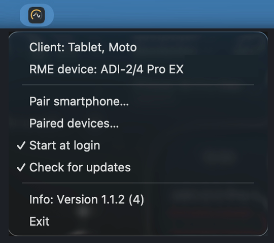 | 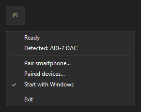 |

| Item | Effect |
| --- | --- |
| Status | Shows whether the host is ready, a smartphone is connected, no ADI-2 was found or USB MIDI is busy. |
| Detected | Shows model and serial number of the connected ADI-2, such as **ADI-2 DAC** or **ADI-2 Pro EX**, or **No ADI-2 detected**. Detection only reads the device list and does not open the MIDI port. |
| Pair smartphone… | Shows a 6-digit code and a QR code. The code is valid for 2 minutes and only once. |
| Paired devices… | Lists paired smartphones; **Revoke** removes a smartphone's access. |
| Start at login / Start with Windows | Starts the host automatically after signing in to the computer. |
| Exit | Quits the host. |

On Windows, allow the host through the firewall for private networks on first start.

**Check for updates** is enabled by default and can be disabled in the host menu. At startup and then at most once a day, the host asks GitHub for the latest version without sending user data. An available update adds a tooltip hint and **Download update X…** to the menu; only clicking this opens the ZIP download for your platform in the browser. Nothing is downloaded or installed automatically.

For **Remote for ADI-2 Host**, pairing and local network privacy, see the [privacy policy](../PRIVACY.md).

### Pairing and connecting

1. Choose **Pair smartphone…** on the host.
2. In the app, open **Connect via host** on the connection screen. Discovered hosts appear in the list; otherwise enter address and port manually.
3. Scan the QR code or enter the code.

The app then connects to this host automatically on every start. A direct USB connection on the smartphone takes priority. Being on the same Wi-Fi is not enough: without pairing, the host forwards nothing. The header shows the green **HOST** field with the computer's name next to **Custom Mode**.

### Behaviour through the host

The host opens USB MIDI only while a paired smartphone is connected and releases it afterwards. It queries the ADI-2 continuously, because the device does not report changes made by other software on its own. Volume therefore appears almost immediately, EQ and other values after about one second; the EQ graph glides to the new state.

Through the host, volume rises only while the app is in the foreground and keeps signalling the host, and never faster than the volume ramp. If the connection drops or the app goes to the background, any increase stops and nothing is caught up later. Lowering, muting and Dim always work immediately. Device setups and factory settings cannot be loaded through the host, because they could raise volumes unnoticed. The analyzer is not yet available through the host.

## Outputs

Use this page to adjust listening level and sound processing for the selected output.

Select **Outputs**, then **Line Out**, **Phones**, **IEM**, **Phones 1/2** or **Phones 3/4**, as offered by the model. The selection identifies the output controlled by the ring, EQ and associated settings. On Pro models, Phones 1/2 can be inactive when **Dual Phones** is off; hold the output selector for headphone configuration.

| Smartphone: Outputs | Tablet: Outputs, portrait |
| --- | --- |
| 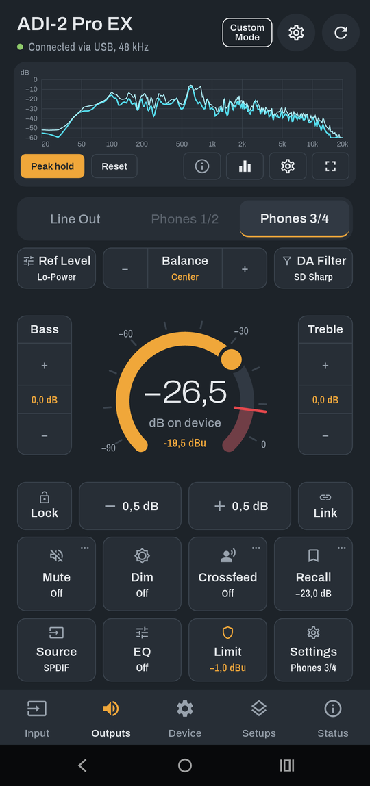 | 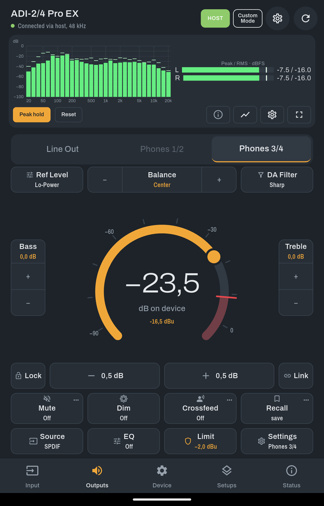 |

### Ring, channels and tone controls

Drag along the volume ring. Movement is relative, so touching a new point does not jump to that absolute volume. The filled arc and number show the current device setting. An outlined target marker and dashed arc indicate a pending increase. The red marker and area show the app's limit. The smaller dBu value is calculated from volume and reference level; it is not a measured audio peak. DAC Line Out shows RCA and XLR values separately.

The **− 0,5 dB** and **+ 0,5 dB** buttons change volume in steps; holding repeats. Decreases are immediate. Increases run through a ramp. Releasing the ring or a held volume control stops an unfinished rise; **Volume rise paused** offers **Stop here** or **Keep raising**. Switching outputs or backgrounding the app also stops volume ramps. The standard view uses a decimal comma on these buttons, while Custom Mode tiles show **−0.5 dB** and **+0.5 dB**.

Use **Bal** to move balance left or right. Holding the balance value in the standard view resets it to centre (**C**). **Bass** and **Treble** adjust tone gain; hold their labels for the detailed tone settings. The reference-level control opens the available **Ref Level** / **Auto Ref Level** choices. The filter control selects the **DA Filter**. When changing reference level, the confirmation can offer volume compensation to keep the output level similar.

### Output buttons

| Control | Tap | Hold / detail |
| --- | --- | --- |
| Mute | Mute or unmute the output | Open headphone/Line muting and toggle settings |
| Dim | Toggle a 20 dB reduction | Show the explanation; there is no separate device Dim configuration |
| Loudness | Toggle loudness | Adjust bass/treble boost and Low Vol Ref; full boost below Low Vol Ref, fading to zero 20 dB above it |
| Crossfeed | Switch off or restore the last selected strength | Select Off or strength 1–5 |
| Recall | Save current volume if empty; otherwise restore the saved value through the ramp | Inspect, replace or delete the saved value |
| Lock | Toggle the device's Lock Volume parameter | In Custom Mode, hold for its parameter view |
| Link | Select outputs to link; tap an active link to clear linking | Reopen Link Volume selection |
| Source | Choose the output's input source | Availability depends on model and Basic Mode; “same as Line” indicates a shared source |
| EQ | Open the output equalizer | In Custom Mode, EQ on/off can be a separate tile |
| Limit | Open Volume Limit | Configure app volume protection |
| Settings | Open the model's output parameters | Includes available reference, filter, stereo, polarity and other DSP controls |

Linked volume changes use the same dB difference for each linked output, rather than forcing identical absolute settings. Select at least two outputs. Each output limit still applies. Recall restores its own output without following the link. Lock is a device parameter; Recall, linking, rise speed and limits are stored by the app per model. ADI-2 Pro and ADI-2 Pro EX share these volume options. ADI-2/4 Pro SE and ADI-2/4 Pro EX also share their volume options. DAC has separate storage.

### Output settings in detail

**Settings** opens parameters for the selected output. Together with the main buttons, the following overview covers its sound and level settings.

| Setting | Effect and use |
| --- | --- |
| Source | Selects the input signal played by this output. Pro models offer **Auto**, **AES**, **SPDIF**, **Analog**, **USB 1/2**, **USB 3/4** depending on model; ADI-2/4 Pro EX also offers **ADAT 3/4**. **same as Line** means the source is shared with Line. |
| Ref Level | Sets the analog reference level or headphone power range **IEM**, **Lo-Power** or **Hi-Power**, where available. A higher range can deliver more output voltage at the same volume setting. |
| Auto Ref Level | Lets the device choose the reference range. **Auto** in the reference selector enables this function; a manual choice disables it. |
| Volume / Balance | Volume adjusts overall level; Balance adjusts the left/right ratio. **C** means centre. |
| Mute / Dim / Lock Volume | Mute, temporarily reduce level by 20 dB, or lock volume control. Mute does not erase the volume setting. |
| Mono | **On** combines both channels into mono; **to Left** sends mono to the left channel. **Off** retains stereo. |
| Stereo Width | Changes the side-signal contribution: 1.00 is normal width, 0.00 is mono; negative values reverse the stereo image. |
| M/S-Proc | Enables mid/side processing for the output. Use only with an appropriate signal path. |
| Polarity | Reverses polarity for **Both**, **Left** or **Right**. **Off** retains the original polarity. |
| Crossfeed | Mixes some of the opposite channel into each headphone channel. **Off** keeps channels separate; 1–5 select the strength. |
| DA Filter | Selects the D/A converter's reconstruction filter. Offered filters depend on model and converter revision, for example **SD Sharp**, **SD Slow**, **Sharp**, **Slow**, **NOS**, **SD LD** or **Brickwall**. On first connection, the app checks once per device whether SD LD is available, restores the previous filter and greys out SD LD if the device does not support it. |
| De-Emphasis | Controls treble correction for sources with emphasis: **Auto**, **On** or **Off**. Do not force extra correction for a normal source. |
| Dual EQ | Enables separate left/right band parameters; see the EQ chapter. |
| Bass/Treble | Enables or disables bass/treble processing together. Adjust gain, frequency and Q with the tone controls or EQ page. |
| Loudness | Makes bass/treble boost depend on volume. **Loudness Bass** and **Loudness Treble** set maximum boost; **Loudness Low Vol Ref** sets the lower reference volume. |
| Digital DC Protection | Selects digital DC protection: **Off**, **On** or **Filter**. The app sends this choice to the device; it does not perform its own DC measurement. |
| Rear TRS Source | Assigns the rear TRS outputs on ADI-2/4 Pro models to **Line 1/2** or **Ph. 3/4**. The choice shown on Line and Phones 3/4 can control the same device parameter. |
| Loopback to USB | Routes this output's signal to USB recording channels. Configure it under **Device**; see the loopback chapter. |

**Note:** The reference-level button offers **Compensate volume (keep loudness)** for a manual change. With this enabled, volume is lowered before switching to a higher reference level; compensation for a lower reference level uses the ramp. The app limit can restrict the attainable value. DAC IEM has a fixed reference level.

## Volume protection

This chapter explains how the app slows volume increases and limits output levels.

### Setting a limit

Open **Limit → Volume Limit** and enable **Limit enabled**. Set the ceiling in dBu; the page also shows the corresponding maximum device volume. Changing Ref Level recalculates the permitted volume and lowers it first if needed. If volume is raised on the device above the ceiling, the connected app turns it back down. This depends on the app remaining connected and is not a permanent hardware limiter. On ADI-2 DAC, the Line Out dBu limit refers to RCA. XLR is 6 dB higher.

**Volume rise** offers **Adaptive**, **20**, **10** and **5 dB/s**. Adaptive becomes slower at higher volume. The speed applies to all outputs. The same page contains **Recall volume** and **Linked outputs**.

### Using ramps, Recall and Link

The ramp gives you time to react to a volume increase. **Adaptive** slows down more at higher volume settings; a large ring movement initially requests a target. The app lowers volume immediately. The target marker can therefore be ahead of the actual ring value. During a ramp, automatic readback requests are deferred and stale volume replies requested shortly beforehand are ignored. A new device volume report that differs from the last value sent ends that output’s ramp, for example when turning the device encoder.

**Recall** remembers one volume value for one output. With no value saved, tapping stores the current setting. Later taps recall that value; increases follow the ramp and stop at the limit. Hold to open management. Under **Recall volume → Use current volume**, store the current value; **Delete** removes it.

**Link** applies volume changes as a difference. With Line Out at −40 dB and another output at −50 dB, a 2 dB increase produces −38 and −48 dB respectively, where each limit allows it. Reaching a limit can change the difference between outputs. Recall affects only its own output. Linking does not share EQ or switch the audio source.

**Lock** toggles **Lock Volume** on the device. The app disables the associated volume controls when the lock is reported. This is separate from the app limit and **Lock UI**.

**Caution:** The dBu limit is calculated from reference level and volume setting. It measures neither headphone sound pressure nor the level in the room. Without an active connection, the app cannot bring down a value raised on the device. Loading a device setup can recall volume levels within the device itself; check **Load Volume with Setup** first.

## Player and status below the header

Use this area to choose the additional information shown above the output controls.

In **App settings → Display below the header**, choose **Player**, **Status**, **Analyzer** or **none**. This area belongs to Outputs. Custom Mode uses the header choice saved in its own layout page.

**Player** uses the active Android media session. Grant notification access using the offered settings link. It can show media information and artwork, send previous/next, play/pause and stop commands, and open the player by tapping its information. Availability depends on the media app. It does not contain a music library. If no usable player content exists, the configured status fallback may appear or the bar collapses. Other platforms do not currently provide this integration.

**Status** shows a compact view of digital input state and clock/sample-rate information. Tap it to open the full Status page.

| Smartphone: Player |
| --- |
| 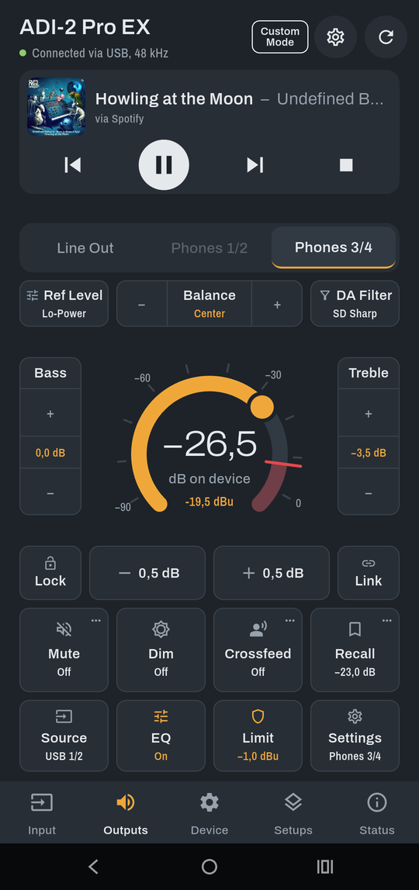 |

**Allow** opens Android notification-access settings. **Do not ask again** dismisses the app's prompt. The player bar controls another media app; it changes neither ADI-2 Source nor calibration. Analyzer or music recording still requires matching playback source and USB routing.

On Android 13 or later, installing a downloaded APK may block access as **Restricted settings**. Try **Allow** once, then open **App info → ⋮ → Allow restricted settings**. Return, choose **Allow** again and enable notification access. The app checks access again when you return.

## Input

Use this page to adjust the analog input signal before it is routed further through the device.

**Input** is available on models with an analog input. Open **Equalizer (input)** to edit its EQ. The page lists the input parameters supported by the selected model, such as **Ref Level**, **Auto Ref Level**, **Trim Gain Left**, **Trim Gain Right**, **Phase Invert**, **M/S-Proc**, **AD Filter**, **Dual EQ**, **AD Conversion** and **DC Filter**. RIAA controls are model dependent. Changes here affect the input path; use Outputs for output-specific processing.

| Smartphone: Input | Tablet: Input, portrait |
| --- | --- |
| 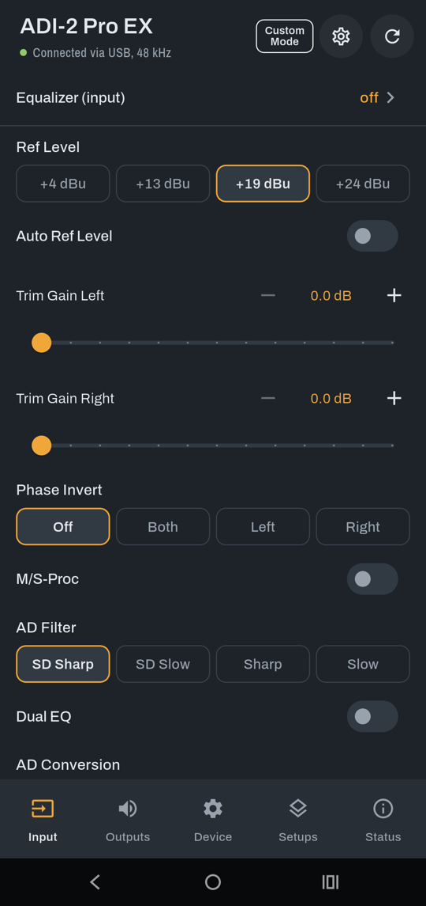 | 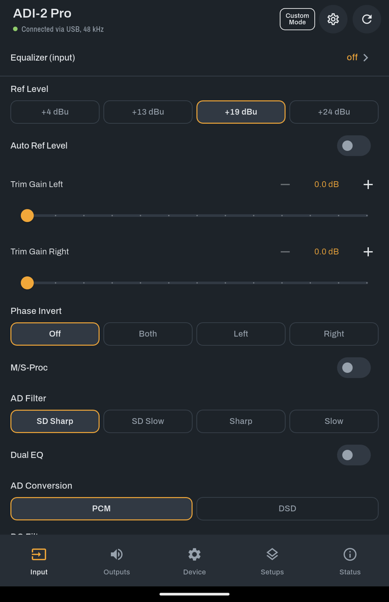 |

### Understanding input parameters

The table explains the available controls; only values reported by the model are visible.

| Setting | Effect and use |
| --- | --- |
| Ref Level | Sets the analog input range. Choose a range appropriate to the source to avoid overload and use the converter effectively. ADI-2/4 Pro EX offers −35 to +24 dBu. |
| Auto Ref Level | Lets the device switch the input reference level automatically. |
| Trim Gain Left / Trim Gain Right | Raises the respective input channel by 0 to 6 dB in 0.5 dB steps, for example to match unequal source levels. |
| Phase Invert | Reverses the polarity of both input channels or one channel; **Off** leaves it unchanged. |
| M/S-Proc | Enables mid/side signal processing in the input path. Leave it off for ordinary left/right stereo. |
| AD Filter | Selects the A/D conversion filter: **SD Sharp**, **SD Slow**, **Sharp** or **Slow**. This is separate from a parametric EQ band. |
| Dual EQ | Allows different EQ curves for left and right inputs. Edit them using **Equalizer (input)**. |
| AD Conversion | Selects **PCM** or **DSD** as the A/D conversion format. |
| DC Filter | Chooses input DC filtering. Depending on model, **Auto**, **ADC**, **RME** or **none** are available; the app presents the reported choices. |
| RIAA Mode | Enables equalization for an appropriate phono signal and selects its gain. ADI-2/4 Pro SE offers **Off** or +14 to +38 dB; ADI-2/4 Pro EX also offers **0 dB**. |
| RIAA Mono Bass | Combines bass into mono during RIAA operation. |
| Bal. Impedance | Selects **94 k** or **47 k** balanced input impedance on ADI-2/4 Pro EX to suit the connected source. |

**Note:** Input EQ processes the input signal. To change only the sound of one headphone, select that output's EQ.

## Device

Use this page to change device-wide signal, clock, headphone and display settings.

**Device** starts with **Save / load backup** and **Loopback to USB**, followed by the parameters reported by the model. Scroll down for further controls and **Setup**. The tables below explain the settings; not every model offers every row.

| Smartphone: Device | Tablet: Device, portrait |
| --- | --- |
| 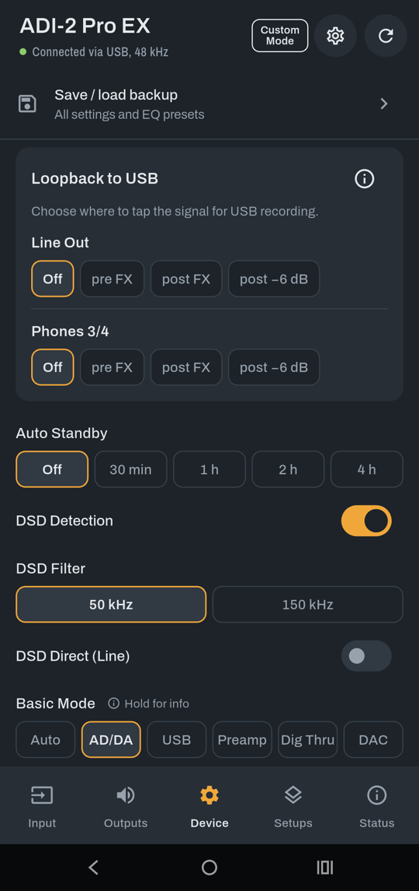 | 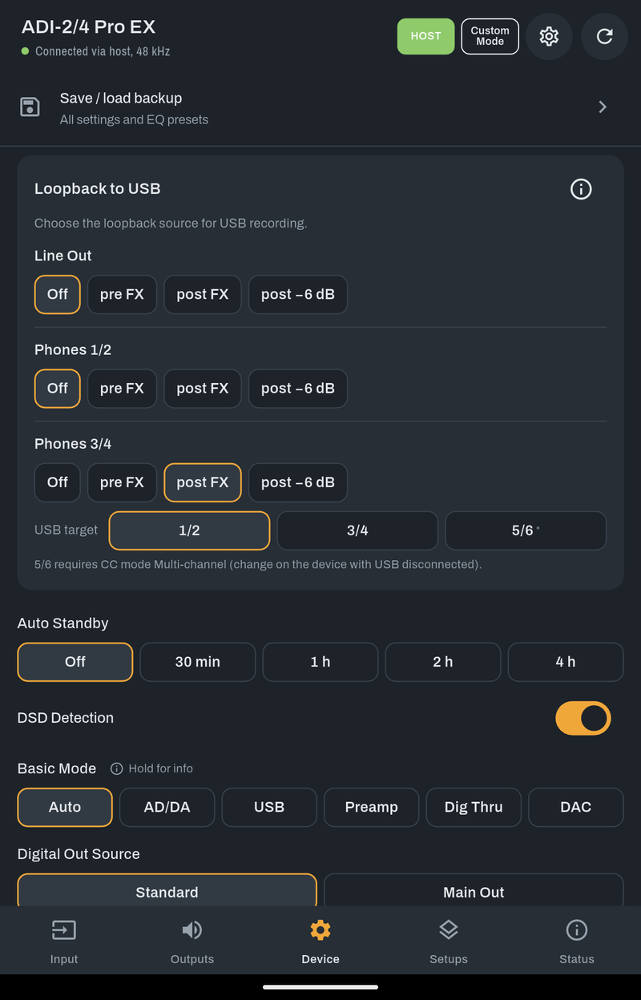 |

### Signal, clock and headphones

These settings determine operating mode, digital routing and socket behaviour.

| Setting | Effect and use |
| --- | --- |
| Basic Mode | Selects the fundamental operating mode on Pro models. Tap to switch; hold for an explanation in Signal flow. |
| Digital Out Source | **Standard** uses the distribution of the current operating mode. **Main Out** sends the processed Main Out signal to the digital outputs. In **Dig Thru and Preamp**, the selection is greyed out on the device and in the app and cannot be selected. |
| Dual Phones | Also enables **Phones 1/2**, for example for a second headphone. |
| Bal. TRS Phones | Configures both headphone sockets for one balanced headphone; select **Off**, **On** or **Auto**. Use only with the appropriate wiring. |
| Toggle Phones/Line | Determines which outputs take part in toggling: **Off**, **Ph 1/2**, **Ph 3/4**, **1/2+3/4**, **all plugged outputs** or **Line/Digit.**. The Custom Mode **Toggle outputs** action uses this configuration. |
| Mute Line with Ph 1/2 / Mute Line with Ph 3/4 | Automatically mutes Line when headphones are plugged into the respective socket. Phones 1/2 also depends on **Dual Phones**. |
| Mute Line when | DAC setting for automatic Line muting or toggling: **Off**, **Phones**, **Toggle Ph/Line** or **Toggle Plugged**. |
| Clock Source | Selects the clock master. **Internal** uses the internal clock, **Auto** automatic selection; external choices are **AES**, **SPDIF**, **SPDIF coax** or **Optical**, depending on model. Check the actual state under **Status**. |
| SPDIF Input | Selects **Auto**, **Coax** or **Optical** for the Pro models' SPDIF input path. |
| SRC Mode | Disables the sample-rate converter or assigns it to **AES In** or **SPDIF In**. This can adapt a digital input source to a different device clock. |
| SRC Gain dig. | Selects **0 dB** or **-3 dB** in the digital SRC path; attenuation provides level headroom. |
| Optical Out Source | Chooses **SPDIF** or **ADAT** as the optical output format. |
| DSD Detection | Enables detection of DSD signals. |
| DSD Filter | Chooses the DSD filter limit **50 kHz** or **150 kHz**. |
| DSD Direct (Line) | Enables the direct DSD path for Line where the device offers it. This path does not use ordinary PCM DSP processing; availability depends on model and converter revision. |

### Display, operation and keys

These controls affect the ADI-2's display and operation; configure the app's display separately under **App**.

| Setting | Effect and use |
| --- | --- |
| Auto Standby | Selects **Off**, **30 min**, **1 h**, **2 h** or **4 h** as the device's standby interval. |
| Display Mode | Selects **Standard** or **Dark** for the device display. |
| Meter Color | Selects **Green**, **Cyan**, **Amber**, **Mono**, **Red** or **Orange** for device metering. The app analyzer can use this color with **Follow device**. |
| Horizontal Meter | Chooses the metering point or view **Post-FX**, **Pre-FX**, **Dual** or **Post-FX dBu** on the device. |
| AutoDark | Enables or disables automatic darkening of the device display. |
| Volume Screen | Enables or disables the device's volume view. |
| Lock UI | Locks device operation according to **Off**, **Remote**, **Keys** or **Keys+Remote**. Separate from locking an individual output's volume. |
| Remap Keys | Selects **Off**, **On** or **IR Remote** for device key assignments. |
| VOL key / I/O key / EQ key / SETUP key | Opens the function list for each device key. Choose, for example, a setup recall, Mute, sound function, filter or EQ preset. Function names remain in English as on the device. |
| Remote key 5 / Remote key 6 / Remote key 7 | Assigns functions from the same model-specific list to additional remote keys on Pro models; these three controls are absent on DAC. |
| Load Volume with Setup | Determines in the **Setup** section whether loading a device setup also recalls volume. Check before loading. |

**Note:** Sample Rate is shown under **Status**. The Device page has no freely adjustable sample-rate control.

### Key assignment functions

The function lists provide the following assignments. The app shows the entries intended for each model; selecting an assignment defines the later key action without executing it immediately.

| Function names in the selector | Assigned key action |
| --- | --- |
| Default, Setup 1 through Setup 9 | Recalls the default configuration or the specified device setup. Check **Load Volume with Setup**. |
| EQ Preset 1 through EQ Preset 9 | Recalls the specified device EQ preset; the key list offers the first nine of the 20 slots. |
| Mono, Mono to L, Mono 1/2, Mono 3/4, Mono all, Mono 1/2 to L, Mono 3/4 to L, Mono all to L | Toggles mono for the indicated path or mono output to the left. |
| Mute, Mute 1/2, Mute 3/4, Mute all | Toggles muting for the indicated scope. |
| Loudness, Loudness 1/2, Loudness 3/4, Loudness all | Toggles volume-dependent sound correction for the indicated scope. |
| EQ enable, EQ In 1/2, EQ Out 1/2, EQ Out 3/4, EQ Out all | Toggles the indicated EQ; **In** means input, **Out** output. |
| B/T enable, B/T Out 1/2, B/T Out 3/4, BT all | Toggles bass/treble processing. |
| EQ+B/T+Ld, EQ+B/T+Ld 1/2, EQ+B/T+Ld 3/4, EQ+B/T+Ld 1-4 | Toggles combined EQ, Bass/Treble and Loudness processing for the indicated scope. |
| Toggle Ph/Line, Polarity, AutoDark, Dim or DIM, Toggle View | Triggers configured output toggling, toggles polarity, automatic display darkening or Dim, or changes the device view. |
| Crossfeed 1 through Crossfeed 5 | Recalls the specified Crossfeed strength. |
| DA SD Sharp, DA SD Slow, DA Sharp, DA Slow, DA NOS, DA SD LD, DA SD LD (Brickwall), Brickwall | Selects the corresponding D/A filter; the actual list depends on model. |
| Source AES, Source SPDIF coax, Source Optical, Source Analog, Source USB 1/2 | Selects the specified input source. |
| RIAA Mode +, RIAA Mode -, RIAA Mono Bass | Steps RIAA mode up/down or toggles mono bass on ADI-2/4 Pro models. |

In Pro function names, **1/2** and **3/4** identify the respective paths, **all** covers multiple paths and **1-4** both output pairs. DAC does not offer these separate Pro assignments. The device stores which function is assigned to each key.

## Basic Mode and Signal flow

Signal flow helps you understand an operating mode and trace a source through to an output.

| Smartphone: Signal flow |
| --- |
| 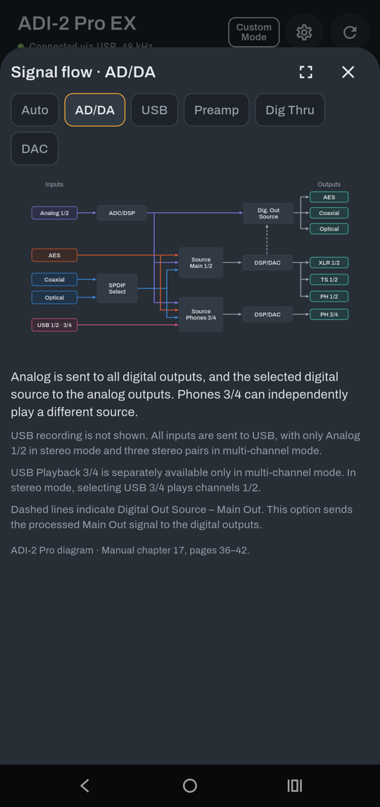 |

### Opening and reading the diagram

Open **Device → Basic Mode** and hold one of the mode buttons. Holding a **Basic Mode** direct tile in Custom Mode also opens the diagram. A short tap on a Basic Mode button outside the diagram switches the device's operating mode instead.

Inside **Signal flow**, switch between **Auto**, **AD/DA**, **USB**, **Preamp**, **Dig Thru** and **DAC**. **Fullscreen** enlarges the drawing; **Exit fullscreen** returns, and **Close** dismisses the diagram. Explanations appear below the drawing; scroll down when needed. With automatic fullscreen enabled, rotating to landscape opens it. In **USB**, you can also view **Stereo · 2/2** or **Multi-channel · 6/8**. The view starts with Stereo; it does not read the actual CC mode.

**Note:** Every choice inside the diagram changes only the explanation displayed. It changes neither Basic Mode nor CC mode on the connected device. The drawings explain ADI-2 Pro signal paths. They are not live measurements or confirmation of routing on every supported model.

| Diagram element | How to read it |
| --- | --- |
| Inputs on the left | **Analog 1/2**, **AES**, **Coaxial**, **Optical** and **USB** are possible sources. USB pair labels identify playback channels arriving from the host. |
| ADC/DSP | Converts analog input to digital and applies input processing. |
| SPDIF Select | Chooses the coaxial or optical SPDIF branch. |
| Source Main 1/2 / Source Phones 3/4 | A source selection point for that output. Several incoming lines represent alternatives, not a summing mixer. |
| DSP/DAC | Output processing followed by D/A conversion before the analog sockets. |
| Dig. Out Source | Distribution to digital outputs; its source depends on operating mode and **Digital Out Source**. |
| Outputs on the right | **XLR 1/2** and **TS 1/2** are the illustrated Line sockets; **PH 1/2** and **PH 3/4** are headphone paths. **AES**, **Coaxial** and **Optical** are digital outputs. |
| USB Rec | A path from device to host for recording. Distinguish it from USB playback on the left. |
| Solid arrow lines | Connections provided in the schematic. Follow a source through selection and processing to its destination. Lines do not indicate measured activity. |
| Dashed arrow lines | The additional path for **Digital Out Source → Main Out**, sending processed Main Out to digital outputs. They do not mean a fault or disconnected cable. |
| Colors | Violet identifies Analog, orange AES, blue SPDIF and pink USB; neutral lines connect further processing stages, and output boxes are teal. Read labels and arrow direction as the main guide. |

### Auto

| Signal flow: Auto |
| --- |
| 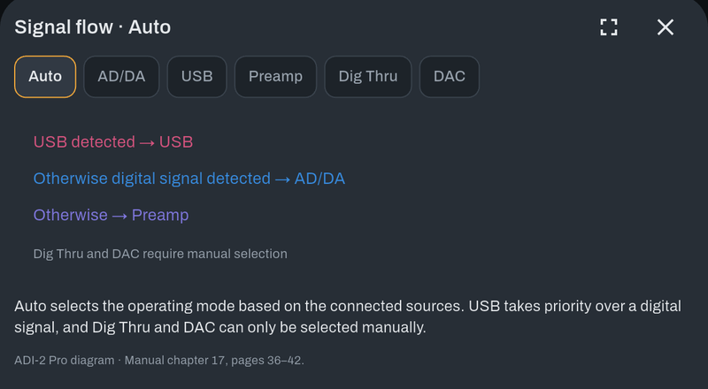 |

**Auto** lets the device determine its fundamental mode from connected sources. The app shows a decision flow: detected USB leads to USB, otherwise a detected digital signal leads to AD/DA, otherwise Preamp. USB therefore takes priority. Dig Thru and DAC require explicit selection.

Example: You alternate between an analog source and USB playback. Auto explains why connecting the USB host can change the fundamental mode. The diagram shows the rule, not continuously updated detection.

### AD/DA

| Signal flow: AD/DA |
| --- |
| 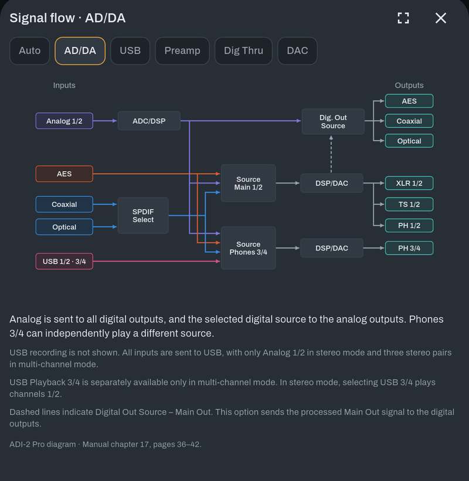 |

**AD/DA** combines two conversion tasks: analog input goes to digital outputs, while a selected digital source can be heard through analog outputs. Phones 3/4 can play a different source from Main 1/2. The source selectors show where each listening path is chosen.

Example: Digitize an analog player while monitoring a digital player through Line. For a separate headphone comparison, set Phones 3/4 to another source.

### USB

| Signal flow: USB |
| --- |
| 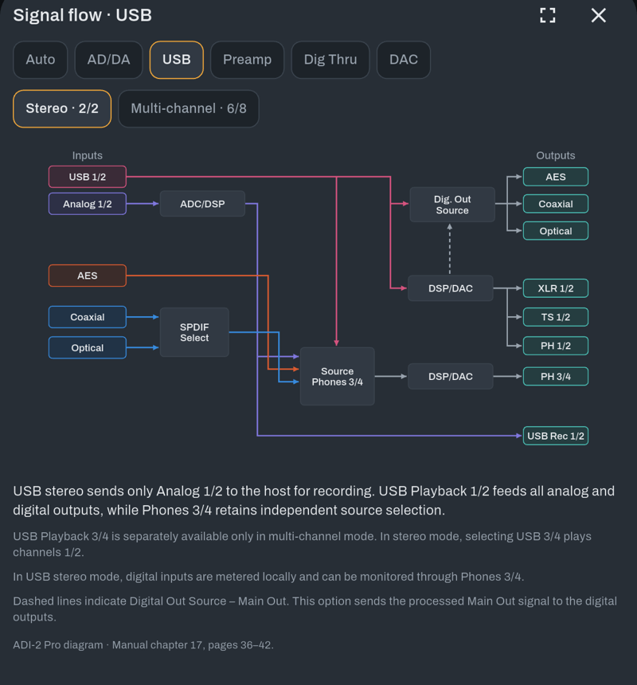 |

**USB** serves playback from the USB host and recording to it. In the stereo schematic, USB Playback 1/2 feeds analog and digital outputs; Analog 1/2 returns to USB Rec 1/2. Phones 3/4 retains source selection. In this stereo mode, digital inputs can be metered locally and monitored on Phones 3/4, but the illustrated standard path does not carry them as separate USB recording pairs.

Example: A host plays music over USB while a recording app captures the analog input. For separate recording of multiple digital sources or separate playback to outputs, inspect the multi-channel schematic.

### Preamp

| Signal flow: Preamp |
| --- |
| 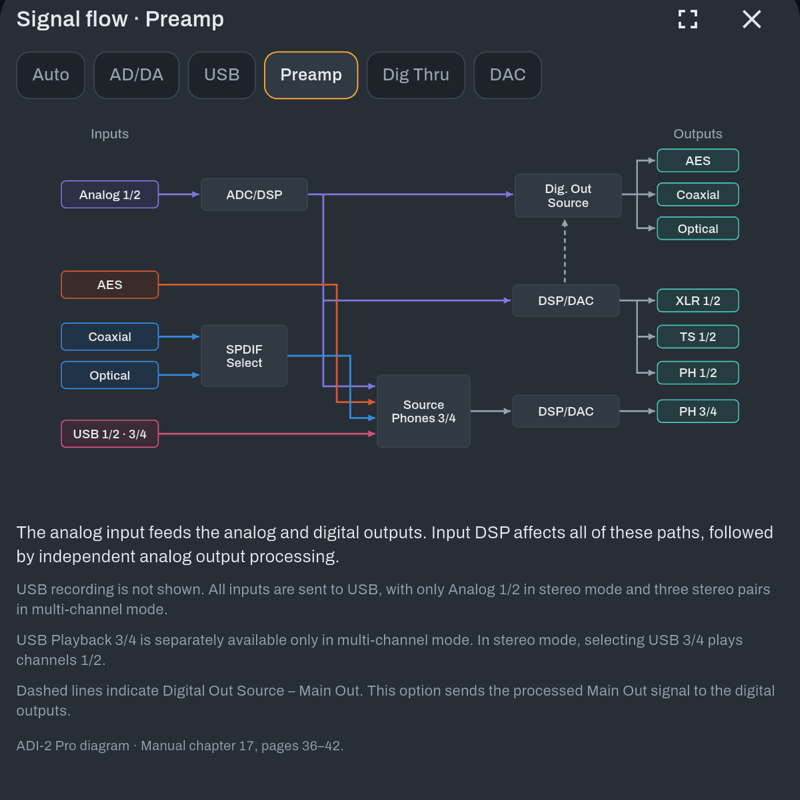 |

**Preamp** uses analog input as the main source for analog and digital outputs. Input processing happens before this distribution. Analog output paths retain their own subsequent processing. Phones 3/4 still has separate source selection in the schematic. **Digital Out Source** is greyed out on the device and in the app in Preamp and cannot be selected.

Example: An analog source should play through Line and headphones and also be sent to a digital destination. An input EQ correction affects the shared input path; headphone correction belongs in output EQ.

### Dig Thru

| Signal flow: Dig Thru |
| --- |
| 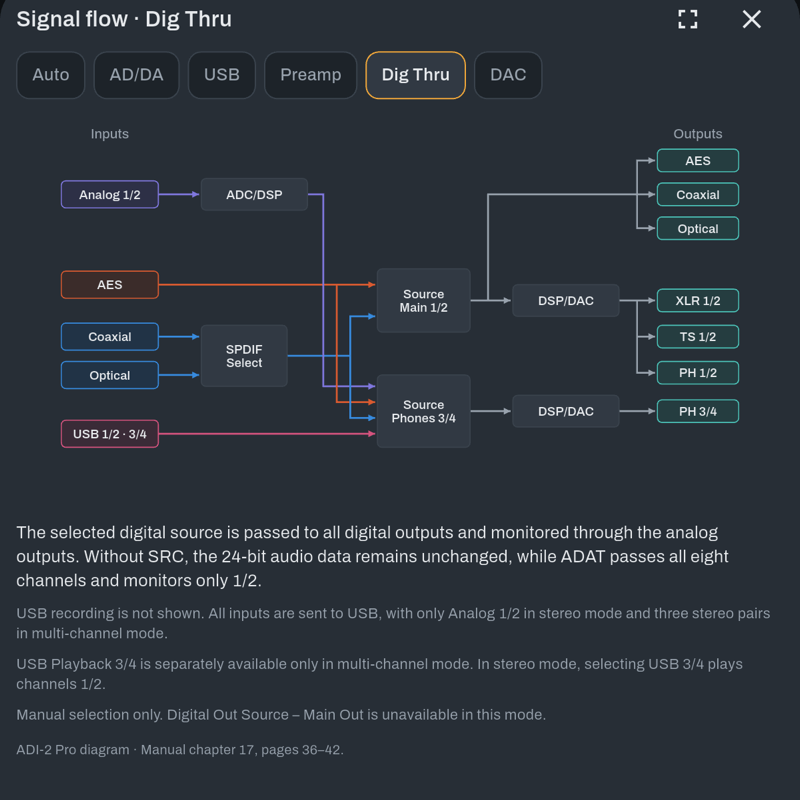 |

**Dig Thru** passes the selected digital source to digital outputs while allowing analog monitoring. Without SRC, the 24-bit audio data remains unchanged on the through path. For ADAT, the explanation describes passing all eight channels while monitoring only 1/2 in analog. The dashed Main Out path is unavailable here.

Example: Forward a digital source to another digital device and monitor it through headphones. Select this mode manually.

### DAC

| Signal flow: DAC |
| --- |
| 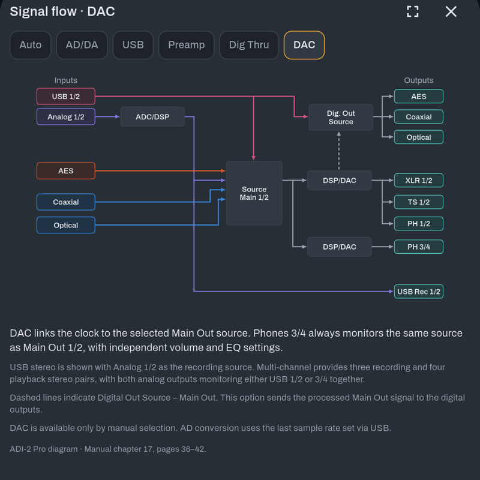 |

**DAC** ties the clock to the chosen Main Out source. Main 1/2 and Phones 3/4 monitor the same source but retain separate volume and EQ. Coaxial and optical appear as separate source choices. A/D conversion uses the sample rate last set through USB.

Example: Send one digital source to speakers and headphones with separate sound correction. Select DAC manually. Here **DAC** is an operating mode of Pro models; distinguish it from the device model **ADI-2 DAC**.

### Distinguishing stereo and multi-channel

The numbers describe USB channels from the host's perspective: recording first, playback second. **Stereo · 2/2** means one stereo pair in each direction; **Multi-channel · 6/8** means three recording and four playback pairs. The mapping below describes the illustrated standard USB path before any alternative loopback assignment.

| Direction | Stereo · 2/2 | Multi-channel · 6/8 |
| --- | --- | --- |
| Recording to host | 1/2: Analog | 1/2: Analog; 3/4: AES; 5/6: SPDIF (ADAT) |
| Playback from host | 1/2 for the output paths | 1/2: Analog 1/2; 3/4: Analog 3/4; 5/6: AES; 7/8: SPDIF (ADAT) |

In USB multi-channel mode, Phones 3/4 with Source Auto monitors USB 1/2 and can, for example, switch to USB 3/4. USB 3/4 is a separate playback stream only in multi-channel mode; in stereo, that selection plays 1/2. **Digital Out Source → Main Out** replaces separate digital playback paths 5/6 and 7/8 with processed Main Out. The multi-channel schematic supports up to 192 kHz.

The app shows the stereo/multi-channel selectors only for the USB diagram. The DAC diagram shows USB stereo and explains multi-channel in its notes: both analog outputs can monitor USB 1/2 or USB 3/4 together. Some other diagrams omit USB recording paths; that does not mean recording is unavailable. To change the actual CC mode, disconnect USB and use **SETUP → Options → Device Mode / DSD → CC-Mode** on the device.

## Loopback to USB

Loopback sends an output signal internally back to USB recording so you can capture it or inspect it in the analyzer.

You do not need a cable from analog output back to input. Loopback is a digital tap inside the device. Under **Device → Loopback to USB**, choose a tap for each available output and, on input-equipped models, the **USB target**. **Info** explains the choices.

| Tap | What reaches USB | Example |
| --- | --- | --- |
| Off | No loopback from this output; the pair's normal recording signal is available unless another loopback replaces it. | Record analog input on USB 1/2 again. |
| pre FX | Signal before output EQ and effects. | Record a source without its output sound correction. |
| post FX | Signal after EQ/effects, before output volume. Loudness still depends on that volume setting. | Record processing or compare it in the analyzer. |
| post −6 dB | Post-FX tap attenuated by 6 dB. | Extra headroom on the USB recording path; the analyzer reads 6 dB lower accordingly. |

**USB target** identifies the recording channel pair at the host, not the output you hear. The choice appears when loopback is enabled. With **Off**, the device value does not store the target pair; check and select it again when re-enabling loopback.

Input-equipped models offer **1/2**, **3/4** and **5/6**; DAC uses **1/2**. Pair 5/6 requires **CC-Mode Multi-channel** and is disabled when Stereo mode is detected. CC-mode detection is currently Android-specific; a selectable target on another platform therefore does not confirm its availability. Change CC mode on the device under **SETUP → Options → Device Mode / DSD → CC-Mode** with USB disconnected.

**Caution:** Loopback replaces the target pair's normal recording signal. To record Analog at the same time, keep its recording pair free or plan a different recording route. A recording app sending its input back to the same playback path can create feedback; disable software monitoring for this route.

### Example: recording music

To capture an output's sound with its processing:

1. Connect the ADI-2 to the recording USB host and select the actual music source for the desired output.
2. For that output under **Loopback to USB**, choose **post FX** and a **USB target** available to the host, for example **1/2**. Choose **post −6 dB** for extra headroom if needed.
3. Select the corresponding ADI-2 input pair in a recording application on that same host and start recording. The remote app has no audio recorder. A mobile device and a computer cannot both act as the direct USB host on the same port at once.
4. After recording, check loopback and choose **Off** when you want to record the original input signal again.

### Example: feeding the analyzer

The app analyzer reads only **USB 1/2**. For the output to inspect, choose **post FX** and **USB target → 1/2**, or use the analyzer's source/loopback selector. Play a signal through the selected output source. Routing to 3/4 or 5/6 does not feed the app analyzer. Level calibration also requires the complete checklist and rules in the Analyzer chapter.

## EQ and fullscreen graph

Use EQ to shape an output or analog input frequency response and save useful curves.

Open **EQ** for an output or **Equalizer (input)**. The top selector chooses a device preset or the available manual/temporary/filter entries. The switch enables the EQ. **Dual EQ** allows separate left/right editing; choose **Left** or **Right**. Without Dual EQ, the shared EQ is edited.

Select bands **1–5**, **Bass** or **Treble**. Drag graph points horizontally for frequency and vertically for gain. Use the selected band's controls for **Gain**, **Frequency**, **Q** and the offered filter types (**Peak**, shelf, high-pass or low-pass as applicable). **Include bass/treble in curve** changes the drawn response; the bass/treble processing switch is a separate control. **Clear** asks to reset the EQ. **Save as preset** stores it in a chosen device slot and overwrites that slot after confirmation. After saving on the live page, the app automatically selects the saved preset for this channel.

The graph's fullscreen icon opens the larger editor. With **Automatically show EQ graph fullscreen in landscape** enabled, rotating a smartphone with an open EQ graph can enter fullscreen automatically. Changes in the live EQ page are sent to the device; storing a preset is a separate operation.

| Smartphone: Equalizer | Tablet: Equalizer |
| --- | --- |
| 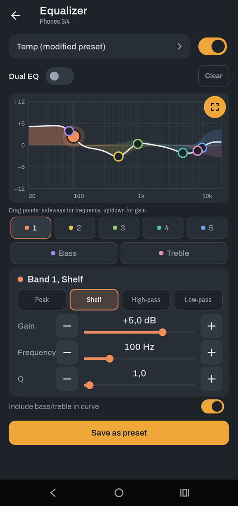 | 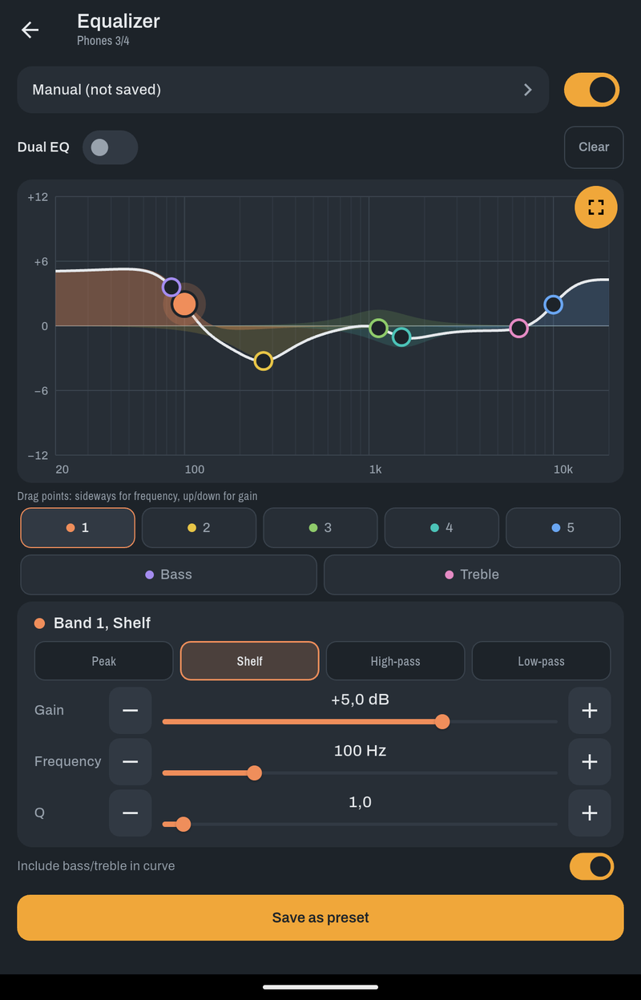 |

### Understanding bands, filters and Q

Each band changes part of the frequency range. **Frequency** sets its position, **Gain** its boost or cut, and **Q** its shape: a low Q makes a Peak filter broad, while a high Q targets a narrow region. For shelf and pass filters, Q shapes the transition. Gain ranges from −12 to +12 dB in 0.5 dB steps; Q uses 0.1 steps. Sliders and minus/plus buttons allow precise adjustments. Gain has no effect for high-/low-pass filters and is hidden or disabled.

| Band | Frequency range | Q | Filter types in the interface |
| --- | --- | --- | --- |
| 1 | 20 Hz–20 kHz | 0.5–9.9 | **Peak**, **Shelf**, **High-pass**, **Low-pass** |
| 2 and 3 | 20 Hz–20 kHz | 0.5–9.9 | **Peak** |
| 4 | 200 Hz–20 kHz | 0.5–5.0 | **Peak** |
| 5 | 200 Hz–20 kHz | 0.5–5.0 | **Peak**, **Shelf**, **Low-pass** |
| Bass | 20–150 Hz | 0.5–1.5 | Fixed low shelf |
| Treble | 3–10 kHz | 0.5–1.5 | Fixed high shelf |

**Peak** boosts or cuts around a centre frequency. **Shelf** shifts a whole region below the corner frequency for band 1 or above it for band 5. **High-pass** attenuates lower frequencies; **Low-pass** attenuates higher ones. Bass and Treble are additional shelf controls; their fullscreen type labels are **Low-Shelf** and **High-Shelf**.

The graph's horizontal axis shows frequency and its vertical axis shows gain in dB. The curve is calculated from EQ parameters, not a measured spectrum. Select a point or band and drag sideways for frequency or vertically for gain. Adjust Q with its control. The fullscreen editor uses the same values as the underlying view.

### Dual EQ and Bass/Treble

With **Dual EQ**, edit the five bands for **Left** and **Right** separately, for example for different channel corrections. Check the selected side before editing. Without Dual EQ, the common EQ is edited. **Bass** and **Treble** remain shared tone controls and do not follow the left/right selection.

**Include bass/treble in curve** includes or excludes their contribution to the calculated curve. This display switch does not enable processing. Use **Bass/Treble** or the switch on a selected Bass/Treble band for that. The main EQ switch and Loudness are also separate functions. A visible curve alone therefore does not identify which processing is audible.

### Live EQ, selection and saving

On the live EQ page, edits go directly to the selected device channel; they do not automatically update a saved preset. The top selector shows **Manual (not saved)**, **Temp (modified preset)**, device slots **Preset 1–20**, **Reset (flat)** or **Rumble filter**. Temp identifies an edited preset state. Selecting another device preset changes live EQ.

After confirmation, **Clear** resets both sides' band values, including Bass/Treble, to defaults with 0 dB gain. Saved presets are retained; EQ enable, Bass/Treble enable and preset selection remain unchanged. The **EQ preset editor** under Setups initially works in its own buffer instead.

Example: Select band 2 as **Peak**, 500 Hz, −2 dB and Q 1.0 for a broad cut. Listen quietly and compare using the EQ switch. To keep the curve, choose **Save as preset**, a device slot and a name, review the overwrite and confirm. Boosts can reduce digital headroom; reduce gain if clipping occurs.

## Setups and EQ preset editor

Use this page to prepare EQ presets separately from live EQ and manage their storage.

**Setups** combines an **EQ preset editor**, **EQ presets (1–20)**, **Device setups 1–9** and **More**. Scroll below the editor to reach the device slots.

The editor and clipboard exist only while this page is open. Switching the main tab discards an unsaved draft. Save it to the device or app library first.

| Smartphone: EQ preset editor | Tablet: EQ preset editor |
| --- | --- |
| 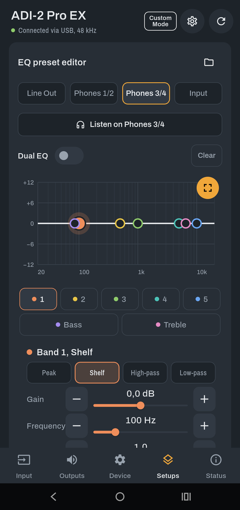 | 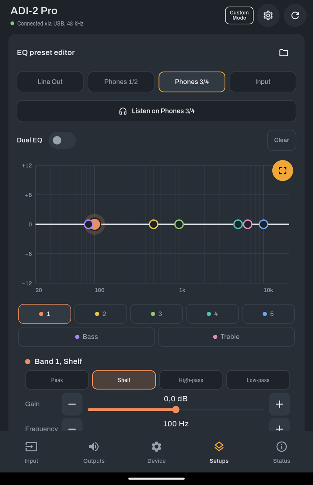 |

1. Choose the editor's target output or Input.
2. Tap one of **EQ presets (1–20)** to load its contents into the editor. **Refresh** reads device presets again. **Not loaded** means the contents have not been read.
3. Edit bands and Dual EQ, using the graph and controls as on the live EQ page. **Copy** and **Paste** transfer the editor contents. Holding a preset slot edits its name in the editor; **Store to device** is needed to write the edited preset and name.
4. Enable **Listen on …** to send the editor EQ to the selected target. While listening, edits, loading another preset or changing target apply the editor to that target. Turning listening off stops further editor writes; it does not restore the previous EQ.
5. Use **Store to device** to overwrite the selected device EQ slot. The **File** menu offers **Save to app library**, **Load from app library**, **Import** and **Share**. Library entries can be loaded, renamed, shared and deleted. These app presets are separate from device slots.

**Device setups 1–9** provides **Load** and **Save** for complete device configurations. Save asks before overwriting. These device setups are distinct from EQ presets and the four Custom Mode layout slots. **More** opens backup and offline transfer; offline mode offers the local default reset instead of connected-device operations.

### Example: preparing a preset carefully

This sequence keeps control over when a draft becomes audible and when it is saved:

1. Leave **Listen on …** off initially and load a device slot that has been read, or an app preset under **File → Load from app library**. Loading replaces the editor contents; keep any needed draft in the library first.
2. Edit the bands. **Clear** resets the editor here; with listening enabled, the reset contents are also sent to the target. **Copy** keeps a copy of the entire editor EQ, including Dual EQ, in the app clipboard; **Paste** applies it and also sends it to the target when listening is enabled.
3. Select the correct target channel and a low listening volume, then enable **Listen on …** for comparison. The editor sends band values and Dual EQ; also check whether EQ and Bass/Treble are enabled at the target. Listening is not an undo function.
4. Use **File → Save to app library** and enter a name. This uses none of the 20 device slots. **Import** loads an EQ-preset JSON file from this app into the library and editor; arbitrary text lists and other preset formats are not read.
5. For permanent device storage, select the destination preset slot, edit or load the desired contents and use **Store to device**. Selecting a slot first loads its contents into the editor. You can then reload a library draft. Storing alone does not select it as a live preset; listen or select it on the live EQ page for that.

**Share** exports one app EQ preset as a file. The library menu can load, rename, share or delete an entry after confirmation. Deleting there removes only the app entry. App presets contain band values including Bass/Treble and Dual EQ, not volume, source or a complete device configuration.

## Setups, backups and offline mode

Use this chapter to choose the right storage method for an EQ curve, a device configuration or an app layout.

### What is stored where?

| Storage method | Contents and location | When to use it |
| --- | --- | --- |
| Live settings | The connected device's current state. | Listen and adjust directly; save separately for later recall. |
| Device setups 1–9 | Device configurations in the ADI-2. | Recall different operating and listening configurations on the device. |
| EQ presets 1–20 | EQ curves in device slots. | Load sound correction without recalling a complete setup. |
| App library | Named EQ presets in app storage, individually shareable. | Collect EQ drafts and exchange them between installations as files. |
| Backup | Current device parameters, the 20 EQ presets and read setup names as a file in app storage. | Save a working device state outside the device. The nine setup slots' contents are not read. |
| Offline settings | Locally prepared current parameters for each model. | Work without hardware, then transfer to the same model. |
| Custom Mode, slots 1–4 | Tiles, colors, output pages and extra display for each model in the app. | Switch control panels; these do not store device settings. |

ADI-2 Pro and ADI-2 Pro EX share offline and layout storage. ADI-2/4 Pro SE and ADI-2/4 Pro EX have separate offline and layout storage but share volume options. These options include limits, Recall, links and rise rate and are stored by device model ID. DAC has separate storage.

### Operating device setups and backups

Under **Device**, in the lower **Setup** section, select a slot, then **Load** or **Save**. Hold a slot to rename it. Saving overwrites that device slot after confirmation. **Factory** resets current device settings after confirmation. **Load Volume with Setup** can make loading a setup change volume; review it before recalling setups. With **Load Volume with Setup** enabled, **Device → Setup → Load** and **Load** in a Custom setup tile’s long-press menu warn before loading. **Load** on the **Setups** page and a short tap on a direct setup tile recall the setup without this confirmation.

Open **Save / load backup** from Device or **Setups → More**. **Back up now** reads device settings and the 20 EQ presets into an app backup. Saved backups can be shared, imported, restored or deleted from the app. Export a copy using **Share** if you need it outside app storage. Restore requires a connected matching model. Its confirmation optionally enables **Also overwrite the 20 EQ presets**. Restored volumes are applied only if lower than current values. App limits also apply with the new Ref Level. A higher Ref Level can make the output louder even if the volume value does not rise. Lower the outputs beforehand or enable a volume limit. A backup of device settings is separate from Custom Mode layouts and app preferences; it is not an archive of the device's nine stored setup slots.

### Restoring a backup or transferring offline settings

To restore, import the backup JSON file if needed, then tap the saved entry or choose **Restore** from its menu. Check model, date and the EQ-preset option. With that option enabled, occupied backup presets overwrite their corresponding device slots; empty backup presets do not clear a device slot. Saved setup names can be restored, but their slot contents cannot. **Delete** removes only the backup file from the app; a previously shared copy is retained.

Offline transfer instead uses the offline state saved for each model, not a backup file. Opening the app does not automatically overwrite a connected device with that state. Explicitly choose **Setups → More → Transfer offline settings**. Even unchanged offline defaults can replace current device settings. See First steps for details and exclusions.

**Caution:** “Volume levels only lower” during restore and transfer refers to saved volume values. Other applied settings, such as reference level, source or EQ, can change the audible level. Start quietly and check routing after applying settings. A backup does not save app layouts, volume-protection settings or the entire app library.

## Status

Use this page to check detected sources and the operating and output state reported by the device.

**Status** shows device mode, clock and sample rate, digital inputs with synchronization and format information, USB state and **Output State** for each output. Choose **dBFS** or **dBu** for the output volume representation. This is device state and calculated output level, not the analyzer's live Peak/RMS audio measurement. Active DSP functions appear as labels. Device-reported overcurrent, DC or power warnings appear at the top; investigate them at the device before continuing to listen.

| Smartphone: Status | Tablet: Status, portrait |
| --- | --- |
| 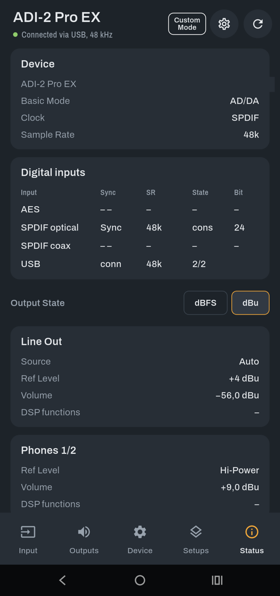 | 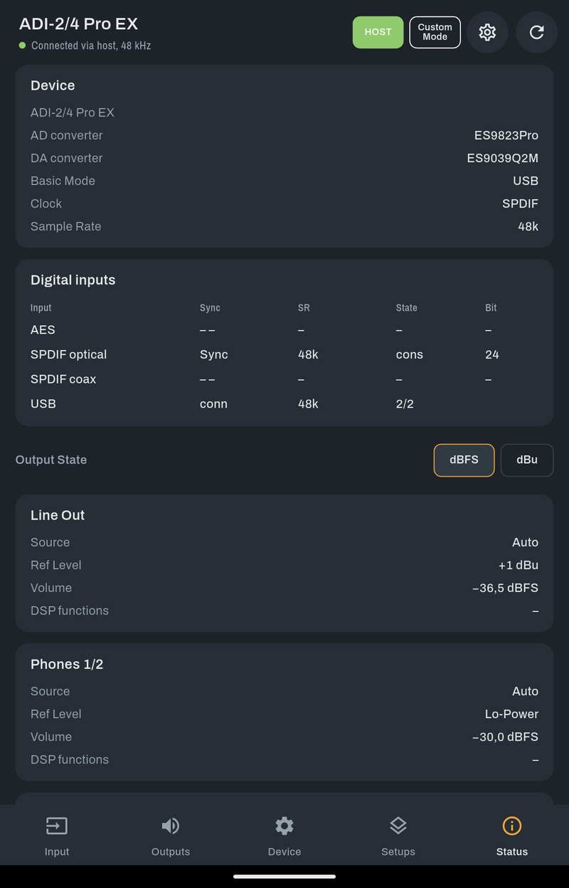 |

### Interpreting status information

The **Digital inputs** table helps diagnose a missing signal.

| Display | Meaning |
| --- | --- |
| Sync | Digital input is detected and synchronous with the device clock. |
| Lock | A digital signal is detected but not reported as synchronous. Check Clock Source and, where relevant, SRC. |
| – – / – | No corresponding data reported for that input. For SPDIF, data is shown only for the selected optical or coaxial branch. |
| SR / Bit | Reported sample rate and word length of the digital input. |
| pro / cons / DSD | Reported professional/consumer format or DSD. **Non-Audio** indicates a signal reported as non-audio; **Emphasis** indicates that flag. |
| USB conn | The app indicates a device connection. The USB row does not detect the actual stereo/multi-channel CC mode. |
| Output State | Source, Ref Level, volume and indicators for Mute, Lock, Dim and active DSP functions for each output. |

The selected Basic Mode setting can be **Auto**, while Status reports the mode actually chosen as a result. A dBu value under Output State is calculated from device settings; it does not show captured music level. Open the analyzer for an audio display.

## ADI-2 DAC

This chapter explains how the DAC interface differs from Pro models.

The ADI-2 DAC has no analog input, so there is no Input page. Its outputs are Line Out, Phones and IEM. Line Out shows RCA and XLR values separately.

| DAC: Outputs | DAC: Device |
| --- | --- |
| 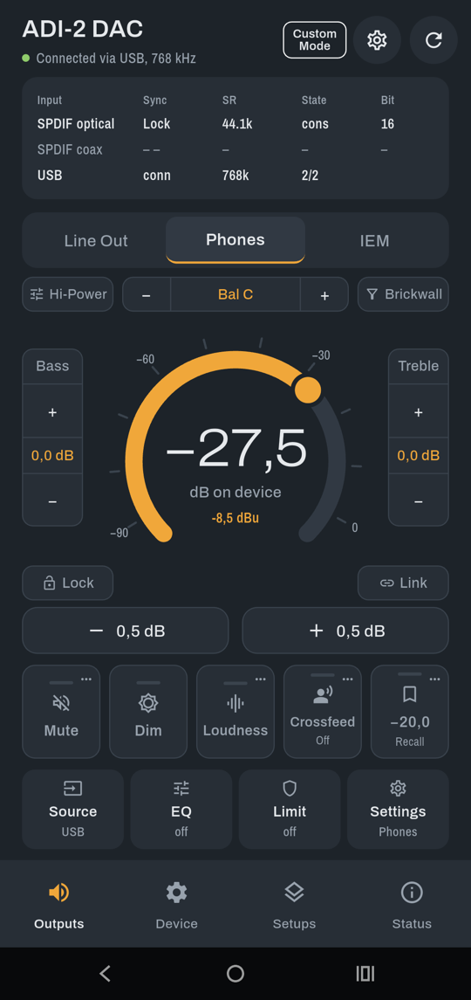 | 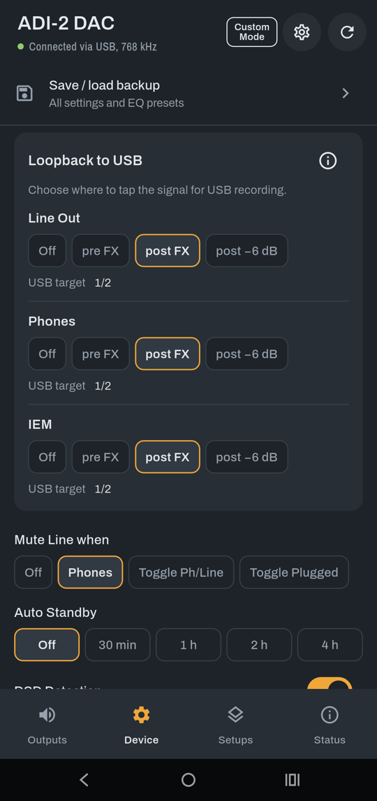 |

| DAC: Setups | DAC: Status |
| --- | --- |
| 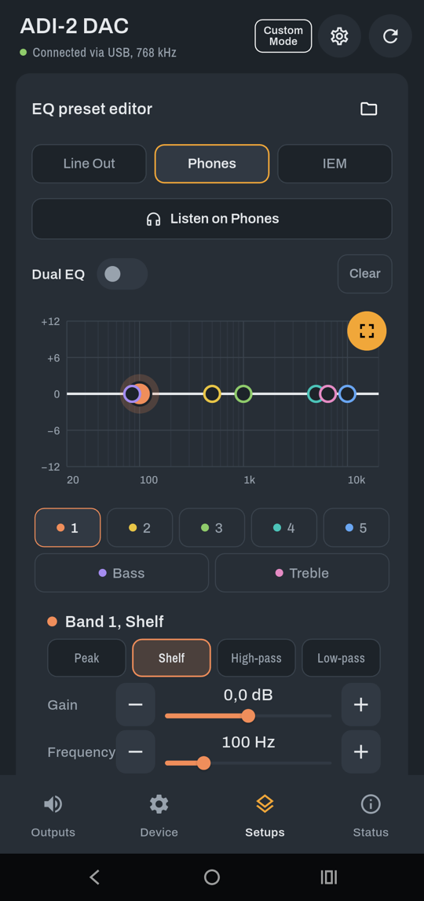 | 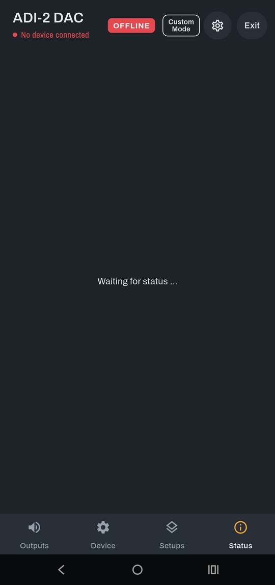 |

**Source** offers **Auto**, **SPDIF coax**, **Optical**, **USB**, **USB (Rec coax)** and **USB (Rec opt.)**. The final two select USB playback with the indicated digital input for USB recording. Loopback can in turn replace that recording on 1/2.

The app uses a fixed −3 dBu reference level for IEM. Line's displayed XLR reference values are 6 dB above RCA. **Mute Line when** controls headphone insertion behaviour. **Switch to active output automatically** lets the app output selection follow the DAC's reported active socket. Pro Basic Modes and their direct tiles are not offered for DAC. The verification limitations at the start of this guide still apply.

## Custom Mode

Use Custom Mode to build a control panel containing the controls and direct actions you use most.

Tap **Custom Mode** in the header to switch to the saved tile layout. The regular navigation pages remain accessible. Open **App settings → Configure Custom Mode → Edit** to configure it; first connect a device or choose an offline model.

| Smartphone: Custom Mode | Tablet: Custom Mode, portrait |
| --- | --- |
| 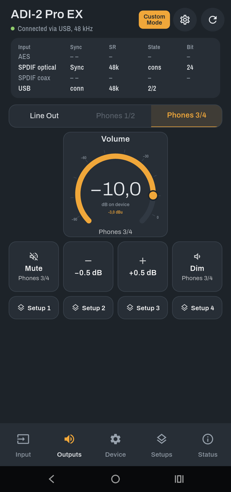 | 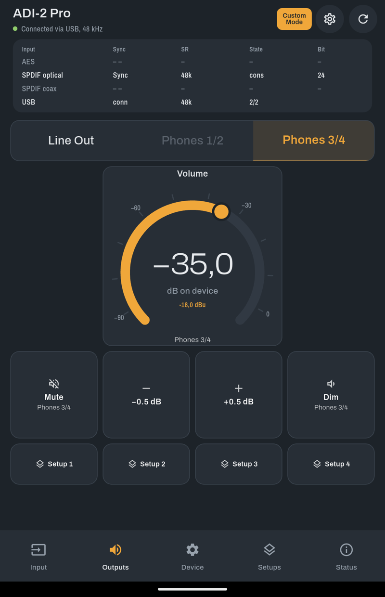 |

| Custom Mode editor |
| --- |
| 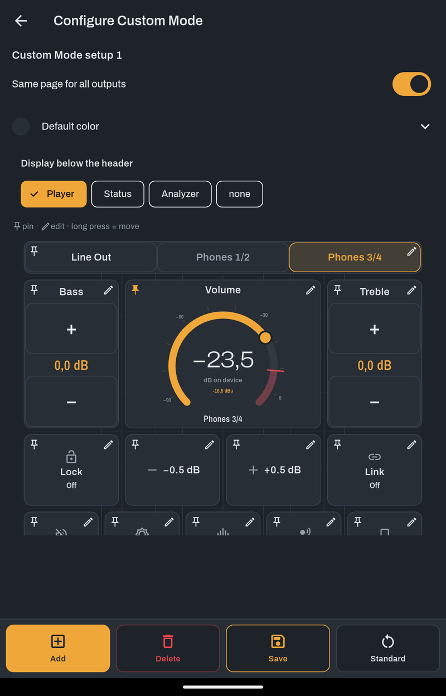 |

There are four layout slots per model variant. ADI-2 Pro and ADI-2 Pro EX share these slots. Tap a slot preview in App settings and confirm to activate it. Empty slots use the default layout until edited. In the editor, **Save** stores the current layout in a chosen slot with an optional name. **Delete** removes the tiles and name; the slot is then free and shows the default layout. **Standard** replaces the tiles with the default layout and keeps the name. Both actions ask for confirmation first.

Use **Add** for a ring, volume steps, output selector, sound/output controls or direct buttons. Direct buttons can recall device setups, EQ presets, an explicit source, Basic Mode or volume, toggle outputs, or apply an app EQ preset. A library preset is copied into its tile; later library edits do not automatically update that copy. A tile can refer to the **Selected output** or a fixed output when offered.

Tap the edit icon to change a tile's label, color, target and size. The width picker offers fractions from one fifth to full width, subject to the selected tile's size limits. Heights use half-row steps up to two rows, again depending on tile type. Swipe sideways through width choices. Hold and drag a tile in the editor to move it on the grid. Pin it to retain its grid position; colliding pinned tiles may be moved to the next free position, with a warning. Choose a **Default color**, or override individual tile colors.

With **Same page for all outputs** enabled, outputs share a page. Disable it for separate output pages. Select the output in the editor or swipe between output pages, then use **Copy to other outputs …** when needed; copying overwrites the selected destination pages after confirmation. Each page has its own **Display below the header** choice.

Outside the editor, holding a tile opens its relevant details: Loudness parameters, Crossfeed strength, Recall management, output choices or the Basic Mode signal diagram. Holding volume-step buttons repeats volume changes instead of opening a menu. A held device-setup tile offers load, save current settings and rename. Standard volume ramps, limits and device locks still apply.

### Which tiles are available?

The **Add** catalog groups the available functions. **Selected output** follows your output selection; a fixed output remains that tile's target even when switching pages.

| Tiles | Operation in the finished layout |
| --- | --- |
| Volume, −0.5 dB, +0.5 dB | Drag the ring or change volume in steps; holding step buttons repeats. |
| Output selection | Chooses the output controlled in the app. Hold for headphone configuration on Pro models. |
| Mute, Dim, Loudness, Crossfeed | Toggle the respective function. Hold for details, or the explanation for Dim. |
| Recall, Link, Lock | Store/recall volume, link outputs or lock volume. Hold for the associated management or parameter view. |
| Bass, Treble, Bal | Change values with minus/plus; hold for details. Unlike the standard view, holding Bal here opens the balance control. |
| Ref Level, DA Filter, Source | Select a value using segments or a dialog, depending on tile size. Hold to open the relevant selector. |
| EQ on/off, Open EQ page | Toggle EQ or open its live editor. Holding either opens live EQ. |
| Limit, Settings | Open volume protection or output settings; holding does the same. |
| Load setup | Recalls the configured device setup 1–9. Hold for load, save current settings and rename. |
| Load EQ preset | Selects a device EQ preset 1–20 for the target. Hold to open its live EQ page. |
| Select source directly | Sets the stored source for the target. No additional hold action. |
| Toggle outputs | Triggers the device toggle action according to its toggle/mute configuration. Hold to open **Mute and toggle**. |
| Select Basic Mode | Sets the stored mode on Pro models. Hold for Signal flow. |
| Set volume to X dB | Requests the stored volume from −114.5 to +6 dB for the target. Increases use the ramp and limit. No additional hold action. |
| App EQ preset | Applies the stored copy of a library EQ including Dual EQ to the target without overwriting a device slot. Check EQ enable at the target. No additional hold action. |

**Caution:** Tapping a direct tile executes its action immediately. A setup tile can also load stored volume levels when **Load Volume with Setup** is enabled. Check source, target and that device option before use.

### Understanding the grid and saving

The editor preview is for configuration: tap to edit a tile, or hold and drag to move it. Use the pin icon to pin or unpin its position; the edit icon opens size, label, color, target and any direct-action value. **Remove** deletes only the tile.

Width is a fraction of the whole control panel, not a fixed pixel size. The scale is **Square = ¼ width · height 1**; height 0.5 is half as tall, height 2 twice as tall. The ring requires at least half width. Its height follows the width so that it grows when widened: half width gives height 2, ¾ gives height 3, full width gives height 4. Unavailable combinations are disabled. Floating tiles fill the available grid; pinning reserves a position. Size changes can make pinned tiles collide, in which case the app can move them and displays a warning.

Edits are saved in the active model/layout slot. **Save** stores the current overall design in the chosen layout slot with an optional name; it does not save to the device. Preserve an existing layout in another slot before rebuilding it. A shared page can later be split into output pages again; previously created separate pages survive a temporary switch to the shared page.

### Example: building a headphone panel

To configure a page for a headphone output:

1. Connect the device or select its offline model. Open **App → Configure Custom Mode → Edit**. If needed, preserve the existing layout in another slot with **Save**.
2. Disable **Same page for all outputs** and select the headphone output. The page starts as a copy of the shared page if that output has no page yet.
3. Keep or add a Volume ring through **Add**, with half width and height 2. Remove unwanted tiles through their edit dialog.
4. Add **Mute**, **Recall** and **Open EQ page**. Set their target to **Selected output**, so switching output pages makes the controls operate on that output. For a permanently available Line mute, you could instead add a separate Mute tile fixed to Line Out.
5. Drag tiles into place and pin important positions. Choose a **Default color** and, for example, **Status** under **Display below the header**.
6. Use **Save**, select one of the four layout slots and optionally enter a name. Leave the editor and activate the corresponding slot preview in app settings if needed.
7. Switch to the finished panel with **Custom Mode**. First check at low volume that each tile controls the intended output. Use **Copy to other outputs …** for similar pages; this overwrites the selected destination pages.

## Analyzer

The analyzer displays captured USB audio as a spectrum and as peak and RMS levels.

Choose **Analyzer** under **Display below the header**, or use the tablet’s landscape **Extra panel**. Grant recording permission when requested. The app analyzes USB audio while the analyzer is visible. On Android, the app must also be in the foreground. On Mac, the analyzer continues in a visible window without focus. Capture stops when the analyzer is hidden or another page covers it. The app does not save the audio or use the smartphone microphone.

**macOS:** Connect the ADI-2 directly to the Mac over USB and grant the app microphone permission. The analyzer explicitly selects the ADI-2 input and does not capture without it. Capture also refuses multiple matching ADI-2 inputs because the target would be ambiguous. The Mac's default audio devices stay unchanged. Shared Dart signal processing provides the same band resolutions and displays as iOS. No audio files or monitoring are produced. The Mac analyzer has not yet been verified on real hardware.

### Platforms and limitations

On **Android**, the app processes USB audio and checks the recording route. A message about the smartphone microphone or another recording device means that a valid ADI-2 recording is unavailable; do not use those readings for calibration. **Grant permission** allows access; **Try again** restarts capture after resolving an interruption.

On Mac, the analyzer has not yet been confirmed on real hardware.

### Source and loopback

The capture pair is **USB 1/2**. With loopback active on that pair, the analyzer shows the routed output; otherwise input-equipped models can show the analog input. The information line identifies the route and capture sample rate. Open the source/loopback controls to choose **Automatic (active output)** or a particular output, then **Tap**: **Off**, **pre FX**, **post FX** or **post −6 dB**. Enabling loopback on USB 1/2 replaces analog input recording on that pair and requires confirmation on first use. Competing output loopbacks on USB 1/2 are disabled; routes on other USB pairs are preserved. On DAC, Automatic follows the device-reported active output; on Pro models it follows the output selected in the app. While the analyzer is visible, a confirmed automatic route follows a change of output after about one second. Merely reopening the analyzer does not overwrite an existing route.

Use **post FX** for comparison with the device: the signal is after EQ/effects and before Volume. Loudness remains dependent on volume. pre FX excludes those effects; post −6 dB lowers the USB readings by 6 dB. The device's Post level meters are after Volume, so they are not the same measurement point.

### Display and readings

- **Lines** and **Bars** choose the spectrum presentation. The frequency axis runs from 20 Hz to 20 kHz; Bars cover 25 Hz–20 kHz. **Band resolution** offers **1/3 octave**, **1/6 octave** and **1/12 octave**. For comparison with the device, use Bars and 1/3 octave.
- **Peak hold** retains peak indications. **Ballistics** offers **fast**, **medium** and **slow** response. Lines/Bars, Peak hold and Ballistics are remembered when the device is rotated or the app restarts.
- **Level range** selects 60, 80 or 100 dB of vertical range.
- **Analyzer color** offers **Follow device**, **Green**, **Cyan**, **Amber**, **Mono**, **Red** and **Orange**.
- **Peak / RMS · dBFS** shows left/right captured audio levels with the saved calibration offset. A full-scale sine has 0 dBFS peak and about −3 dBFS RMS. Clipping is shown separately. Spectrum bands reference a full-scale sine at the band centre to 0 dB. Filter responses and ballistics can differ from the device; its lowest band also includes DC.

Open **Analyzer settings** for these options and calibration. In fullscreen, **Spectrum only** hides the control bar and **Show controls** restores it. The fullscreen illustrations below are landscape. On tablets, fullscreen keeps the current orientation.

| Smartphone: Lines, compact | Smartphone: Bars, compact |
| --- | --- |
|  | 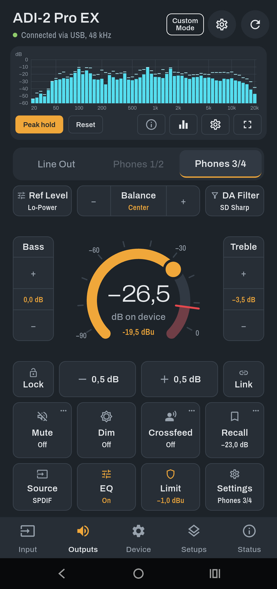 |

| Tablet: Lines, portrait | Tablet: Bars, portrait |
| --- | --- |
| 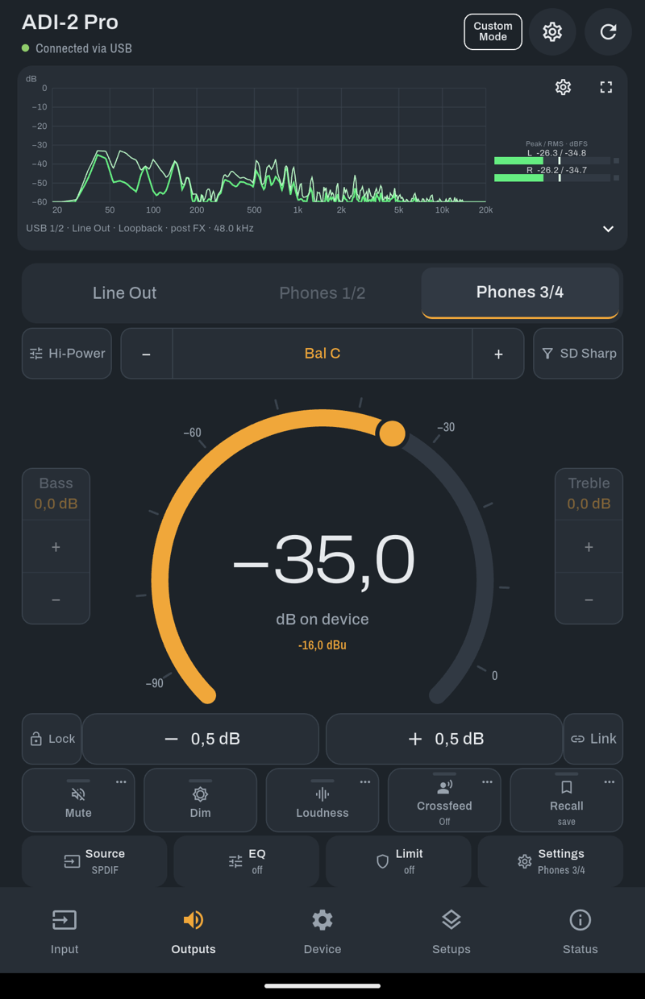 | 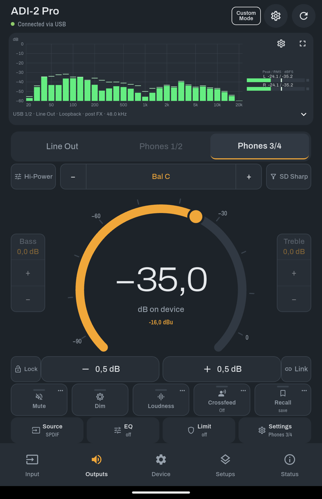 |

| Tablet: Analyzer settings | Smartphone: Lines, landscape fullscreen |
| --- | --- |
| 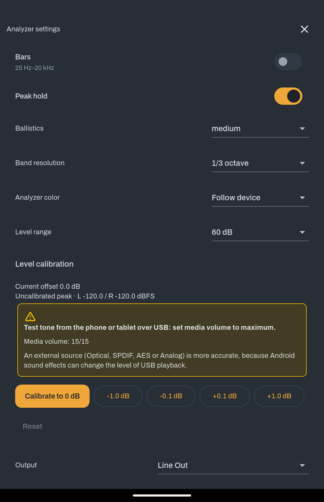 | 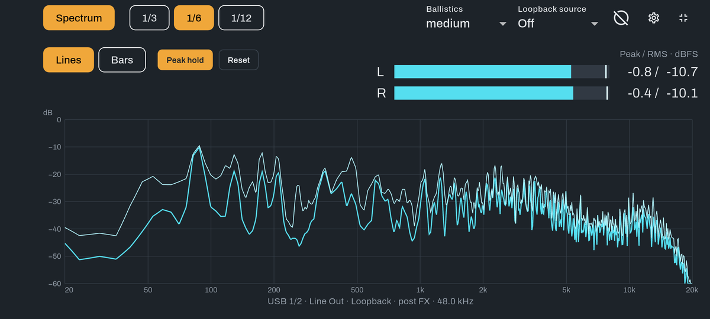 |

| Smartphone: Bars, landscape fullscreen | Tablet: Lines, landscape fullscreen |
| --- | --- |
| 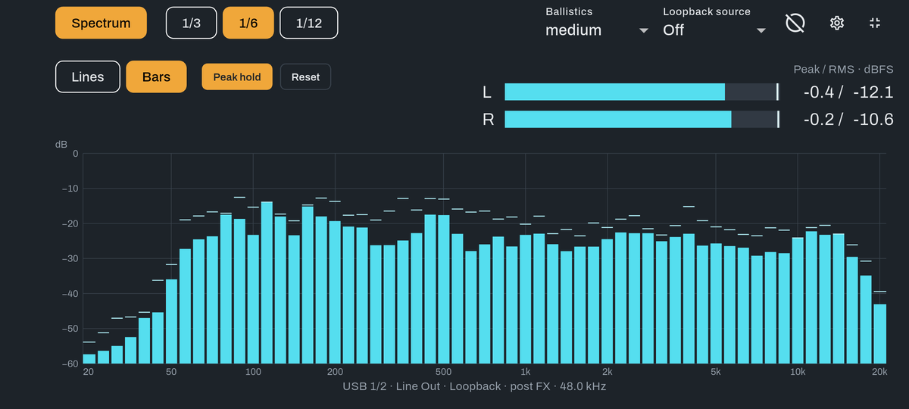 | 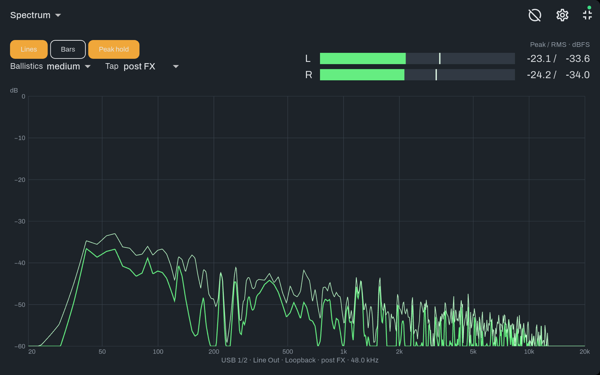 |

| Tablet: Bars, landscape fullscreen |
| --- |
| 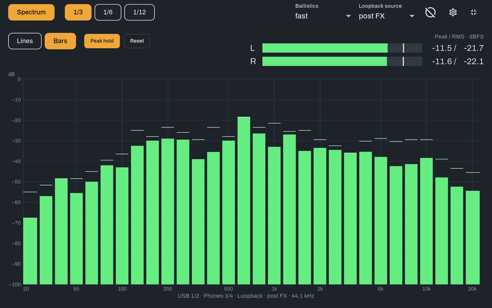 |

### Interpreting a spectrum

Low frequencies are on the left, high frequencies on the right; a taller indication means more level in that region. **Lines** shows a more continuous spectrum, while **Bars** groups energy into frequency bands. Finer **Band resolution** divides a range into more, narrower bands; readings using different bandwidths are therefore not directly equivalent.

**Peak** describes peak values; **RMS** describes an averaged effective level. Two music signals can have equal peaks but different RMS levels. **Peak hold** briefly retains spectrum peaks: markers start falling again after about one second. **Ballistics** affects how quickly the spectrum falls; **slow** makes observation easier, while **fast** follows changes more quickly. **Level range** changes only the visible dB span, not recording gain.

Tap the compact analyzer or **Fullscreen** to enlarge it. The information line can be expanded when shortened. **Spectrum only** hides the controls; tapping the display or **Show controls** restores them. These display actions do not change device EQ.

**Note:** A calibration offset shifts the level display but improves neither frequency resolution nor a frequency response altered by Android effects. A difference from device metering is not automatically a fault: first match tap, presentation, band resolution and calibration.

### Level calibration: why and how

USB capture can have a device-dependent level offset. Android sound effects can also alter the level and frequency response of audio played by the smartphone over USB. The app cannot turn these effects off; some devices keep processing USB audio even when an effect looks disabled. A single calibration offset corrects level, not frequency-dependent coloration.

For a device combination without a saved response, the app offers **Calibrate analyzer?** automatically. The response is saved. Calibration remains manually accessible through Analyzer settings later.

1. **Mute** all listening outputs before feeding a full-scale test signal. Use an external source through Optical, SPDIF, AES or Analog where available to avoid smartphone playback processing.
2. Start active ADI-2 USB capture. Route the measured output to USB 1/2 with **Loopback to USB** set to **post FX**; check this on the Device page. Set the **DA Filter** to **SD Sharp**, the filter setting required for this calibration, and turn off EQ and all effects for the measurement path.
3. Feed a steady full-scale sine (0 dBFS) equally to L and R. If it comes from Android over USB, set Android media volume to maximum. External sources are not affected by that media-volume setting. For USB playback, explicitly use **USB Playback 1/2**. On Pro models, select **USB 1/2** at the measured output. A USB source indication alone is insufficient in multi-channel mode.
4. Open **Analyzer settings → Level calibration → Calibrate to 0 dB → Start measurement**. The app measures uncalibrated peaks for about two seconds.
5. Review and save the proposed offset. It belongs to the displayed device combination. Manual ±1.0 and ±0.1 dB buttons adjust it; **Reset** returns the offset to 0 dB after confirmation.

Both channels must exceed −60 dBFS, differ by no more than 1 dB and remain stable within ±0.5 dB per channel. Offsets outside −40 to +40 dB or insufficient/interrupted capture are rejected without saving. Recheck calibration after changing the source path or Android audio processing. End the test tone before restoring listening volume.

For the **built-in test tone (Android and macOS)**, enable **Use built-in test tone** in the **Calibrate to 0 dB** dialog. The app plays 1 kHz at 0 dBFS through USB playback 1/2 during measurement, for at most 3.6 seconds. Automatic checks cover connection, muting of all outputs, a USB source at the measured output, post FX loopback on USB 1/2 without a conflicting route, SD Sharp, and disabled EQ, Loudness and Crossfeed. Bass/Treble blocks playback only when processing is enabled and Bass or Treble gain is nonzero. On Android, media volume must be available and at maximum. Fresh mute and volume values for every output are requested before starting and during playback. **Mute all outputs** mutes them for you. The manual preparations in the checklist remain required. On ADI-2/4 Pro EX, calibration with the built-in test tone is not yet confirmed.

On macOS, the capturing ADI-2 is explicitly selected as the only output, and the route is verified before audible playback and throughout output. Disconnection or an invalid route stops the tone; it does not switch to the Mac speakers. The fixed buffer includes 250 ms of initial silence and 20 ms fades and ends by itself even if the app stops responding. Only the Android media-volume condition is omitted on macOS; all other checklist points and fresh confirmation of device values remain required. Calibration is stored separately by Mac, USB model and available serial number. The Mac test tone is available only at device sample rates of **44.1–192 kHz**. Outputs stay muted after the tone. Any output above −30 dB is lowered. Verification requires two consecutive queries with fresh mute and volume values for every output and confirmed volumes at or below −30 dB. Without sufficient device confirmation, the test tone remains blocked or is interrupted. Outputs stay muted. Check volume on the device.

**Note:** Without the app's test tone, supply an externally generated, known full-scale sine. If the app detects low Android media volume during USB playback, it offers **Calibrate anyway** for explicit acknowledgement. That would include the attenuation in the offset; for the reference procedure described here, first set media volume to maximum. The built-in test tone does not allow bypassing this condition. If **Start measurement** is unavailable, check the displayed conditions and current recording route. A previous offset is not applied as a universal correction after changing the device combination.

### Calibration checklist

Manual preparation for both measurement methods

- [ ] All outputs are muted.
- [ ] The measured output’s **Source** matches the signal path. For USB tones, use **USB Playback 1/2** and, on Pro models, output source **USB 1/2**. For an external source, select its actual input.
- [ ] **Loopback to USB** is set to **post FX** on USB 1/2 for the measured output. Check this on the Device page.
- [ ] **DA Filter** is set to **SD Sharp**.
- [ ] EQ, Loudness and Crossfeed are off at the measured output. Disable Bass/Treble or set both gains to zero.
- [ ] For a tone over USB, Android media volume is at maximum (this point does not apply on macOS).
- [ ] Manually reset an earlier offset that was not measured. The app does not check this as a start condition.

For an externally generated signal

- [ ] Start the known full-scale sine on L and R and manually check for a stable analyzer level.

For the built-in tone

- [ ] Stop any other test signal. Prepare USB playback 1/2 and enable the test-tone option.
- [ ] Meet the automatically displayed start conditions. Level stability is evaluated during measurement.
- [ ] On Mac, the device sample rate is between 44.1 and 192 kHz.

After measurement

- [ ] The proposed offset is plausible, then saved.
- [ ] The test tone is stopped.
- [ ] Volume is lowered before unmuting the outputs.

### Calibration rules

1. Never play a full-scale tone while an output is unmuted.
2. −120 dBFS means no signal. Fix the signal path instead of calibrating.
3. Save only offsets from a real measurement with this exact device combination.
4. Check the real device state on the Device page, not the remembered app choice.
5. Calibrate again after changing the source path, ADI-2, smartphone, tablet or Mac, or Android audio effects.

## Tablet layouts

Use the larger screen for controls and displays side by side.

In portrait, the app retains bottom navigation and provides larger controls and page content. The portrait analyzer remains embedded above Outputs. Its fullscreen button opens a portrait fullscreen view.

In landscape, navigation moves to the left. Outputs occupies the left content column; **Additional panel** on the right switches between **EQ**, **Analyzer**, **Status** and **Player**. EQ follows the selected output. Analyzer routing follows its automatic or fixed source choice. Custom Mode can be used in the left column. Input, Device, Setups and Status use wider page layouts; scroll within the relevant content to reach remaining controls.

| Outputs and EQ | Outputs and Status |
| --- | --- |
| 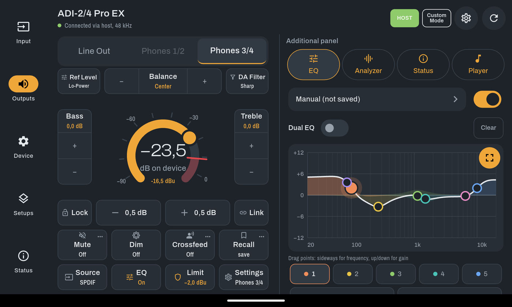 | 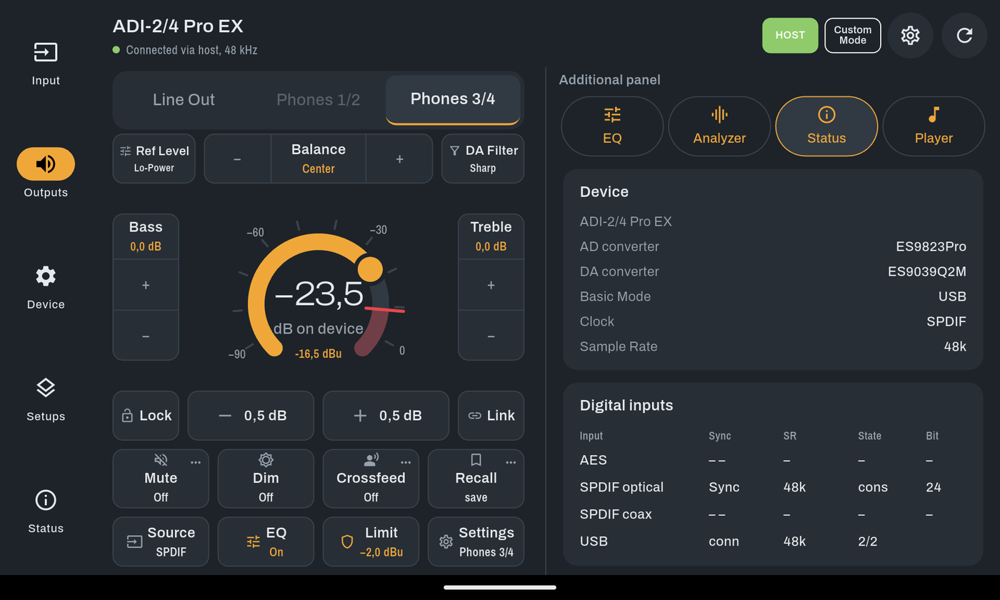 |

| Outputs and analyzer lines | Outputs and analyzer bars |
| --- | --- |
| 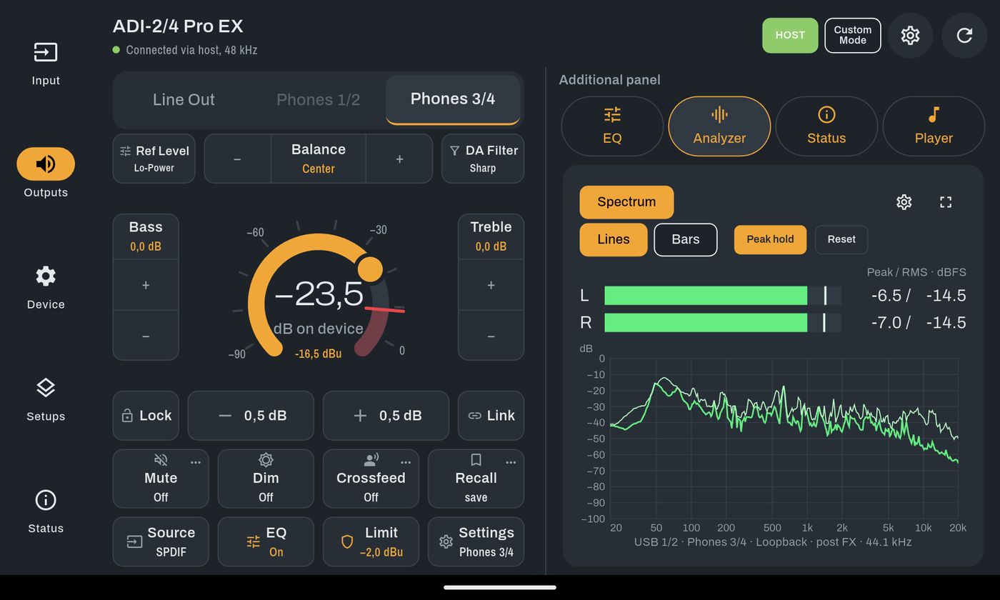 | 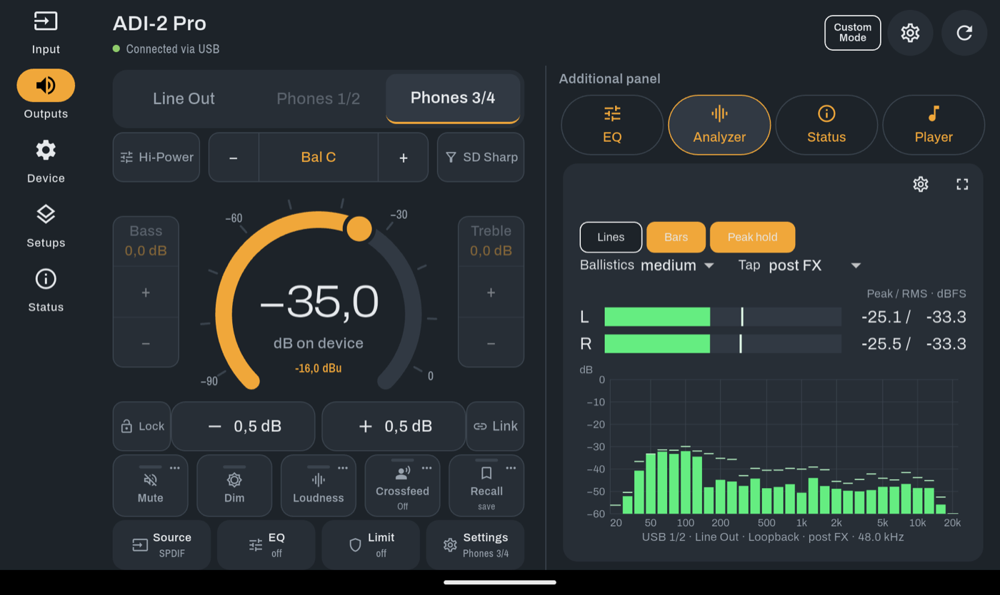 |

| Custom Mode and Additional panel | Input, landscape |
| --- | --- |
| 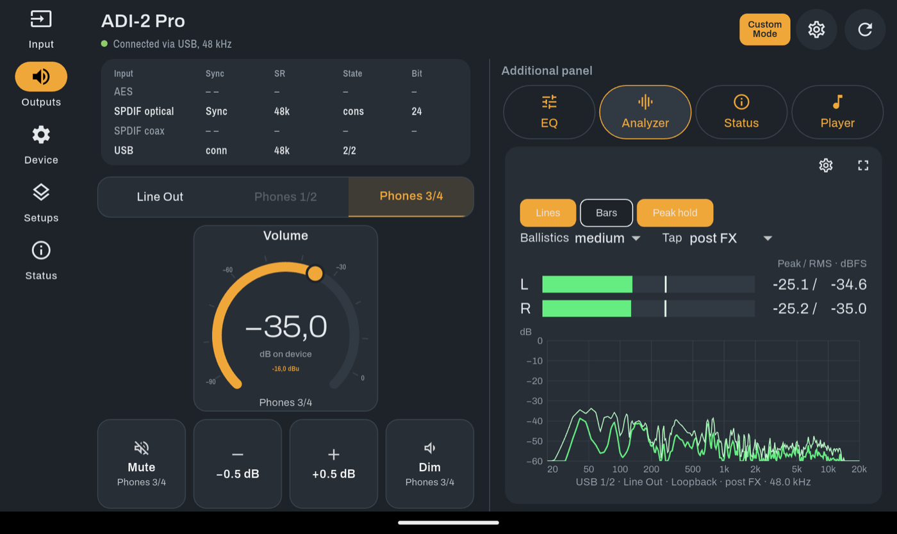 | 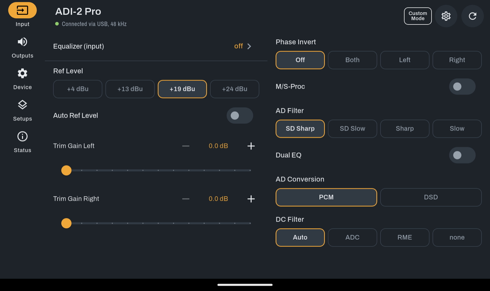 |

| Device, landscape | Setups, landscape |
| --- | --- |
| 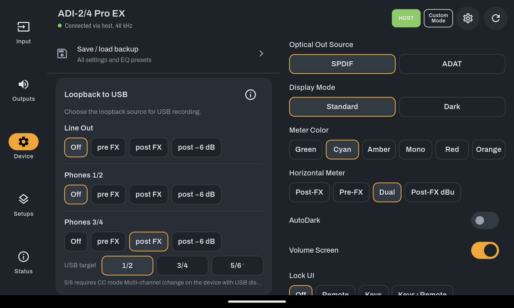 | 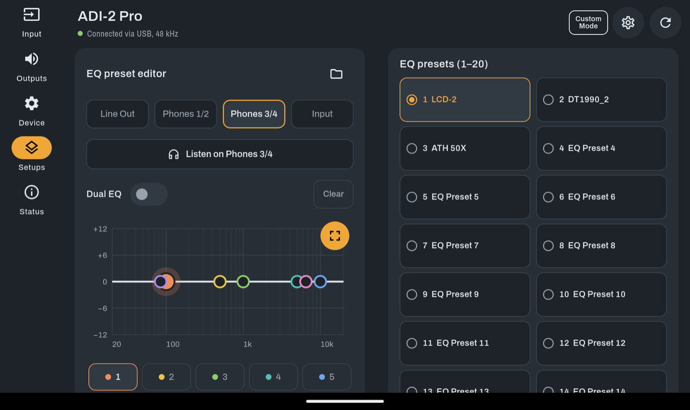 |

| Status, landscape |
| --- |
| 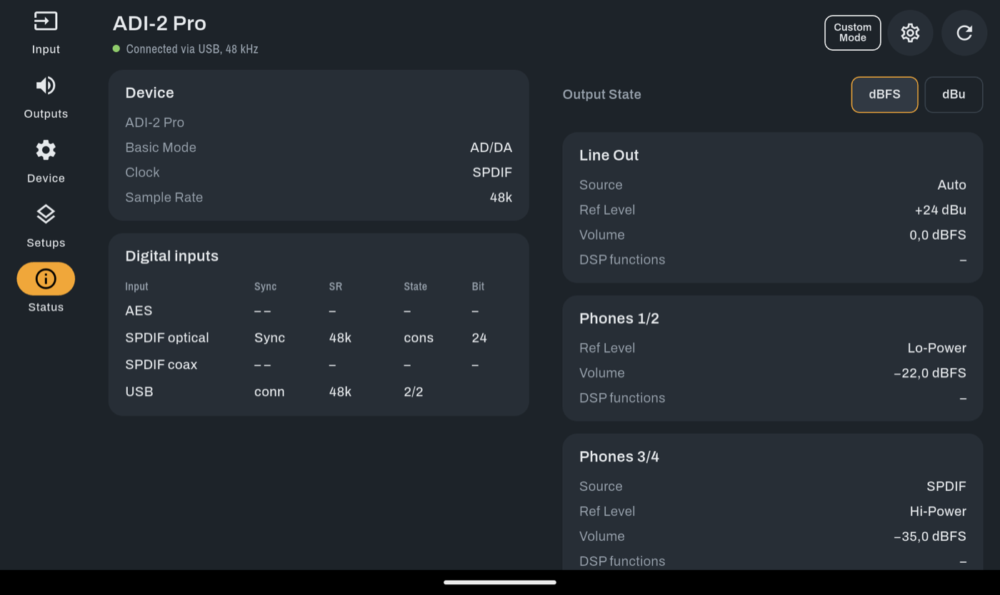 |

## App settings

**Check for updates automatically** is enabled by default. At startup and then at most once a day, the app only asks GitHub for the latest version without sending user data. The switch disables automatic checks; **Check for updates now** still works. When an update is available, **Download** opens the download in the external browser. **Later** suppresses the automatic dialog for that version; **Download** remains available in settings. Downloads and installations are never automatic.

Use these settings to customize the app language, additional displays and interaction.

Open the gear icon (**App**) in the header. **App settings** provides:

- **Configure Custom Mode**, its editor and four slot previews.
- **Language**: English or Deutsch.
- **Display below the header**: Player, Status, Analyzer or none.
- **Band resolution**, **Analyzer color** and **Level range**.
- **Switch to active output automatically**: currently for ADI-2 DAC, for example when plugging in headphones.
- **Automatically show EQ graph fullscreen in landscape**: on smartphones for the EQ graph and analyzer; on smartphones and tablets for Basic Mode signal diagrams.
- **About the app**, version and **Trademarks and legal**, which also contains **Open-source licenses**.

These are app preferences. The Device page controls the connected ADI-2 itself.

The ADI-2 Pro EX is recognized by its serial number and shown accordingly in the app. The **Status** page also lists the installed AD and DA converters under **Device** once they are known.

| Smartphone: App settings |
| --- |
| 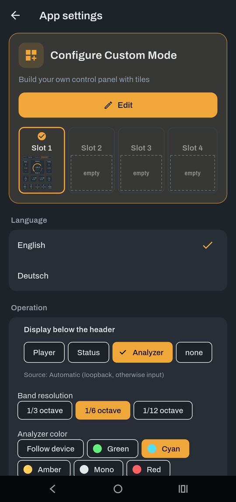 |

## Glossary

This glossary explains the terms used when adjusting settings and reading displays.

| Term | Meaning in this guide |
| --- | --- |
| ADC / DAC, AD / DA | Analog-to-digital or digital-to-analog converter; AD/DA identifies conversion direction. DAC can also mean the Pro operating mode or the device model. |
| Basic Mode | Pro models' fundamental operating mode, determining the main signal paths. |
| Clock / Sample Rate | Timing and number of audio samples per second, for example 48 kHz. Digital devices need compatible clock timing. |
| CC-Mode | USB Class Compliant operation with stereo or multi-channel mapping. Change on the device with USB disconnected. |
| DSP / FX | Digital signal processing or effects, such as EQ and Crossfeed. |
| dB | A ratio of levels. A volume setting does not directly specify sound pressure at the ear. |
| dBFS | Digital level relative to full scale. Analyzer 0 dBFS peak is digital full scale; the output status display instead represents the volume setting. |
| dBu | Analog voltage level referenced to approximately 0.775 V RMS at 0 dBu. The app calculates output values from reference level and volume. |
| Ref Level | Analog reference/operating range. A higher output reference can deliver more voltage for the same digital level. |
| Gain / Frequency / Q | Amount, position and shape of an EQ filter; higher Q makes a Peak filter narrower. |
| pre FX / post FX | Before or after the relevant effect processing. Output loopback post FX is before Volume; after processing does not mean after volume. |
| Loopback | Internal return of an output signal to USB recording channels. |
| USB Playback / USB Rec | Audio played from host to device or recorded from device to host. |
| Peak / RMS | Peak or effective value of captured audio. |
| Crossfeed | Mixing some of the opposite stereo channel into each channel for headphone playback. |
| Dual EQ | Separate left/right EQ band parameters; Bass/Treble remain shared tone controls. |
| Loudness / Low Vol Ref | Volume-dependent bass/treble boost and the reference volume for its full effect. |
| PCM / DSD | Different digital audio formats. Available conversion and Direct options depend on the device. |
| SRC | Sample-rate converter adapting a digital input source to the device clock. |
| M/S | Mid/side as an alternative to left/right stereo representation. |
| RIAA | Equalization for appropriately pre-emphasized phono signals; leave it off for ordinary Line sources. |
| Preset / Setup / Layout | A single EQ curve, device configuration or arrangement of app tiles. These use different storage methods. |
| Ramp / Recall / Limit | Slow volume increase, saved recall volume and the app's upper level limit. |
| Calibration offset | A measured correction to analyzer level readings for a particular device combination. |

## Troubleshooting

Use these checks to resolve connection, control and measurement problems.

| Symptom | What to check |
| --- | --- |
| No device found | Data cable, direct connection, OTG/host support, USB permission; reconnect, then Search again |
| USB device found but no MIDI response | Enable MIDI Control at the model-specific menu listed above; reconnect if necessary |
| Controls missing or disabled | Selected model/output, Dual Phones, shared source in the current Basic Mode, and Lock Volume |
| Volume stops rising | Release stops a ramp; check the continuation prompt, Lock, Limit and linked output limits |
| Line Out unexpectedly muted | Headphone insertion and Mute Line / toggle settings; hold Mute |
| Analyzer asks for permission | Grant recording permission for ADI-2 USB audio |
| Mac test tone unavailable | Set the device sample rate to 44.1–192 kHz and check the displayed start conditions |
| Device confirmation for test tone missing | Keep outputs muted, check volume on the device, then check connection and fresh mute/volume reports from every output |
| No analyzer signal | USB 1/2 routing, active source, loopback tap, and actual source audio; pair 3/4 or 5/6 does not feed the analyzer |
| USB recording interrupted or unavailable | Reconnect USB, close other recording users if needed, return to the analyzer and use Try again; check the reported recording route |
| Analyzer differs from the device | Compare post FX, Bars, 1/3 octave; check calibration, media volume, Android effects and the position of device meters after Volume |
| Calibration rejected | Stable equal-level signal on both channels, sufficient level and uninterrupted USB capture; read the displayed reason |
| Player absent | Android only; notification access, active media session and Player header choice |
| Diagram shows a different mode | The diagram is explanatory; check actual Basic Mode under Device and reported operating mode under Status |
| USB target 5/6 has no signal | Set CC-Mode Multi-channel on the device with USB disconnected; app detection is available only on Android |
| Preset editor does not change the sound | Check Listen, target channel and its EQ and Bass/Treble switches; storing alone does not activate a live preset |
| Previous EQ does not return after listening | Turning listening off only stops further writes; reload the earlier EQ yourself |
| Custom tile controls the wrong output | Check Selected output or fixed target in the tile dialog and the current output page |
| Backup restore refused | Connected model must match; use this app's backup format and a compatible app version |

For support, describe the ADI-2 model, app version, mobile device, OS version, connection and reproducible steps. Remove personal information from screenshots and diagnostics before posting publicly.

## License and legal

This section identifies the software license and owners of the named trademarks.

Free software under **GPL-3.0**. © 2026 Markus Rass. [Project license information](../README.md#license-and-trademarks).

RME is a registered trademark of RME Intelligent Audio Solutions. ADI-2 Pro is a trademark of RME Intelligent Audio Solutions; ADI-2 and ADI-2 Remote are RME product names. Alesis and ADAT are registered trademarks of Alesis Corp.; ADAT optical is a trademark of Alesis Corp. Apple, iPhone, Mac and macOS are trademarks of Apple Inc. Android is a trademark of Google LLC. Direct Stream Digital and DSD are trademarks of their respective owners (Sony / Philips). All other trademarks and product names belong to their respective owners and are used only to identify compatible devices and functions.

[Privacy policy](../PRIVACY.md)
